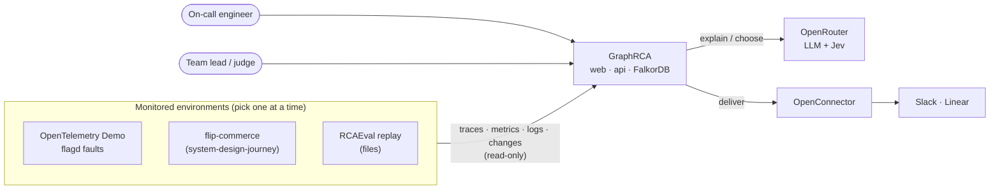
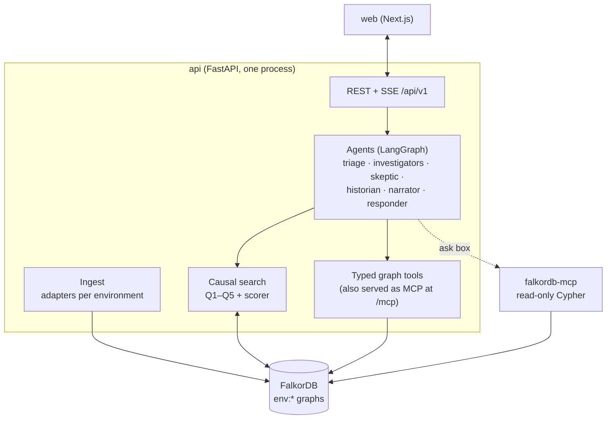

# GraphRCA: Architecture

> **Hackathon:** Graph Hacks: Context for AI Agents (powered by FalkorDB)
> **Status:** design, pre-kickoff (no product code yet) · **Last reviewed:** 2026-10-15

**Problem.** Something in production breaks. On-call engineers jump between dashboards, traces and logs to work out
**what** broke, **where**, **why** and **what to do next**. AI SRE tools speed this up, but most ask an LLM to guess the
cause and can't show how they got there.

**Pitch.** *Traversal's causal search, open and explainable, on FalkorDB.* GraphRCA keeps a live graph of your production
system, searches it for causes the way an SRE would, remembers every incident, and every answer is a path in the graph
you can click, rerun and argue with.

---

## Document map

| Doc | Read it for |
|---|---|
| **ARCHITECTURE.md** (this file) | The one-page picture: requirements, principles, context, key decisions |
| [HLD.md](HLD.md) | Components, deployment, data flows, failure modes, scale, security |
| [LLD.md](LLD.md) | Modules, function signatures, Cypher, scoring, agent state, state machines, tests |
| [USER_FLOW.md](USER_FLOW.md) | What each user does, screen by screen |
| [README.md](README.md) | Getting started with Docker |
| [docs/API.md](docs/API.md) | REST + SSE reference |
| [docs/GRAPH_SCHEMA.md](docs/GRAPH_SCHEMA.md) | Every label, edge, property and index |
| [docs/EXAMPLE_RUNS.md](docs/EXAMPLE_RUNS.md) | The three environments we demo on |
| [docs/adr/](docs/adr/) | Decision records 0001–0010 |
| [docs/COMPETITORS.md](docs/COMPETITORS.md) | Competitor landscape, pricing, gaps, positioning |
| [docs/planning/](docs/planning/) | Earlier planning notes: [GRAPH_HACKS_PLAN](docs/planning/GRAPH_HACKS_PLAN.md), [FALKORDB_PLAN](docs/planning/FALKORDB_PLAN.md), [FALKORDB_BRAINSTORM](docs/planning/FALKORDB_BRAINSTORM.md). Where they differ from the docs above (e.g. ports), the docs above win |

---

## 1. Requirements

### 1.1 Functional

| ID | Requirement | Track |
|---|---|---|
| F1 | Build and keep current a graph of services, operations, calls, changes and owners from telemetry | 01 |
| F2 | On an alert, open an incident and find the root cause by searching the graph upstream from the symptom | 01 |
| F3 | Show why the winner won and why each alternative lost ("why not X?") as graph paths | 01 |
| F4 | Answer "what breaks if X goes down?" (blast radius) | 01 |
| F5 | Several agents work the same incident in parallel and hand off through the graph | 02 |
| F6 | Remember past incidents and their fixes; recall similar ones on a new incident | 02 |
| F7 | Keep each environment / tenant in its own graph | 02 |
| F8 | Answer "who should I page / who fixed this before?" with sources | 03 |
| F9 | Natural-language questions answered with the graph path behind the answer | 01 |
| F10 | Post the diagnosis to Slack / Linear | 01 |

### 1.2 Non-functional

| ID | Requirement | Target |
|---|---|---|
| N1 | Diagnosis latency, alert → verdict | < 60 s on the demo environments |
| N2 | Causal-search query latency | < 200 ms p95 per query (Q1–Q5) |
| N3 | Determinism | Same input → same ranking and score parts, byte for byte |
| N4 | Production safety | Read-only towards telemetry sources; actions are proposals only |
| N5 | Footprint | Runs on one 16 GB laptop (OTel Demo included) |
| N6 | Explainability | 100% of verdict claims cite evidence; unsupported claims are dropped |
| N7 | Degradation | Verdict still produced when every LLM is unavailable |

### 1.3 Scale estimate (sizing FalkorDB)

| Environment | Services | Operations | CALLS edges | Per incident |
|---|---|---|---|---|
| OTel Demo (Astronomy Shop) | ~20 | ~150 | ~500 | 100–300 anomalies, ≤ 50 hypotheses |
| flip-commerce (your system-design-journey) | 3–6 + Mongo + Redis | ~30 | ~60 | ≤ 50 anomalies, ≤ 10 hypotheses |
| RCAEval TT replay | ~60 | ~400 | ~1,500 | 100–500 anomalies |

Even with a few hundred stored incidents this is **< 100k nodes and < 1 GB RAM**. One FalkorDB instance, no sharding, no
replicas. The real limits are variable-length path queries (bounded by a hop limit of 6 and by aggregating spans into
operations) and the OTel Demo's own RAM needs.

---

## 2. Design principles

| # | Principle | How it's enforced | ADR |
|---|---|---|---|
| P1 | **The graph is the reasoning** | Candidate generation, pruning, blast radius, memory and handoffs are graph queries. Remove FalkorDB and nothing works | [0001](docs/adr/0001-falkordb-primary-store.md) |
| P2 | **Deterministic ingestion and scoring** | Topology, anomalies and scores come from plain Python + Cypher. The LLM never ranks | [0002](docs/adr/0002-deterministic-ingestion-and-scoring.md) |
| P3 | **Agents use typed tools** | LLM agents call fixed, parameterized graph tools; free Cypher only through the read-only official MCP server | [0003](docs/adr/0003-typed-mcp-tools.md) |
| P4 | **The graph is the shared agent state** | Agents pass an `incident_id`, not blobs; they read and write the incident subgraph | [0007](docs/adr/0007-graph-as-shared-agent-state.md) |
| P5 | **Every answer is a path** | API responses carry node/edge ids; the UI highlights them; uncited claims are dropped | [0002](docs/adr/0002-deterministic-ingestion-and-scoring.md) |
| P6 | **One graph per environment** | `env:<name>` per environment, `scratch:<incident>` for algorithm projections | [0001](docs/adr/0001-falkordb-primary-store.md) |
| P7 | **Simple to run** | Modular monolith: one API process, FalkorDB in Docker with pinned tags | [0005](docs/adr/0005-modular-monolith.md), [0009](docs/adr/0009-falkordb-via-docker.md) |

---

## 3. System context

Containers, data flows and deployment are in [HLD.md](HLD.md).

---

## 4. Architecture at a glance

**How a diagnosis works, in five steps** (detail in [LLD.md §5–§7](LLD.md)):
1. **Triage** opens an `Incident`, measures the blast radius, and runs **Q1** to turn every anomalous upstream operation into a `Hypothesis`.
2. **Investigators** (one per hypothesis, in parallel) run **Q2** (did each hop go bad in time order?) and **Q3** (is it slow itself, did something change right before?) and write `Evidence` with `SUPPORTED_BY` / `REFUTED_BY` edges.
3. The **scorer** adds PageRank over the anomalous part of the call graph, copied to a scratch graph (**Q4**) and computes a deterministic score; the **skeptic** tries to refute the winner.
4. The **historian** recalls similar past incidents (**Q5**); the **narrator** explains the winning path, citing evidence; **Jev** drops unsupported claims.
5. The **responder** picks actions from the runbook (preferring fixes that worked before) and posts to Slack / Linear.

---

## 5. Key decisions

| ADR | Decision |
|---|---|
| [0001](docs/adr/0001-falkordb-primary-store.md) | FalkorDB is the primary store; one graph per environment |
| [0002](docs/adr/0002-deterministic-ingestion-and-scoring.md) | Ingestion and scoring are deterministic; the LLM explains and picks tools |
| [0003](docs/adr/0003-typed-mcp-tools.md) | Typed MCP tools for agents; official FalkorDB MCP only read-only |
| [0004](docs/adr/0004-no-graphiti.md) | No Graphiti: an LLM must not decide what enters the graph |
| [0005](docs/adr/0005-modular-monolith.md) | Modular monolith: ingest, agents, tools and API in one process |
| [0006](docs/adr/0006-operation-level-aggregation.md) | Aggregate spans to operations; never store span nodes |
| [0007](docs/adr/0007-graph-as-shared-agent-state.md) | Agents coordinate through the incident subgraph |
| [0008](docs/adr/0008-deterministic-incident-signature.md) | Incident memory uses a deterministic 64-dim signature vector |
| [0009](docs/adr/0009-falkordb-via-docker.md) | FalkorDB via Docker, pinned tag, host port 6380 |
| [0010](docs/adr/0010-example-environments.md) | Demo on OTel Demo (primary), flip-commerce (secondary), RCAEval (offline eval) |

---

## 6. Quality attributes: how they're met

| Attribute | Mechanism | Detail |
|---|---|---|
| Explainability | Hypotheses, evidence and refutations are nodes; every answer returns a path | [LLD §6](LLD.md) |
| Determinism | Deterministic ingest + fixed weights + id tie-break; LLM output never feeds the score | [LLD §6.3](LLD.md) |
| Availability (demo) | LLM / Jev / OpenConnector failures degrade gracefully; FalkorDB is the only hard dependency | [HLD §7](HLD.md) |
| Performance | Hop limit 6, operation-level aggregation, indexes on lookup keys, scratch graphs for algorithms | [HLD §8](HLD.md) |
| Security | Password, parameterized Cypher, read-only MCP with API key, typed tools, no secrets in the graph | [HLD §9](HLD.md) |
| Tenancy | One graph per environment; nothing queries across `env:*` graphs | [GRAPH_SCHEMA](docs/GRAPH_SCHEMA.md) |

---

## 7. Risks and open questions

| Risk | Mitigation |
|---|---|
| FalkorDB Cypher differences (variable-length filters, `algo.pageRank` signature, vector index syntax) | Smoke-test script on the pinned tag before building ([README](README.md#5-smoke-test)) |
| OTel Demo needs about 6 GB RAM | flip-commerce and RCAEval replay as lighter environments; recorded backup video |
| flip-commerce is shallow (about 2 hops) | Use it for the "real Mongo failover" story, OTel Demo for multi-hop |
| Port clashes (6379, 8080, 3000) | FalkorDB on host 6380, browser 3002, run one example environment at a time ([HLD §5](HLD.md)) |
| FalkorDB license is SSPLv1 | Fine for the hackathon; never call it "open source" in the pitch |
| Hackathon rules (FalkorDB must be primary, public/synthetic data, code after kickoff) | Confirm on the event page; all three environments use public or self-owned data |

## Sources
[FalkorDB Docker docs](https://docs.falkordb.com/operations/docker.html) ·
[FalkorDB MCP server](https://github.com/FalkorDB/FalkorDB-MCPServer) ·
[FalkorDB algorithms](https://docs.falkordb.com/algorithms/) ·
[Traversal causal search](https://www.traversal.com/blog/introducing-causal-search-engine-from-correlated-alerts-to-causally-consistent-diagnoses) ·
[Traversal production world model](https://www.traversal.com/glossary/production-world-model) ·
[Resolve AI knowledge graph](https://resolve.ai/blog/knowledge-graph-agentic-ai-incident-response) ·
[OpenTelemetry Demo](https://github.com/open-telemetry/opentelemetry-demo) ·
[RCAEval](https://github.com/phamquiluan/RCAEval) ·
[OpenConnector](https://github.com/oomol-lab/open-connector)
