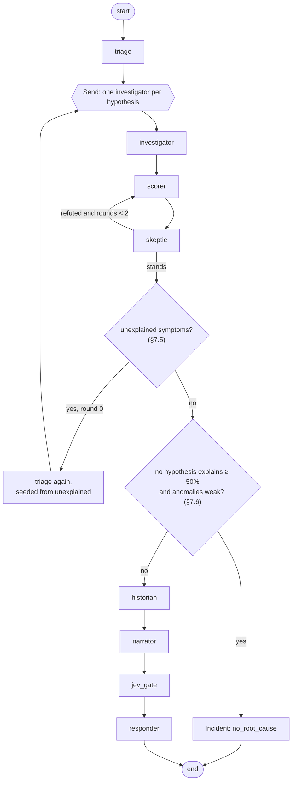
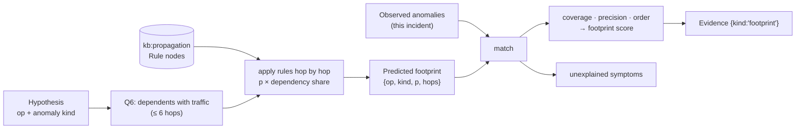
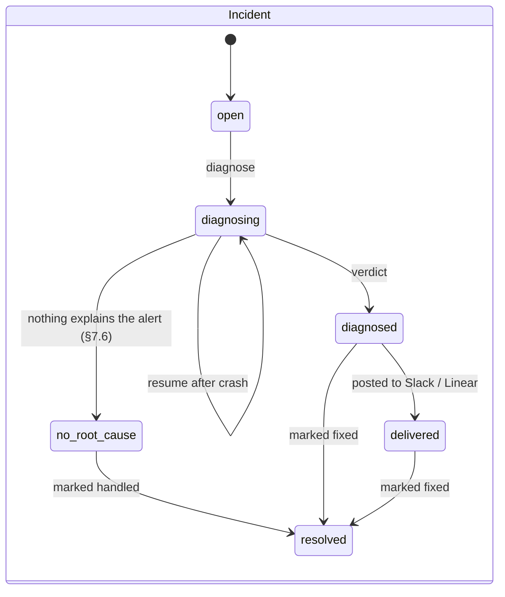
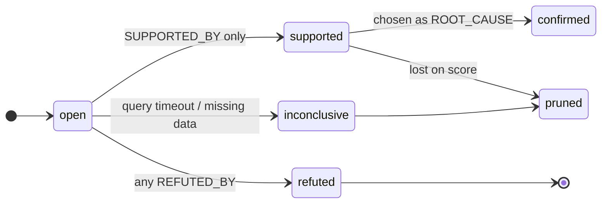

# GraphRCA: Low-Level Design

How each part is built. Containers and runtime views are in [HLD.md](HLD.md); the full label/edge reference is in
[docs/GRAPH_SCHEMA.md](docs/GRAPH_SCHEMA.md); endpoints are in [docs/API.md](docs/API.md).

---

## 1. Package layout

```
graph-hacks/
  docker-compose.yml  .env.example  weights.json
  api/
    main.py               # FastAPI app: REST router, SSE, MCP mount at /mcp, startup seed
    config.py             # Settings (pydantic-settings) from env
    graph.py              # FalkorDB client wrapper + query catalogue (Q1–Q5, upserts)
    models.py             # Pydantic models shared by REST, tools and agents
    events.py             # in-process event bus for SSE
    ingest/
      base.py             # Adapter protocol
      otel.py             # Jaeger / OTLP spans → operations + CALLS
      prometheus.py       # metrics → series
      logs.py             # Drain3 over log lines (OpenSearch, winston JSON, nginx access)
      changes.py          # flagd events, git log, docker events, manual changes
      rcaeval.py          # RCAEval file adapter
      detect.py           # robust z, PELT onset, self/child time → Anomaly
      seed.py             # indexes, owners.yaml, runbooks.yaml
    search/
      causal.py           # hypotheses from Q1, checks Q2/Q3, projection + Q4
      score.py            # deterministic scoring + confidence
      signature.py        # 64-dim incident signature
      simulate.py         # Fault Simulator: Q6 + rules → predicted footprint, match vs observed (§7)
    agents/
      flow.py             # LangGraph wiring
      triage.py  investigator.py  skeptic.py  historian.py  narrator.py  responder.py  ask.py
    tools/
      graph_tools.py      # typed tools (Python functions)
      mcp_server.py       # same tools exposed over MCP
    ai/
      openrouter.py       # chat completions client
      jev.py              # Jev Noul / Choice client
    deliver/
      openconnector.py
    eval.py               # RCAEval replay + metrics
  web/                    # Next.js app
  seed/  owners.yaml  runbooks.yaml  propagation_rules.yaml
  examples/
    flip-commerce/        # collector config + run scripts for the user's system-design-journey
    otel-demo/            # notes + fault script
  tests/
```

Dependency rule: `agents → tools → search → graph`, `ingest → graph`. Nothing imports `agents` except `main.py`.
`graph.py` is the only module that talks to FalkorDB.

---

## 2. `graph.py`

```python
class Graph:
    def __init__(self, url: str): ...
    def env(self, name: str) -> "EnvGraph"              # select_graph(f"env:{name}")
    def scratch(self, incident_id: str) -> "EnvGraph"   # select_graph(f"scratch:{incident_id}")

class EnvGraph:
    def ro(self, qid: str, **params) -> list[dict]      # GRAPH.RO_QUERY, timed, logged
    def rw(self, qid: str, **params) -> list[dict]      # GRAPH.QUERY
    def delete(self) -> None
```

Every query lives in one dict, `QUERIES: dict[str, str]`, keyed by id. Callers pass the id plus parameters, never Cypher
text. Each call logs `{qid, duration_ms, rows}` and feeds the p50/p95 shown on `/health`. Per-query client timeout: 5 s.

### 2.1 Upserts (ingest)

```cypher
-- U1 upsert_call: one aggregated caller→callee pair per 30 s tick
MERGE (cs:Service {name: $caller_svc})
MERGE (co:Operation {id: $caller_op}) ON CREATE SET co.name = $caller_name
MERGE (cs)-[:HAS_OP]->(co)
MERGE (ts:Service {name: $callee_svc}) ON CREATE SET ts.kind = $callee_kind
MERGE (to:Operation {id: $callee_op}) ON CREATE SET to.name = $callee_name
MERGE (ts)-[:HAS_OP]->(to)
MERGE (co)-[c:CALLS]->(to)
SET c.rps = $rps, c.p95_ms = $p95_ms, c.err_rate = $err_rate, c.last_seen = $ts,
    co.last_seen = $ts, to.last_seen = $ts

-- U2 write_anomaly
MATCH (o:Operation {id: $op})
CREATE (a:Anomaly {id: $id, incident: $incident, kind: $kind, onset: $onset, score: $score,
                   self_ratio: $self_ratio, child_ratio: $child_ratio, ref: $ref,
                   detector: $detector})-[:ON]->(o)

-- U3 write_change
MATCH (s:Service {name: $service})
MERGE (c:Change {id: $id}) ON CREATE SET c.type = $type, c.ts = $ts, c.summary = $summary, c.ref = $ref
MERGE (c)-[:CHANGED {ts: $ts}]->(s)
```

Operation ids are `<service>/<operation>`, e.g. `checkout/PlaceOrder`, `flip-node/GET /products`, `mongodb/find products`.
Datastores become `Service {kind: 'datastore'}` from the span's `db.system` attribute.

### 2.2 Causal-search queries

**Q1 `upstream_candidates`**
```cypher
MATCH p = (sym:Operation {id: $symptom})-[:CALLS*1..6]->(cand:Operation)
MATCH (a:Anomaly {incident: $inc})-[:ON]->(cand)
WITH cand, min(length(p)) AS hops, min(a.onset) AS onset, max(a.score) AS strength,
     collect(DISTINCT a.kind) AS kinds
RETURN cand.id AS op, hops, onset, strength, kinds
ORDER BY onset, op
```
The symptom operation itself is added in Python as a hypothesis with `hops = 0` (it can be its own cause).

**Q2 `propagation_path`**
```cypher
MATCH p = (sym:Operation {id: $symptom})-[:CALLS*1..6]->(cand:Operation {id: $cand})
WITH p, nodes(p) AS ops
UNWIND range(0, size(ops) - 1) AS i
WITH p, i, ops[i] AS n
OPTIONAL MATCH (a:Anomaly {incident: $inc})-[:ON]->(n)
WITH p, i, n, min(a.onset) AS onset
ORDER BY i
WITH p, collect(n.id) AS path, collect(onset) AS onsets
RETURN path, onsets
```
Python check, per returned path: no `null` in `onsets`, and `onsets[i+1] <= onsets[i] + skew` (default skew 15 s), i.e.
the problem started at the candidate end and moved towards the symptom. Best path = passes, then fewest hops, then
lexicographic. Pass → `Evidence {kind:'propagation'}` `SUPPORTED_BY`; no passing path → `REFUTED_BY`.

**Q3 `mechanism`**
```cypher
MATCH (a:Anomaly {incident: $inc})-[:ON]->(cand:Operation {id: $cand})<-[:HAS_OP]-(s:Service)
OPTIONAL MATCH (ch:Change)-[:CHANGED]->(s)
  WHERE ch.ts <= a.onset AND ch.ts >= a.onset - $lookback_s
RETURN a.id AS anomaly, a.kind AS kind, a.self_ratio AS self_ratio, a.child_ratio AS child_ratio,
       collect(ch {.id, .type, .ts, .summary}) AS changes
```
Rules: `child_ratio >= 2 * self_ratio` and `child_ratio > 1.5` → **victim** (refuted: its callee explains it).
Any change in the lookback (default 600 s) → `Evidence {kind:'change'}` `SUPPORTED_BY`.

**Q4 `pagerank`** (two steps)
```cypher
-- Q4a, on env graph: anomalous ops in this incident and the CALLS edges among them
MATCH (a:Anomaly {incident: $inc})-[:ON]->(o:Operation)
WITH collect(DISTINCT o) AS ops
UNWIND ops AS x
MATCH (x)-[c:CALLS]->(y) WHERE y IN ops
RETURN x.id AS caller, y.id AS callee, c.err_rate AS err, c.p95_ms AS p95

-- Q4b, on scratch:<inc>: after Python writes (:Operation {id}) nodes and (caller)-[:BLAME {w}]->(callee) edges
CALL algo.pageRank('Operation', 'BLAME') YIELD node, score
RETURN node.id AS op, score
```
`BLAME` points the same way as `CALLS` (caller → callee): an anomalous caller "blames" the anomalous operations it
depends on, so rank flows from symptoms down the dependency chain and collects at the deepest anomalous callee.
`w = max(err, p95 ratio)` of the call, if the pinned version supports weighted PageRank. The scratch graph is deleted in a `finally`. If the pinned FalkorDB
lacks this signature, the fallback is `networkx.pagerank` on the same edge list, recorded in `score_parts.pagerank_impl`.

**Q5 `similar_incidents`**
```cypher
CALL db.idx.vector.queryNodes('Incident', 'signature', 5, vecf32($sig)) YIELD node AS past, score
WITH past, score WHERE past.id <> $inc AND past.status = 'resolved'
MATCH (past)-[:ROOT_CAUSE]->(:Hypothesis)-[:BLAMES]->(cause)
OPTIONAL MATCH (past)-[:RESOLVED_BY]->(act:Action)
RETURN past.id AS incident, score, labels(cause)[0] AS cause_type,
       coalesce(cause.id, cause.name) AS cause, collect(act.name) AS fixes
ORDER BY score DESC, incident
```

**Q6 `simulate`** (Fault Simulator, §7): every operation that depends on the candidate through calls that carried traffic.
```cypher
MATCH p = (caller:Operation)-[:CALLS*1..6]->(c:Operation {id: $cand})
WHERE all(r IN relationships(p) WHERE r.rps > 0)
RETURN caller.id AS op, length(p) AS hops,
       [n IN nodes(p) | n.id] AS path, [r IN relationships(p) | r.rps] AS rps
ORDER BY hops, op
```

### 2.3 Tool queries

| Tool | Query |
|---|---|
| `blast_radius(service)` | `MATCH (s:Service {name:$svc})-[:HAS_OP]->(o) MATCH p=(caller:Operation)-[:CALLS*1..6]->(o) MATCH (cs:Service)-[:HAS_OP]->(caller) OPTIONAL MATCH (cs)-[:OWNED_BY]->(t:Team) RETURN DISTINCT cs.name, caller.id, min(length(p)) AS hops, t.name` |
| `why_not(incident, service)` | the service's `Hypothesis` with its `REFUTED_BY` evidence and stored paths; if none, run Q1 membership → "not upstream of the symptom" |
| `recent_changes(service, minutes)` | `Change -[:CHANGED]-> Service` within the window, with `AUTHORED` person |
| `who_knows(service)` | `OWNED_BY` team members + `FIXED` incidents whose root cause is on that service + `AUTHORED` changes on it, ranked by count |

---

## 3. Ingest

### 3.1 Adapter protocol

```python
class Adapter(Protocol):
    env: str
    def calls(self, since: datetime, until: datetime) -> Iterable[CallAgg]        # aggregated per (caller_op, callee_op)
    def series(self, start: datetime, end: datetime) -> Iterable[Series]          # (op_or_pod, metric, kind, points)
    def logs(self, start: datetime, end: datetime) -> Iterable[LogLine]           # (service, ts, level, text)
    def changes(self, since: datetime) -> Iterable[ChangeEvent]
```

| Adapter | calls | series | logs | changes |
|---|---|---|---|---|
| `otel` (OTel Demo) | Jaeger `/api/traces` | Prometheus `query_range` | OpenSearch | flagd flag changes |
| `otel` (flip-commerce) | OTel Collector file exporter (JSON lines) | span-derived latency/error series; k6 summary for load | winston JSON + nginx access log | `examples/flip-commerce/faults.py` journal |
| `rcaeval` | `traces.csv` | `metrics` parquet | `logs.csv` | `inject_time.txt` as a marker only (not a `Change`, so it can't leak the answer) |

### 3.2 Detectors (`detect.py`)

- **Baseline:** `[t_alert - 10 min, t_alert - 2 min]`. **Window:** `[t_alert - 2 min, t_alert + 5 min]`.
- **Robust z:** `z = (x - median_base) / (1.4826 · MAD_base + ε)`. Anomaly if `max |z| ≥ 4` in the window.
- **Onset:** first change point from `ruptures.Pelt(model="rbf").fit(x).predict(pen=…)` inside the window; fallback =
  first sample with `|z| ≥ 4`.
- **Self vs child time** (latency anomalies): from spans, `self = duration − Σ child durations`.
  `self_ratio = p95_self_window / p95_self_base`, `child_ratio = p95_child_window / p95_child_base`.
- **Logs:** Drain3 templates per service; anomaly if a template is **new** in the window or its rate ratio ≥ 5 with ≥ 10
  occurrences. Kind `new_template` or `log_burst`.
- **Kinds:** `latency`, `errors`, `cpu`, `mem`, `saturation`, `log_burst`, `new_template`, `down` (no spans and no metrics
  from an operation that had traffic in the baseline).

All detectors sort inputs by key before processing so the output order is stable (N3).

#### Slow-burn pass (problems that build over hours)

The short baseline only looks back 10 minutes. A memory leak that started 3 hours ago already looks "normal" by then and
would be missed. So for kinds in `SLOW_BURN_KINDS` (default `mem`, `saturation`, `cpu`; plus disk and queue-length
metrics when present), a second pass runs:

1. **Fetch:** the same series at a 1-minute step over `[t_alert − SLOW_BURN_LOOKBACK_S, t_alert]` (default 6 h) via
   Prometheus `query_range`. This is read from the source, not stored.
2. **Trend test:** Mann-Kendall for a monotonic increase (p < 0.01) plus the Theil-Sen slope.
3. **Anomaly if** the trend is significant **and** either the value at `t_alert` is ≥ 1.5× the value at the start of
   the lookback, or it crosses 80% of a known limit (e.g. `container_spec_memory_limit_bytes`).
4. **Onset** = first change point from PELT on the 1-minute series, i.e. when the climb started, not the alert time.
5. Written as `Anomaly {…, detector: 'slow_burn'}`; the existing pass writes `detector: 'short'`. If both fire on the
   same operation and kind, keep one node with the earlier onset and the higher score.

How it fits the rest:
- **Q2 (onset order):** slow-burn onsets are earlier, so the true cause naturally sits at the start of the chain.
- **Fault Simulator:** `mem` rules already predict self `latency`, then `down` (§7.1).
- **Cost:** one extra `query_range` per (operation, slow-burn kind), about 360 points each, only when an incident opens.

---

## 4. Data models (`models.py`, excerpt)

```python
class HypothesisOut(BaseModel):
    id: str; target: str; target_type: Literal["Operation", "Change"]
    status: Literal["open", "supported", "refuted", "inconclusive", "confirmed", "pruned"]
    score: float | None; score_parts: dict[str, float]; hops: int; onset: datetime | None

class EvidenceOut(BaseModel):
    id: str; kind: Literal["propagation", "mechanism", "change", "victim", "pagerank", "log", "history"]
    verdict: Literal["supports", "refutes"]; summary: str; path: list[str]; ref: str | None

class Verdict(BaseModel):
    incident_id: str; root_cause: HypothesisOut; confidence: float
    runner_up: HypothesisOut | None; path: list[str]; evidence: list[EvidenceOut]
```

---

## 5. Agents (`agents/flow.py`)

### 5.1 State

```python
class IncidentState(TypedDict):
    incident_id: str
    env: str
    symptom: str                         # operation id
    alert_ts: datetime
    hypothesis_ids: list[str]            # set by triage
    verdict_id: str | None               # set by scorer
    second_cause_id: str | None          # set if the Fault Simulator finds unexplained symptoms (§7.5)
    no_root_cause: bool                  # typed negative answer (§7.6)
    skeptic_rounds: int                  # max 2
    explanation_id: str | None
    action_ids: list[str]
    errors: Annotated[list[str], operator.add]
```

State holds **ids only**. Content lives in the graph (P4 / [ADR 0007](docs/adr/0007-graph-as-shared-agent-state.md)).

### 5.2 Graph of steps



LangGraph `Send` handles the fan-out; a checkpointer (SQLite, `./data/checkpoints.db`) lets
`POST /incidents/{id}/diagnose` resume after a crash.

### 5.3 Agent contracts

| Agent | LLM | Input | Output (graph writes) |
|---|---|---|---|
| triage | no | alert | `Incident {status:'diagnosing'}`, `TRIGGERED_BY`, `Hypothesis` per Q1 row + symptom |
| investigator | **optional**: may call extra tools (`recent_changes`, `who_knows`) for context; never sets status | hypothesis id | Q2, Q3 and the **Fault Simulator** (Q6 + match, §7) → `Evidence` (incl. `footprint`) + `SUPPORTED_BY`/`REFUTED_BY`; status from rules in §2.2 and §7 only |
| scorer | no | hypothesis ids | Q4, `score`, `score_parts`, `Incident -[:ROOT_CAUSE]->` top hypothesis |
| skeptic | yes: picks which alternative to test and which tool to use | top-2 + the winner's `unexplained` symptoms | `Evidence` (refutes) **only via deterministic tools**; the LLM chooses, the tools decide. Leads with "what doesn't the winner explain?" |
| historian | no | incident | signature, `SIMILAR_TO` edges |
| narrator | yes | verdict + evidence (as JSON data) | `Explanation {claims:[{text, cites[]}]}` |
| jev_gate | Jev Noul | each claim + its cited evidence | `support_p` per claim; drop < 0.7 or uncited |
| responder | Jev Choice | root cause kind + `Runbook` steps + past `RESOLVED_BY` counts | `Action {name, status:'proposed'}`; delivery |

Narrator prompt contract (system message, fixed): output JSON `{"what":[claim], "where":[claim], "why":[claim]}` with
`claim = {"text": str, "cites": ["E…"]}`; only ids that appear in the input may be cited; temperature 0; pinned model id.

---

## 6. Scoring (`search/score.py`)

### 6.1 Features (all in [0, 1], rank-normalized within the incident)

| Feature | From |
|---|---|
| `onset_earliness` | 1 − rank of onset among hypotheses |
| `strength` | max anomaly score of the candidate |
| `mechanism_fit` | 1 if self-caused (`self_ratio ≥ child_ratio`) or kind ∈ {cpu, mem, down, errors}; 0.5 if mixed; 0 if victim |
| `pagerank` | Q4 score |
| `change_match` | 1 if a `Change` in the lookback, else 0 |
| `footprint` | Fault Simulator match score (§7.4) |
| `refuted` | 1 if any `REFUTED_BY` evidence |

### 6.2 Formula

```
score = w·features − 1.0 · refuted
confidence = 1 / (1 + exp(−k · (score₁ − score₂)))
```

### 6.3 `weights.json`

```json
{ "version": "2026-10-15.v2",
  "w": { "onset_earliness": 0.25, "strength": 0.20, "mechanism_fit": 0.15, "pagerank": 0.10,
         "change_match": 0.10, "footprint": 0.20 },
  "k": 8.0, "skew_s": 15, "lookback_s": 600, "max_hops": 6,
  "simulator": { "rules_version": "2026-10-15", "min_p": 0.3, "refute_below_coverage": 0.2,
                 "no_root_cause": { "max_coverage": 0.5, "max_anomaly": 0.6 },
                 "second_cause": { "min_unexplained_ops": 2, "strong_anomaly": 0.8 } } }
```
v1 (before the Fault Simulator) had no `footprint` term. Both versions are kept so the ablation table can compare them.

Tie-break: higher score, then earlier onset, then operation id. The weights version is stored on the `Incident`.

---

## 7. Fault Simulator

"If this were the cause, what would we see?" For each hypothesis, predict the **symptom footprint** from the graph and
compare it with what was observed. Why: [ADR 0011](docs/adr/0011-fault-simulator.md); research:
[docs/TECH_RESEARCH.md](docs/TECH_RESEARCH.md).



### 7.1 Propagation rules (`kb:propagation`)

Environment-agnostic knowledge, kept in its own FalkorDB graph and seeded from `seed/propagation_rules.yaml`:

```yaml
version: 2026-10-15
rules:   # cause_kind on the candidate → symptom_kind on a dependent (upstream) or on itself (self)
  - { cause: [errors, down],               symptom: errors,  direction: upstream, p: 0.80, delay_s_max: 30 }
  - { cause: [errors, down],               symptom: latency, direction: upstream, p: 0.30, delay_s_max: 30 }
  - { cause: [latency, cpu, saturation],   symptom: latency, direction: upstream, p: 0.90, delay_s_max: 20 }
  - { cause: [latency, cpu, saturation],   symptom: errors,  direction: upstream, p: 0.25, delay_s_max: 60 }   # timeouts
  - { cause: [mem],                        symptom: latency, direction: self,     p: 0.60, delay_s_max: 120 }
  - { cause: [mem],                        symptom: down,    direction: self,     p: 0.40, delay_s_max: 300 }
  - { cause: [down], kind_of_service: datastore, symptom: errors, direction: upstream, p: 0.95, delay_s_max: 15 }
```

```cypher
// seed (MERGE per rule)
MERGE (r:Rule {id: $id})
SET r.cause_kinds = $cause, r.symptom_kind = $symptom, r.direction = $direction,
    r.p = $p, r.delay_s_max = $delay_s_max, r.service_kind = $kind_of_service, r.version = $version
```

Probabilities start from the values above and are tuned on RCAEval (grid search, then frozen with `rules_version`).
Hop 1 applies the rules for the *candidate's* cause kind. Each further hop treats the previous hop's symptom as the new
cause and applies the same table (so `errors` keeps propagating as `errors` at p 0.8 per hop, `latency` as `latency` at
0.9), which keeps the rule table small.

### 7.2 Simulation (`search/simulate.py`)

```python
def simulate(env: EnvGraph, cand_op: str, cause_kind: str, rules: list[Rule], min_p=0.3) -> list[Prediction]:
    """Predicted footprint of a fault on cand_op. Deterministic; sorted by (hops, op)."""
```
1. Self predictions: `direction: self` rules on `cand_op` (plus the cause itself, `p = 1`).
2. Q6 rows → for each dependent, walk its path from the candidate outwards. At each hop
   `p_hop = rule.p × share`, with `share = min(1, call.rps / caller_total_in_rps)`: the fraction of the caller's work that
   depends on this call. The caller's incoming rps is the sum of `CALLS.rps` into it, or its own `rps` for entry points.
3. `p = Π p_hop` along the best path (max over paths); keep `p ≥ min_p`.
4. Expected onset window per prediction: `[t_cause, t_cause + hops × delay_s_max]`.

`Prediction = {op, kind, p, hops, path, onset_window}`.

### 7.3 Observed set

`O` = operations with an `Anomaly` in this incident, each with its strongest kind and earliest onset. Datastore and
proxy operations are included; the symptom operation always is.

### 7.4 Match and footprint score

```
matched     = {o ∈ O : ∃ prediction with same op and kind, onset inside its window}
missed      = predictions not observed                    (predicted, didn't happen)
unexplained = O \ matched                                 (happened, not predicted)

coverage  = |matched| / |O|
precision = Σ p(matched predictions) / Σ p(all predictions)
order     = Spearman(hops, onset) over matched, mapped from [-1, 1] to [0, 1]   (0.5 if < 3 matched)
footprint = 0.5 · coverage + 0.3 · precision + 0.2 · order
```

Written as `Evidence {kind:'footprint', summary:'explains 6 of 7 symptoms', value:{coverage, precision, order, matched,
missed, unexplained}}`: `SUPPORTED_BY` if `coverage ≥ 0.2`, else `REFUTED_BY` (it can't explain the incident).

**Why it beats symptom anchoring:** a downstream victim (e.g. `frontend`) predicts a footprint of its own callers only, and
the deeper anomalies (`cart`, `valkey`) land in `unexplained`, so coverage stays low. The true cause predicts the whole
chain.

### 7.5 Second root cause (multi-fault)

After the skeptic, take the winner's `unexplained` set `U`. If `|U| ≥ 2`, or any op in `U` has anomaly score ≥ 0.8,
run triage once more seeded from the earliest-onset op in `U` (Q1 from that op), investigate, score, and write a second
`(Incident)-[:ROOT_CAUSE {rank: 2}]->(Hypothesis)`. One extra round at most.

### 7.6 Typed negative answer: `no_root_cause`

If **no** hypothesis has `coverage ≥ 0.5` **and** the strongest anomaly score in the incident is `< 0.6`, the incident ends
in status `no_root_cause` with summary "Nothing in the graph explains this alert", listing what was checked. No root cause
is invented, and the responder proposes "check the alert threshold" from the runbook instead.

### 7.7 What-if mode (no incident)

`POST /api/v1/simulate {operation | service, kind}` runs §7.2 on the current topology with no matching:
- returns predicted operations with `p`, hops, expected delay and owners (`OWNED_BY`);
- if `service` is given, simulates every operation of that service and merges, keeping max `p`;
- writes `(:Simulation {id, target, kind, ts, rules_version})-[:PREDICTS {p, hops, kind}]->(:Operation)` so a later
  incident can be compared against the prediction made before the change ("we predicted 9, 8 happened").

### 7.8 Canvas overlay

Observed = filled node, predicted = dashed outline. Matched → green, missed (predicted, didn't happen) → amber,
unexplained (happened, not predicted) → red. The legend shows `explains 6 / 7 · precision 0.82 · order 0.9`.

---

## 8. State machines





---

## 9. Events (SSE)

`GET /api/v1/incidents/{id}/stream`, `text/event-stream`. One event per graph write.

| Event | Data |
|---|---|
| `incident.status` | `{status}` |
| `hypothesis.created` | `{id, target, hops, onset}` |
| `evidence.added` | `{id, hypothesis_id, kind, verdict, path}` |
| `footprint` | `{hypothesis_id, coverage, precision, order, matched[], missed[], unexplained[]}` (drives the canvas overlay) |
| `hypothesis.status` | `{id, status, score?}` |
| `verdict` | `Verdict` (incl. `second_root_cause` when found) |
| `no_root_cause` | `{summary, checked: [hypothesis ids], max_coverage}` |
| `memory.similar` | `[{incident, score, cause, fixes}]` |
| `explanation` | `{claims, dropped}` |
| `action` | `{id, name, delivery}` |
| `error` | `{code, message}` |

The bus is an `asyncio.Queue` per subscriber; events carry a monotonically increasing `seq` so a reconnecting client
sends `Last-Event-ID` and gets the replay from the graph.

---

## 10. External calls: timeouts and retries

| Call | Timeout | Retries | On final failure |
|---|---|---|---|
| FalkorDB query | 5 s | 1 (connection errors only) | `503 GRAPH_UNAVAILABLE` / hypothesis `inconclusive` |
| Jaeger / Prometheus / OpenSearch | 5 s | 2, backoff 0.5 s | record gap on `Incident.gaps` |
| OpenRouter chat | 20 s | 1 | template explanation |
| Jev | 10 s | 1 | claims marked `unverified` |
| OpenConnector | 10 s | 0 (user retries) | `Action.delivery = failed` |

---

## 11. Configuration

| Env var | Default | Used by |
|---|---|---|
| `FALKORDB_URL` | `redis://:pw@falkordb:6379` | `graph.py` |
| `FALKORDB_MCP_URL`, `MCP_API_KEY` | — | ask agent |
| `OPENROUTER_API_KEY`, `LLM_MODEL`, `JEV_MODEL` | pinned ids | `ai/` |
| `OPENCONNECTOR_URL`, `OPENCONNECTOR_API_KEY` | — | `deliver/` |
| `ENV_NAME` | `astronomy-shop` | ingest |
| `JAEGER_URL`, `PROMETHEUS_URL`, `OPENSEARCH_URL` | host.docker.internal ports | `ingest/otel.py` |
| `FLIP_OTEL_FILE`, `FLIP_LOG_DIR`, `FLIP_NGINX_LOG` | — | flip-commerce adapter |
| `RCAEVAL_DIR` | `./data/rcaeval` | `ingest/rcaeval.py` |
| `BASELINE_S` | `480` (t − 10 min … t − 2 min) | `ingest/detect.py` short pass |
| `WINDOW_AFTER_S` | `300` | incident window end (t + 5 min) |
| `SLOW_BURN_LOOKBACK_S` | `21600` (6 h) | `ingest/detect.py` slow-burn pass |
| `SLOW_BURN_KINDS` | `mem,saturation,cpu` | slow-burn pass |

---

## 12. Test plan

| Test | How |
|---|---|
| Query unit tests | `tests/fixtures/mini_graph.cypher` (8 ops, a known root cause) loaded into `env:test`; assert Q1–Q5 rows |
| Rule tests | victim rule, onset-order rule, change lookback: table-driven with hand-made rows |
| Slow burn | synthetic memory series climbing linearly for 3 h before the alert: short pass alone → **missed**; with the slow-burn pass → detected, onset within 5 min of the climb's start |
| Fault Simulator | `mini_graph` with a known cause: the true cause's footprint has coverage ≥ 0.8 and beats the loudest victim; hand-computed `p` for a 2-hop path matches |
| Multi-fault | fixture with two independent faults → second `ROOT_CAUSE {rank: 2}` |
| Healthy baseline | fixture with weak, unrelated anomalies → status `no_root_cause`, no `ROOT_CAUSE` edge |
| What-if | `POST /simulate` on `redis` returns the same ops as reverse `CALLS*` with traffic, sorted, with owners |
| Determinism | diagnose one RCAEval case twice → identical `score_parts` JSON |
| Agent contract | narrator output validated against the JSON schema; uncited claim is dropped |
| Smoke (pinned FalkorDB) | `api/smoke_falkordb.py`: variable-length filter, Q2 shape, `algo.pageRank`, vector index, full-text, two parallel writers |
| Eval | `python -m api.eval --suite re2 --system tt` → AC@1, AC@3, ablations (no PageRank / no temporal / no mechanism / **no footprint**, i.e. weights v1 vs v2) |
| End-to-end | flip-commerce: stop the Mongo primary → incident → verdict names `mongodb` with a `docker stop` change |
