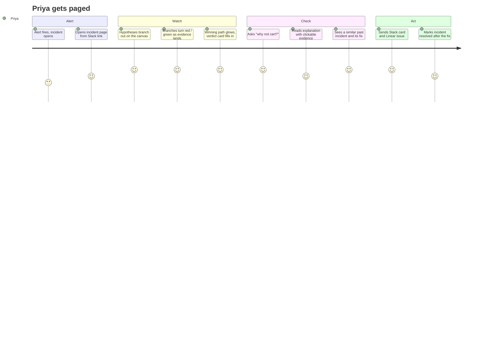
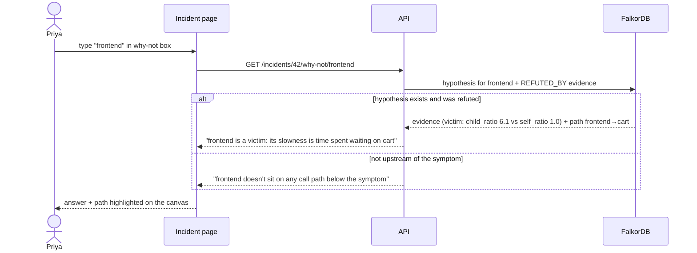
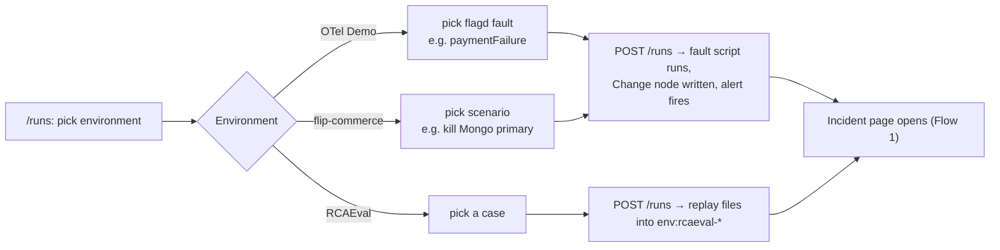

# GraphRCA: User Flows

Who uses GraphRCA, and what they do, step by step. Every step names the **screen**, the **API call** and the **graph work**
behind it, so flows trace straight into [docs/API.md](docs/API.md) and [LLD.md](LLD.md).

---

## Personas

| Persona | Wants | Main screens |
|---|---|---|
| **Priya, on-call SRE** | Know what broke and what to do, fast, and trust it | Incident page, why-not box, Slack card |
| **Arjun, team lead** | Check the impact of a change before shipping; know who to pull in | Blast radius, ask box, memory panel |
| **Judge / demo viewer** | See that the graph does the reasoning | Live canvas, FalkorDB browser, example runs |

## Screens

| Screen | Route | Purpose |
|---|---|---|
| Incidents list | `/` | Open and past incidents, environment switcher |
| Incident | `/incident/[id]` | Live graph canvas, verdict card, evidence, explanation, why-not box, memory panel, deliver |
| Blast radius | `/blast-radius` | Pick a service → what breaks, who owns it |
| Ask | `/ask` | Question → answer + highlighted path |
| Example runs | `/runs` | Start a scripted fault on an example environment, or replay an RCAEval case |
| Eval | `/eval` | RCAEval accuracy table |

---

## Flow 1: Alert → live diagnosis → deliver (the main flow)

| # | User does | Screen | API | Graph work |
|---|---|---|---|---|
| 1 | Nothing (alert arrives) | — | `POST /api/v1/alerts` | `MERGE Incident` on alert id; `TRIGGERED_BY` |
| 2 | Opens the link | Incident | `GET /incidents/{id}`, `GET /incidents/{id}/stream` | read incident subgraph |
| 3 | Watches hypotheses appear | Incident: canvas | SSE `hypothesis.created` | triage: blast radius, **Q1** |
| 4 | Watches branches turn red / green | Incident: canvas | SSE `evidence.added`, `hypothesis.status` | investigators: **Q2**, **Q3** |
| 5 | Reads the verdict | Incident: verdict card | SSE `verdict` | **Q4** + scorer, `ROOT_CAUSE` |
| 6 | Types "cart" into why-not | Incident: why-not box | `GET /incidents/{id}/why-not/cart` | refuting `Evidence` + path, or "not upstream" |
| 7 | Clicks `[E3]` in the explanation | Incident: explanation | — | highlights that evidence's path on the canvas |
| 8 | Reads "seen before" | Incident: memory panel | SSE `memory.similar` | **Q5**, `SIMILAR_TO` |
| 9 | Clicks **Send** | Incident | `POST /incidents/{id}/deliver` | `Action.delivery` updated |
| 10 | Clicks **Resolved**, picks what fixed it | Incident | `POST /incidents/{id}/resolve` | `RESOLVED_BY`, runbook success count +1, `Person -[:FIXED]->` |

**Edge cases**
- Second alert for the same symptom within 10 min → joins the open incident (alert count goes up), no new incident.
- LLM down → verdict still shows; explanation shows "AI explanation unavailable" and a template summary.
- A source is down → banner "Traces unavailable for this window"; hypotheses that needed it end `inconclusive` (grey).

---

## Flow 2: "Why not X?"

---

## Flow 3: Blast radius before a change

Arjun wants to restart Redis during business hours.

| # | User does | Screen | API | Graph work |
|---|---|---|---|---|
| 1 | Opens Blast radius, picks `redis` | Blast radius | `GET /blast-radius/redis` | reverse `CALLS*1..6` into redis operations |
| 2 | Sees 3 services / 9 operations affected, grouped by hops | Blast radius | — | — |
| 3 | Sees owners for each affected service | Blast radius | — | `OWNED_BY` |
| 4 | Clicks "past incidents involving redis" | Blast radius | `GET /incidents?cause=redis` | `ROOT_CAUSE → BLAMES → redis ops` |

---

## Flow 4: Ask box

| # | User does | Screen | API | Graph work |
|---|---|---|---|---|
| 1 | Asks "who should I page for checkout?" | Ask | `POST /ask` | ask agent picks `who_knows('checkout')` |
| 2 | Gets "team-payments (owner); Ravi fixed the last two checkout incidents" | Ask | — | `OWNED_BY`, `FIXED`, `AUTHORED` |
| 3 | Clicks the answer | Ask | — | path shown: Ravi → FIXED → INC-17 → ROOT_CAUSE → checkout/PlaceOrder |
| 4 | Asks something no tool covers ("which operation has the most callers?") | Ask | `POST /ask` | ask agent uses `falkordb-mcp` `query_graph_readonly`; the Cypher it ran is shown under the answer |

---

## Flow 5: Repeat incident (memory)

1. Last week: `paymentFailure` on the OTel Demo was diagnosed, fixed by "turn off flag", marked resolved (Flow 1, step 10).
2. Today: the same fault fires. Q5 finds last week's incident with high similarity.
3. Memory panel: "Seen 7 days ago. Root cause `payment/Charge`. Fixed by: turn off flag `paymentFailure` (worked 1/1)."
4. Responder ranks "turn off flag" first because of its `RESOLVED_BY` success count.

---

## Flow 6: Human takeover mid-incident

1. Priya sees the investigators chasing `cart`, but she knows a deploy just went out to `currency`.
2. She adds a note in the incident page: "currency deployed at 14:02".
3. API: `POST /incidents/{id}/notes` → `Decision {by:'priya', text}` + a `Change` node if she picks "this was a change".
4. The next agent step reads the subgraph, sees the new `Change`, and Q3 picks it up for `currency`.
5. The canvas shows her note as a node linked to the incident, so the handoff is visible.

---

## Flow 7: Example run (demo / judge)

| Environment | Scenario examples | What the judge sees |
|---|---|---|
| OTel Demo | `paymentFailure`, `adHighCpu`, `emailMemoryLeak` (check names in flagd config) | Multi-hop search across ~20 services |
| flip-commerce | kill Mongo primary, kill 2 Mongo nodes, stop Redis, CPU limit + k6 breakpoint, change `MONGO_CIRCUIT_*` | A real failover in your own system; config change found as the cause |
| RCAEval | any RE2 case | Same engine on a public benchmark, with an accuracy number |

Details: [docs/EXAMPLE_RUNS.md](docs/EXAMPLE_RUNS.md).
