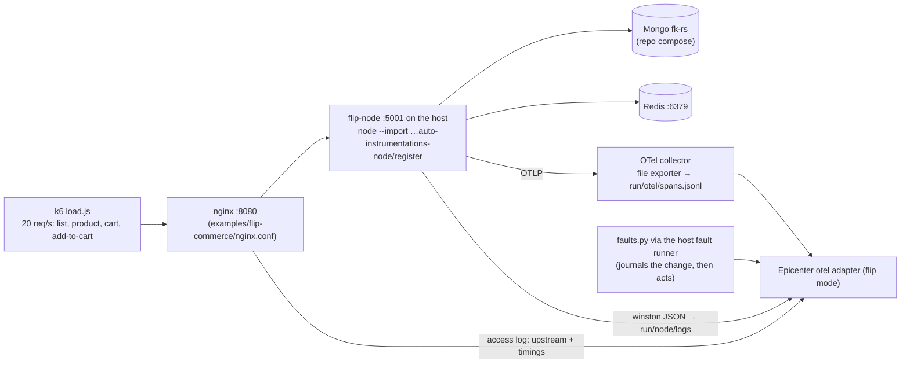

# Example Runs

Three environments Epicenter is demoed and tested on. Run **one at a time**: the OTel Demo and flip-commerce both use
host port 8080. Why these three: [ADR 0010](adr/0010-example-environments.md).

| | OTel Demo | flip-commerce | RCAEval replay |
|---|---|---|---|
| Source | `open-telemetry/opentelemetry-demo` (public) | your `D:\vertical_scaling\system-design-journey` (self-owned) | RCAEval RE2 (public) |
| What it shows | Multi-hop search across ~20 services | A real Mongo / Redis failure in your own system; config change as the cause | Same engine on a benchmark, with a number |
| Graph depth | 3–5 hops | ~2 hops | 3–6 hops |
| Faults | flagd feature flags | `docker stop`, CPU limit + k6, config change | recorded fault cases |
| RAM | ~6 GB | ~2 GB | none extra |
| `ENV_NAME` | `astronomy-shop` | `flip-commerce` | `rcaeval-tt` / `rcaeval-ob` |

Phase 11 adds samples in three sizes, so every machine runs something and the engine is tested from a 5-service toy to
a 2000-operation graph. They are listed in §0 and specified in §4–§6. Which ones a given machine should run is decided by
the system evaluator ([LLD §13](LLD.md#13-system-evaluator-syscheck), [SETUP §2](SETUP.md#2-what-your-machine-can-run)).

---

## 0. Sample sizes: small, medium, huge

**The demo set is three demos** (2026-10-17; [SETUP §5](SETUP.md#5-the-three-demos)):

| Demo | Sample | Kind | Docker memory | Graph size | Shows |
|---|---|---|---|---|---|
| 1 Small | Synthetic small (§4) | generated, replayed | none extra | 5 svc / 14 ops | the full ingest → detect → search path on any laptop, with a known answer (8/8) |
| 2 Medium | RCAEval RE2-TT (§3) | recorded benchmark | none extra | ~40 svc in a window | accuracy on public data (AC@1 87.8%, held-out 90.0%) |
| 3 Real-world | OTel Demo (§1) | live | ~6 GB | ~15 svc | multi-hop search on a live microservice shop, faults flipped by feature flags |

Also built, used in development, and recorded below, but not part of the demo set: the fixture self-test
(`api.selftest`, the tier-1 check), flip-commerce (§2), synthetic medium / huge (§4). HotROD (§5) and Train-Ticket live
(§6) were dropped.

The OTel Demo 3.1.0 `compose.yaml` is the demo's minimal core (no Kafka, accounting or fraud-detection; those are in
`compose.full.yaml`, which `run.py` doesn't load), plus `compose.observability.yaml`. flagd is part of the core, so
every scenario applies.

Considered and not picked:
- **DeathStarBench** (social network, media, hotel): C++/Thrift services with Jaeger tracing, but no built-in fault
  knobs, and heavy to build.
- **Online Boutique:** Kubernetes-first; the OTel Demo is its descendant.
- **Sock Shop:** archived, with Zipkin-era tracing.

---

## 1. OpenTelemetry Demo (primary, multi-hop)

```bash
git clone --branch 3.1.0 https://github.com/open-telemetry/opentelemetry-demo D:\hacktober_proj\opentelemetry-demo
python examples/otel-demo/run.py up      # demo + observability + examples/otel-demo/compose.epicenter.yaml, the runner
python examples/otel-demo/run.py status  # frontend / Jaeger / Prometheus / OpenSearch health, flags that are on
python examples/otel-demo/run.py down    # compose stop (never down -v)
```

Stop flip-commerce first (both use host ports 8080 and 4317). The clone is never edited except the flagd flag file that
`faults.py` flips. `compose.epicenter.yaml` is the only layer Epicenter adds:

| Override | Why |
|---|---|
| Jaeger `16686`, OpenSearch `9200` published | the adapter reads them from the api container via `host.docker.internal` |
| `recommendation` healthcheck → `bash </dev/tcp/localhost/9001` | 3.1.0's compose probes with `nc`, which the `IMAGE_VERSION=3.0.0` image doesn't ship, so `up` stopped at "dependency failed to start" |
| load-generator: 10 HTTP users, browser traffic off | the headless browser users cost ~2 CPUs; 20 users overloaded the 8-CPU Docker VM (checkout p95 15 s with no fault) |

The `otel` adapter (demo mode) reads:
- **Traces:** Jaeger `…:16686/jaeger/ui/api/traces` (the demo serves Jaeger under `QUERY_BASE_PATH`). Operation names
  normalize ids and static files: `GET /api/products/2ZYFJ3GM2N` → `GET /api/products/{id}`,
  `/_next/static/chunks/<hash>.js` → `/_next/static/chunks/{file}`.
- **Metrics:** Prometheus, per `container_name` (the collector's docker_stats receiver): cores as
  `rate(container_cpu_usage_nanoseconds_total[1m])` and `container_memory_usage_total_bytes`. Not
  `container_cpu_utilization_ratio`: it is smoothed and took 3 min to show ad's jump from 0.02 to 3 cores. The SDKs'
  `process_*` metrics carry no service label in 3.1.0.
- **Logs:** OpenSearch `otel-logs-*` (`resource.service.name`, `severity.text`).
- **Changes:** the fault journal, written by `faults.py` before the flag flips.

Flag names checked against 3.1.0's `src/flagd/demo.flagd.json`: `paymentFailure` (variant `50%`), `adHighCpu` (`on`),
`emailMemoryLeak` (`100x`). Each run flips `defaultVariant` with one atomic rename; flagd picks it up in about a second.

| Scenario | Alert on | Settle | Expected verdict | Live result (2026-10-16, 10 users) | Re-run (2026-10-17, full test) |
|---|---|---|---|---|---|
| `paymentFailure` | `frontend/POST /api/checkout` | 90 s | `payment/Charge`, change = flag on | `payment/oteldemo.PaymentService/Charge`, 0.81–0.83, path payment → checkout → frontend, "flag paymentFailure → 50% 64 s before" | same op, 0.99, flag change found; found in 0.8 s, alert → verdict 131 s; undo → flags `off` |
| `adHighCpu` | `frontend/GET /api/data` | 60 s | `ad/*`, kind `cpu` | `ad/oteldemo.AdService/GetAds`, cpu (0.02 → 3 cores), confirmed | same op, 0.999, found in 2.4 s (gap: traces) |
| `emailMemoryLeak` | `frontend/POST /api/checkout` | 90 s | `no_root_cause` at demo traffic | `no_root_cause`: email's memory rose 79 → 87 MB in the window (+10%), under the detector, then plateaued | **differs:** `email/POST /send_order_confirmation`, 0.61, with the flag change (gap: logs). Email is the leaking service, so this verdict is right and the expectation was conservative; demo traffic decides which way it falls |

Trigger: the `/runs` screen, or `POST /api/v1/runs {"env":"astronomy-shop","scenario":"paymentFailure"}`; undo with
`DELETE /api/v1/runs/{run_id}?env=astronomy-shop`. Every run was undone and the flags read `off` afterwards.

What the runs taught (fixed in the engine, each with a test):
- **Bucket a span where it ends.** `checkout` waits seconds on product-catalog before it calls `payment`; by start time
  the parent's errors landed a bucket *before* the child that caused them, and the propagation check refuted
  `payment/Charge` (first run: `checkout/PlaceOrder`). An error is only observed when the span ends, and a parent
  always ends after its child.
- **cpu from the usage counter**, not `container_cpu_utilization_ratio` (first `adHighCpu` run: `no_root_cause` on a
  0.41 cpu score that the counter shows as a 100× jump).
- **A weak wobble on the alerting operation itself is not a root cause** (first `emailMemoryLeak` run blamed
  `frontend/POST /api/checkout` at 0.81 on two latency blips that began before the flag flipped).
- **A rerun keeps the alert-time window**: "ingested" is the incident's ingest counter, so a healthy window (no
  anomalies) isn't re-read later with whatever happened since.

Limits: checkout runs at ~4 per minute with 10 users, so error onsets are sampled sparsely (payment's onset lands
~60 s after the flag); 20 users overloaded the Docker VM (load average 22 on 8 CPUs, checkout p95 15 s with no fault).

**Fault Simulator demo moment (`paymentFailure`):** the alert fires on `frontend`, the loudest symptom. Click the
runner-up `checkout/PlaceOrder` on the incident page: its footprint "explains 1 of 5", with `payment` red as
*unexplained*. Click `payment/Charge`: the chain payment → checkout → frontend lights up. This is symptom anchoring
being avoided, on screen.

---

## 2. flip-commerce (your system-design-journey)

**Source:** `D:\vertical_scaling\system-design-journey\season-1\2.vertical-vs-horizontal-scaling\`.
**Rule: that repo is never modified.** Everything Epicenter needs lives in `graph-hacks/examples/flip-commerce/`
(collector config, run scripts, fault scripts).

### 2.1 What's there

| Part | Detail |
|---|---|
| API | The same flip-commerce REST API (users, products, cart, wishlist) in 6 stacks, `servers/01-node` … `06-fastapi` (ports 5001–5006). Epicenter runs **01-node** (raw `node:http`, mongoose 9, `redis` 6, winston) on the host |
| Data | MongoDB 8 replica set `fk-rs` (27017–27019) from the repo's own `servers/01-node/infra/mongo/compose.yaml`. The app reads with `primaryPreferred` and writes with `w: majority` (hardcoded) |
| Resilience | A hand-rolled Mongo gate (`shared/mongo-gate.ts`): `503` + `Retry-After` when no read is possible or a write has no majority. Redis calls have a hardcoded 150 ms timeout and fall back to Mongo |
| Not in the repo | No Redis service, no OpenTelemetry, and an nginx config that needs a brotli module build and Unix paths. Epicenter supplies all three in `examples/flip-commerce/` |

### 2.2 How Epicenter runs it (the repo is never modified)

```bash
python examples/flip-commerce/run.py up      # ~2 min: Mongo, Redis + collector + nginx, flip-node with OTel, load, runner
python examples/flip-commerce/run.py status  # JSON health of every part
python examples/flip-commerce/run.py down    # stops it; data volumes kept
```



- **Compose (`examples/flip-commerce/compose.yaml`):**
  - Redis `fk-redis`;
  - the OTel collector (OTLP → JSON lines);
  - nginx with Epicenter's config: same `/node/` routing; no brotli; **no proxy cache** (the repo's 15 s cache would
    serve stale 200s through an outage); upstream pinned to IPv4.
- **Traces:**
  - `@opentelemetry/auto-instrumentations-node` 0.80.0 is installed in `examples/flip-commerce/otel-node/` and loaded
    with `node --import`. The http, mongodb (driver 7) and redis (client 6) instrumentations give
    `flip-node/GET /products → mongodb/find products` and `flip-node/GET /cart → redis/GET`.
  - Raw `node:http` span names are just `GET`; the adapter adds the route (`/products/{id}`).
- **nginx:** sends no `traceparent`, so each access-log line names its upstream operation (prefix stripped) and time.
  That gives `nginx/GET /node/products → flip-node/GET /products`.
- **Logs:** `NODE_ENV=production` + `LOG_LEVEL=http` make winston write JSON per request; the working directory is
  `run/node/`, so the logs stay out of the repo.
- **Load:** product list 50%, product page 30%, cart read 10%, **add-to-cart 10%**. Writes matter: with
  `primaryPreferred`, a Mongo fault only hurts writes.
- **Faults:** `faults.py` writes the change to `examples/run/changes.jsonl` **before** it acts. `POST /runs` reaches it
  through the token-gated host fault runner ([ADR 0012](adr/0012-host-fault-runner.md)). Each fault has `--undo`.

### 2.3 Scenarios (each verified live, 2026-10-16)

Each fault was run from `/runs` with about 10 min of normal load before it (the detector baseline), then undone. The
"Verdict" column is what Epicenter answered.

| Scenario | What `faults.py` does | What flip-commerce does | Verdict |
|---|---|---|---|
| `mongo-primary-down` | `docker stop` the current primary | Elects a new primary in ~60 ms; reads never stop (`primaryPreferred`); **0 errors** | `no_root_cause`: nothing user-facing broke. The change stays on record |
| `mongo-majority-lost` | stop 2 of 3 members | Reads continue on the survivor; **every write gets `503`** from the gate, before it reaches Mongo | **`mongodb/findAndModify` (down)**, 79%, change `docker stop 2 of 3`; runner-up `flip-node/POST /cart` |
| `redis-down` | `docker stop fk-redis` | Session lookups fall back to Mongo; cart keeps working; only "Redis reconnecting" warnings | **`redis/GET` (down)**, change `docker stop`; the alerting cart route is fine |
| `circuit-misconfig` | redeploy flip-node with `replicaSet=fk-rss` (typo) | flip-node can't find its replica set and never boots: nginx `502` everywhere; every Mongo call stops too | **`flip-node/GET /products`**, 62%, change `deploy … replicaSet=fk-rss`; runner-up `mongodb/find products` (looks just as dead) |
| `cpu-saturation` | +400 req/s k6 stress on the single worker | Self time ×45–240 on every route; nginx ejects the upstream ("no live upstreams") → instant `502`s; Mongo spans inflate ×5–20 (measured inside the saturated process) | **`flip-node/GET /products`**, 60%; runner-up `nginx/GET /node/products`; Mongo refuted as a victim of its caller |
| `healthy-baseline` | nothing; an alert fired on `nginx/GET /node/products` | — | **`no_root_cause`**: 0 anomalies, 0 hypotheses |

**Live findings that changed the plan:**
- **The doc's `circuit-misconfig` (`MONGO_CIRCUIT_FAILS=1`) can't trip.** The gate only counts failures when no
  election is possible.
- **Two other bad configs changed nothing.**
  - `socketTimeoutMS=3`: the driver kept serving 7–30 ms queries.
  - `w=5`: the code hardcodes `writeConcern: majority`.
  - The replica-set typo is the bad config this app can actually ship.
- **`mongo-primary-down` and `redis-down` don't produce an outage.** That is the system's resilience working. The
  honest answers ("nothing explains this alert" / "Redis is down, users unaffected") are the point.

### 2.3b What the engine learned from these runs (phase 9)

- **A live window ends now, mid-bucket.** Live ingest stops at the last complete 5 s bucket; before that fix, every
  operation looked `down`.
- **A dependency behind a client-side gate leaves no error spans.** Its calls just stop. `down` now looks for silence
  from the window start (t − 120 s), not from the alert. A cut-short last bucket marks the onset, so it lines up with
  the callers' first errors.
- **`down` scores 1.0 (weights v3).** At 0.86 it lost to the callers' 100% error rate after rank normalization.
- **A quiet symptom with only weak anomalies is `no_root_cause`.** One weak log anomaly otherwise "covers" itself 100%.
- **A datastore's latency is measured inside its callers.** When a caller's own time grows ≥ 2× its waiting (it's
  saturated), the datastore's "latency" is the caller's lag. Q3b refutes it as a victim (the mirror of the victim rule).
- **A proxy in front of a slow app fails fast.** New propagation rule (rules 2026-10-16): latency, CPU or saturation
  upstream of a `proxy` → errors at the proxy (p 0.7). nginx ejects the upstream and answers 502.
- **Near-tied strengths rank as ties.** Strength is quantised to 2 decimals before rank normalisation; 0.9999 vs 1.0
  had become 0.5 vs 1.0.
- **Every window ends on a complete bucket**, at the 300 s cap or at "now". A half-filled last bucket made busy
  operations look `down`.
- **`down` still needs the silence to last to the window end.** RCAEval's bursty load generator leaves 20–60 s gaps
  on healthy operations, so a mid-window gap is not counted. An outage that recovers before ingest runs isn't
  `down`; live ingest runs at alert time, while it's ongoing.

### 2.3c Reproduce one

```bash
python examples/flip-commerce/run.py up          # then wait ~10 min of load (the baseline)
# /runs → "Lose the Mongo majority" → Run; the card counts down to the alert, then opens the incident
python -m api.ingest.live --env flip-commerce --incident inc-run-<ts> --as-of-alert   # re-ingest as the alert saw it
```

### 2.4 Ports

flip-commerce uses 6379 (Redis), 8080 (nginx), 4317/4318 (collector), 5001 (flip-node), 27017–27019 (Mongo); the
host fault runner uses 8090 on loopback. Epicenter uses 6380 for FalkorDB on the host, so both run together. Stop
the OTel Demo first: it also wants 8080 and 4317.

### 2.5 Limits (be honest in the demo)

- **Shallow graph:** nginx → flip-node → Mongo / Redis. Good for "real failure, right answer, clear why"; not for
  multi-hop. Use the OTel Demo for blast radius and multi-hop search.
- **Only 01-node is wired.** The other stacks would take the same approach (`06-fastapi` through
  `opentelemetry-instrument`); the Go server needs code changes.
- **Detection needs about 10 minutes of normal load** before a fault, because that's the detector's baseline window.
  Back-to-back faults need the same gap.

---

## 3. RCAEval replay (offline, measured)

```bash
docker compose exec api python -m api.ingest.rcaeval --case re2tt_ts-auth-service_cpu_2 --env rcaeval-tt --download
docker compose exec api python -m api.eval --suite re2 --system tt
```

- Cases come from Hugging Face `phamquiluan/RCAEval` (Parquet layout, ~25 MB each); `--download` fetches one into
  `RCAEVAL_DIR` (`./data/rcaeval`, git-ignored). Names are `re2tt_<service>_<fault>_<n>`; faults are cpu, mem, disk,
  delay, loss, socket.
- RCAEval has no alert: the faults are driven by a load generator that calls every entry point but isn't traced. Replay
  models it as `client/load` (service `client`, kind `external`) with a `CALLS` edge to every root operation (a span
  with no `parentSpanID`; orphans don't count), and that is the incident's symptom. Every anomalous operation is then
  upstream of the symptom, and the scorer decides. The incident id is `rc-<case>`.
- `python -m api.search.causal --env rcaeval-tt --incident rc-<case>` diagnoses it (~1 s); each call is a new, kept run.
- Replaying a case again starts a new ingest: the previous anomalies are retired as `<incident>@i<k>` (not deleted), so
  readers see the same current anomalies as before and earlier diagnosis runs stay fully linked. One case takes ~15 s.
- Uses the same writers and the same causal search; only the adapter differs.
- `inject_time.txt` is used as the alert time only, never as a `Change`, so the answer can't leak into the graph.
- Report AC@1 / AC@3 and the ablations whatever they are, including losses.

---

## 4. Synthetic samples (self-made)

Generated cases with a known answer, in any size, on any machine. They fill the gap between the fixtures (hand-made
graphs, which skip ingest) and the live environments (which need real hardware).

```bash
docker compose exec api python examples/synthetic/gen.py --size small|medium|huge --fault <kind> --seed <n> [--run]
docker compose exec api python -m api.ingest.rcaeval --case <printed case id> --env synthetic   # or /runs → Synthetic
docker compose exec api python -m api.eval --suite synth --size small,medium,huge               # every fault per size
```

- **Layout:** the generator writes the **RCAEval layout**, so the existing replay path ingests it unchanged:
  `traces.parquet`, `metrics.parquet`, `logs.parquet`, `inject_time.txt`.
  - Two extra files: `labels.json` (root-cause service / op / fault, read by eval only, never ingested) and, for
    `config`, `changes.jsonl` in the fault-journal format (read by the RCAEval adapter through `read_journal`).
  - Output goes to `data/rcaeval/synth-<size>_<svc>_<fault>_<seed>/`; `/runs` lists every case found there under env
    `synthetic`, with its `expect` from `labels.json`.
  - Each (size, fault) gets its own inject time, one day apart, so cases replayed into the shared `env:synthetic` never
    overlap. `--run` and the eval use a throwaway graph per case instead.
- **Topology:** a layered call graph, one per (size, seed), so every fault of a size runs on the same system:
  `edge → api tier → domain services → datastores (mongodb, redis, mysql, store-*)`; each operation calls 1–3
  operations one or two tiers down. Faults land only on operations that traffic reaches from the edge.

  | Size | Services | Ops (seed 1) | Traces | Traces / s | Metrics |
  |---|---|---|---|---|---|
  | small | 5 | 14 | 15 min (t−10 … t+5) | 5 | 1 s steps; `mem`: 6 h at 5 s |
  | medium | 30 | ~150 | 15 min | 20 | same |
  | huge | 300 | 1,814 (~300k spans) | 15 min | 50 | same |

- **Healthy behaviour:** log-normal latencies per operation, 0.3% background errors (a parent fails with 70% of its
  failed children), per-service CPU and memory with noise. Traffic is flat.
- **Faults** start at `inject_time`:

  | `--fault` | Injected | Label |
  |---|---|---|
  | `cpu` | one service's CPU → 0.95; its ops' self time ×20 (M/M/1 at ρ 0.95: response = service / (1 − ρ)) | that service |
  | `mem` | linear memory climb from 3 h before the alert, metrics only | that service, found by the slow-burn pass |
  | `delay` | +300 ms self time on one op | that op's service |
  | `error` | 30% errors on one op, plus ERROR log lines | that op's service |
  | `down` | a datastore op times out and fails | that datastore |
  | `config` | `delay` + a `Change` 60 s before | that op's service, with the change |
  | `two` | `cpu` on one service + 40% errors on an op in a disjoint subtree (neither reaches the other) from t+30 | both, as rank 1 and 2. Needs medium+: small has no independent pair and says so |
  | `loud-victim` | +150 ms on a datastore op whose caller retries 3× (the bigger anomaly upstream) | the datastore, not the loud caller |
  | `healthy` | noise only, plus a ×1.15 wobble on one op for a minute | `no_root_cause` |

- **Determinism:** numpy `default_rng([seed, size, fault])`. The same seed gives byte-identical files and so the same
  verdict (AGENTS hard rule 5); `tests/test_synth.py` checks the bytes.
- **Honesty:** synthetic data is easier than real data in one way (the faults spread the way the propagation rules
  say) and harder in another (hundreds of low-traffic operations at huge). Report synthetic accuracy apart from
  RCAEval, never mixed into it. Its job is to test scale and code paths, not to prove accuracy.

**Results** (2026-10-17, seed 1, weights `2026-10-17.v5`, `data/eval/0007-synth-s1-…json`):

| Size | AC@1 | AC@3 | Misses |
|---|---|---|---|
| small | **8 / 8** (100%) | 100% | none (`two` skipped: no independent pair) |
| medium | **7 / 9** (78%) | 100% | `cpu` → `api-3` (caller); `two` → first cause right, no second cause |
| huge | **5 / 9** (56%) | 67% | `cpu`, `mem`, `healthy` → a false error-rate anomaly on a low-traffic op (`svc-173`, `api-25`); `two` → `store-8` |

What the runs found:
- **Bug, fixed:** the slow-burn pass never had its 6 h of data. `ingest_window` handed it the short window's series
  (from t − 12 min), so a climb that started hours earlier could never reach the 1.5× ratio, in replay or live. The
  adapters now have `metric_series(start, end)` and the pass fetches `[t − 6 h, t]` itself, as LLD §3.2 says
  (`tests/test_synth.py` small `mem`). `mem` went from missed to found at every size.
- **Known gap (huge):** with ~1,800 operations, a few background errors in a quiet 5 s bucket pass the error detector
  (`eps_abs` 0.01, sustain 3) somewhere, and one such anomaly can win, even on `healthy`. The fix is a minimum error
  count per bucket (or a binomial test) in the detector: a `detect` change, so a new weights version and an RE2 re-run.
  Not done in this pass.
- **Known gap (`two`):** the second fault is ranked #2 but explains < 50% of what the first left
  (`simulator.second_cause.min_coverage` 0.5), so it isn't confirmed as a second cause. The `multi_fault` fixture
  passes; tuning the frozen v5 weights for a synthetic case isn't worth it.

## 5. Jaeger HotROD (dropped)

Built and wired on 2026-10-17 (`jaegertracing/example-hotrod:2.20.0`, fix flags checked), then dropped when the demo
set was cut to three. One run happened before it was removed: `healthy-baseline` → `no_root_cause` ✓, but alert →
verdict took 60 s, almost all of it ingest: with Jaeger as the only source, the adapter queries each service in turn
and every dispatch trace (~50 spans) comes back once per service it touches, about 6× over. If HotROD (or any
Jaeger-only env) comes back, read each trace once (one query from the entry service) before relying on its N1.

## 6. Train-Ticket (huge, live, opt-in; dropped)

**Phase 11 stretch; only on a 16-core / 32 GB+ box.** Train-Ticket (FudanSELab) is a 41-service train booking system
(Java / Spring Boot, Node, Python, Go; MongoDB and MySQL). RCAEval's RE2-TT cases were recorded on it, so a live run
can be compared with the replay of the same fault. Source:
[train-ticket repo](https://github.com/FudanSELab/train-ticket).

- **Setup:** the repo's quickstart docker-compose plus `examples/train-ticket/compose.epicenter.yaml`, which adds OTel
  Java agent env vars and a Jaeger. Measure its real footprint with `docker stats` before trusting the 24 GB estimate.
- **Faults** (`faults.py`, journaled first, each with `--undo`), mirroring RCAEval:
  - `auth-cpu`: `stress-ng` inside `ts-auth-service`;
  - `order-delay`: `tc netem delay` on `ts-order-service`.

  Expected: `ts-auth-service/*` (`cpu`) and `ts-order-service/*` (`latency`), the same targets as the replays
  (`re2tt_ts-auth-service_cpu_*`, `re2tt_ts-order-service_delay_1`).
- **Not on the demo box:** `m6i.2xlarge` can't hold it next to the OTel Demo. Rehearse it on an `m6i.4xlarge` if at all.

---

## 7. Demo script (phase 10)

About 6 minutes, small → medium → real-world. Everything runs from the `/runs` screen. The backup video follows the
same order.

| # | Time | Do | Say / point at |
|---|---|---|---|
| 1 | 0:00 | Open `/` (landing), then **Open the app** | "Every outage has an epicenter. The graph does the reasoning; the LLM only explains." |
| 2 | 0:30 | `/runs` → **synthetic · small `config`**, then **small `healthy`** (demo 1) | A known answer: the labelled op, badge "matches expected" (in a graph that already holds older synthetic runs the change isn't linked; a fresh `env:synthetic` shows it). Then `no_root_cause` on a healthy system: Epicenter doesn't invent a cause. |
| 3 | 1:00 | `/runs` → **astronomy-shop · paymentFailure**; open the incident while it streams | The lanes fill live. The alert is on `frontend`, the loudest symptom. |
| 4 | 2:00 | Click runner-up `checkout/PlaceOrder`, then `payment/Charge` (§1, "Fault Simulator demo moment") | Its footprint "explains 1 of 5", `payment` red as unexplained. `payment/Charge` lights the chain payment → checkout → frontend, with the flag change 64 s before. Symptom anchoring avoided, on screen. |
| 5 | 3:00 | **Receipts** + **Graph \| Data** toggle | Every query that produced the answer, with timings; the same subgraph as a table. |
| 6 | 3:30 | `/runs` → **rcaeval-tt · `re2tt_ts-auth-service_cpu_2`** (demo 2) | A real recorded fault on 40+ Train-Ticket services: `ts-auth-service`, found in under a second of diagnosis. |
| 7 | 4:30 | `/simulate` → type `redis` (the traces name valkey-cart `redis`), kind `down`, **Simulate**, then **Play** | What-if: 12 operations in 6 services, cart → checkout / frontend, with owners and how soon, before anything breaks. |
| 8 | 5:15 | `/eval` | The RCAEval number on 90 RE2-TT cases, the held-out split and the ablations, losses included (README results table). |
| 9 | 5:45 | Undo the runs (`/runs` → Undo) | Read-only towards the systems: only `faults.py` changed anything, and it put it back. |

**Before going on stage:**
- `python examples/otel-demo/run.py status` is green, and `/health` is all `ok`.
- The OTel Demo has been up for **≥ 25 min**, and one rehearsal run of `paymentFailure` is done (≥ 10 min before the
  live one). A run 10 min after a cold start blamed `postgresql` (2026-10-17); see SETUP §5, demo 3.
- The synthetic cases and the RCAEval case are on disk (`/runs` lists them; generate / `--download` the day before).

**If the OTel Demo won't start:** steps 3–5 use the RCAEval replay of `re2tt_ts-order-service_delay_1` (`/runs` →
replay) instead, and the backup video covers the live moment.
