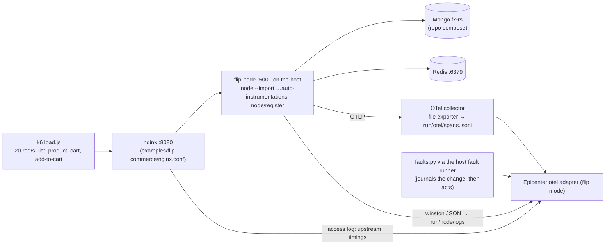

# Example Runs

Three environments Epicenter is demoed and tested on. Run **one at a time**: the OTel Demo and flip-commerce both use
host port 8080. Why these three: [ADR 0010](adr/0010-example-environments.md).

| | OTel Demo | flip-commerce | RCAEval replay |
|---|---|---|---|
| Source | `open-telemetry/opentelemetry-demo` (public) | your `D:\vertical_scaling\system-design-journey` (self-owned) | RCAEval RE2 (public) |
| What it shows | Multi-hop search across ~20 services | A real Mongo / Redis failure in your own system; config change as the cause | Same engine on a benchmark, with a number |
| Graph depth | 3–5 hops | ~2 hops | 3–6 hops |
| Faults | flagd feature flags | `docker stop`, CPU limit + k6, config change | recorded fault cases |
| RAM | ~6 GB | ~2 GB | none extra |
| `ENV_NAME` | `astronomy-shop` | `flip-commerce` | `rcaeval-tt` / `rcaeval-ob` |

Phase 11 adds samples in three sizes, so every machine runs something and the engine is tested from a 5-service toy to
a 2000-operation graph. They are listed in §0 and specified in §4–§6. Which ones a given machine should run is decided by
the system evaluator ([LLD §13](LLD.md#13-system-evaluator-syscheck), [SETUP §2](SETUP.md#2-what-your-machine-can-run)).

---

## 0. Sample sizes: small, medium, huge

| Size | Sample | Kind | Docker memory | Graph size | Shows |
|---|---|---|---|---|---|
| Small | Fixture self-test (`tests/fixtures/*.cypher`) | hand-made graphs | none extra | 4–10 ops each | known cause, two faults, healthy, quiet symptom, saturated caller, weak self-blame |
| Small | Synthetic small (§4) | generated, replayed | none extra | 5 svc / ~15 ops | the full ingest → detect → search path on a laptop |
| Small | Jaeger HotROD (§5) | live, real OTLP traces | < 1 GB | 4 svc / ~10 ops | live ingest + a config change as the cause, on any machine |
| Medium | Synthetic medium (§4) | generated, replayed | none extra | 30 svc / ~150 ops | two faults, a loud victim, a healthy run, a config change |
| Medium | RCAEval RE2-TT (§3) | recorded benchmark | none extra | ~40 svc | accuracy on public data |
| Medium | flip-commerce (§2) | live, own system | ~2 GB | 5 svc / ~15 ops | real Mongo / Redis failures |
| Medium | OTel Demo minimal (§1) | live | ~3 GB | ~15 svc | multi-hop without Kafka and its consumers |
| Huge | OTel Demo full (§1) | live | ~6 GB | ~20 svc / ~80 ops | the main multi-hop demo |
| Huge | Synthetic huge (§4) | generated, replayed | ~1 GB during replay | 300 svc / ~2000 ops, 6 h | scale: N2 query latency at size, the slow-burn pass |
| Huge | Train-Ticket live (§6) | live, opt-in | 24 GB+ (estimate) | 41 svc | the system RCAEval recorded, faulted live |

OTel Demo minimal is the demo's own `docker-compose.minimal.yml`: no Kafka, accounting, fraud-detection or flagd-ui,
about 3 GB instead of 6 GB ([OTel Demo Docker deployment](https://opentelemetry.io/docs/demo/docker-deployment/)).
`run.py up --minimal` selects it **(phase 11)**; flagd itself is still there, so `paymentFailure` and `adHighCpu`
apply.

Considered and not picked:
- **DeathStarBench** (social network, media, hotel): C++/Thrift services with Jaeger tracing, but no built-in fault
  knobs, and heavy to build.
- **Online Boutique:** Kubernetes-first; the OTel Demo is its descendant.
- **Sock Shop:** archived, with Zipkin-era tracing.

---

## 1. OpenTelemetry Demo (primary, multi-hop)

```bash
git clone --branch 3.1.0 https://github.com/open-telemetry/opentelemetry-demo D:\hacktober_proj\opentelemetry-demo
python examples/otel-demo/run.py up      # demo + observability + examples/otel-demo/compose.epicenter.yaml, the runner
python examples/otel-demo/run.py status  # frontend / Jaeger / Prometheus / OpenSearch health, flags that are on
python examples/otel-demo/run.py down    # compose stop (never down -v)
```

Stop flip-commerce first (both use host ports 8080 and 4317). The clone is never edited except the flagd flag file that
`faults.py` flips. `compose.epicenter.yaml` is the only layer Epicenter adds:

| Override | Why |
|---|---|
| Jaeger `16686`, OpenSearch `9200` published | the adapter reads them from the api container via `host.docker.internal` |
| `recommendation` healthcheck → `bash </dev/tcp/localhost/9001` | 3.1.0's compose probes with `nc`, which the `IMAGE_VERSION=3.0.0` image doesn't ship, so `up` stopped at "dependency failed to start" |
| load-generator: 10 HTTP users, browser traffic off | the headless browser users cost ~2 CPUs; 20 users overloaded the 8-CPU Docker VM (checkout p95 15 s with no fault) |

The `otel` adapter (demo mode) reads:
- **Traces:** Jaeger `…:16686/jaeger/ui/api/traces` (the demo serves Jaeger under `QUERY_BASE_PATH`). Operation names
  normalize ids and static files: `GET /api/products/2ZYFJ3GM2N` → `GET /api/products/{id}`,
  `/_next/static/chunks/<hash>.js` → `/_next/static/chunks/{file}`.
- **Metrics:** Prometheus, per `container_name` (the collector's docker_stats receiver): cores as
  `rate(container_cpu_usage_nanoseconds_total[1m])` and `container_memory_usage_total_bytes`. Not
  `container_cpu_utilization_ratio`: it is smoothed and took 3 min to show ad's jump from 0.02 to 3 cores. The SDKs'
  `process_*` metrics carry no service label in 3.1.0.
- **Logs:** OpenSearch `otel-logs-*` (`resource.service.name`, `severity.text`).
- **Changes:** the fault journal, written by `faults.py` before the flag flips.

Flag names checked against 3.1.0's `src/flagd/demo.flagd.json`: `paymentFailure` (variant `50%`), `adHighCpu` (`on`),
`emailMemoryLeak` (`100x`). Each run flips `defaultVariant` with one atomic rename; flagd picks it up in about a second.

| Scenario | Alert on | Settle | Expected verdict | Live result (2026-10-16, 10 users) |
|---|---|---|---|---|
| `paymentFailure` | `frontend/POST /api/checkout` | 90 s | `payment/Charge`, change = flag on | `payment/oteldemo.PaymentService/Charge`, 0.81–0.83, path payment → checkout → frontend, "flag paymentFailure → 50% 64 s before" |
| `adHighCpu` | `frontend/GET /api/data` | 60 s | `ad/*`, kind `cpu` | `ad/oteldemo.AdService/GetAds`, cpu (0.02 → 3 cores), confirmed |
| `emailMemoryLeak` | `frontend/POST /api/checkout` | 90 s | `no_root_cause` at demo traffic | `no_root_cause`: email's memory rose 79 → 87 MB in the window (+10%), under the detector, then plateaued |

Trigger: the `/runs` screen, or `POST /api/v1/runs {"env":"astronomy-shop","scenario":"paymentFailure"}`; undo with
`DELETE /api/v1/runs/{run_id}?env=astronomy-shop`. Every run was undone and the flags read `off` afterwards.

What the runs taught (fixed in the engine, each with a test):
- **Bucket a span where it ends.** `checkout` waits seconds on product-catalog before it calls `payment`; by start time
  the parent's errors landed a bucket *before* the child that caused them, and the propagation check refuted
  `payment/Charge` (first run: `checkout/PlaceOrder`). An error is only observed when the span ends, and a parent
  always ends after its child.
- **cpu from the usage counter**, not `container_cpu_utilization_ratio` (first `adHighCpu` run: `no_root_cause` on a
  0.41 cpu score that the counter shows as a 100× jump).
- **A weak wobble on the alerting operation itself is not a root cause** (first `emailMemoryLeak` run blamed
  `frontend/POST /api/checkout` at 0.81 on two latency blips that began before the flag flipped).
- **A rerun keeps the alert-time window**: "ingested" is the incident's ingest counter, so a healthy window (no
  anomalies) isn't re-read later with whatever happened since.

Limits: checkout runs at ~4 per minute with 10 users, so error onsets are sampled sparsely (payment's onset lands
~60 s after the flag); 20 users overloaded the Docker VM (load average 22 on 8 CPUs, checkout p95 15 s with no fault).

**Fault Simulator demo moment (`paymentFailure`):** the alert fires on `frontend`, the loudest symptom. Click the
runner-up `checkout/PlaceOrder` on the incident page: its footprint "explains 1 of 5", with `payment` red as
*unexplained*. Click `payment/Charge`: the chain payment → checkout → frontend lights up. This is symptom anchoring
being avoided, on screen.

---

## 2. flip-commerce (your system-design-journey)

**Source:** `D:\vertical_scaling\system-design-journey\season-1\2.vertical-vs-horizontal-scaling\`.
**Rule: that repo is never modified.** Everything Epicenter needs lives in `graph-hacks/examples/flip-commerce/`
(collector config, run scripts, fault scripts).

### 2.1 What's there

| Part | Detail |
|---|---|
| API | The same flip-commerce REST API (users, products, cart, wishlist) in 6 stacks, `servers/01-node` … `06-fastapi` (ports 5001–5006). Epicenter runs **01-node** (raw `node:http`, mongoose 9, `redis` 6, winston) on the host |
| Data | MongoDB 8 replica set `fk-rs` (27017–27019) from the repo's own `servers/01-node/infra/mongo/compose.yaml`. The app reads with `primaryPreferred` and writes with `w: majority` (hardcoded) |
| Resilience | A hand-rolled Mongo gate (`shared/mongo-gate.ts`): `503` + `Retry-After` when no read is possible or a write has no majority. Redis calls have a hardcoded 150 ms timeout and fall back to Mongo |
| Not in the repo | No Redis service, no OpenTelemetry, and an nginx config that needs a brotli module build and Unix paths. Epicenter supplies all three in `examples/flip-commerce/` |

### 2.2 How Epicenter runs it (the repo is never modified)

```bash
python examples/flip-commerce/run.py up      # ~2 min: Mongo, Redis + collector + nginx, flip-node with OTel, load, runner
python examples/flip-commerce/run.py status  # JSON health of every part
python examples/flip-commerce/run.py down    # stops it; data volumes kept
```



- **Compose (`examples/flip-commerce/compose.yaml`):**
  - Redis `fk-redis`;
  - the OTel collector (OTLP → JSON lines);
  - nginx with Epicenter's config: same `/node/` routing; no brotli; **no proxy cache** (the repo's 15 s cache would
    serve stale 200s through an outage); upstream pinned to IPv4.
- **Traces:**
  - `@opentelemetry/auto-instrumentations-node` 0.80.0 is installed in `examples/flip-commerce/otel-node/` and loaded
    with `node --import`. The http, mongodb (driver 7) and redis (client 6) instrumentations give
    `flip-node/GET /products → mongodb/find products` and `flip-node/GET /cart → redis/GET`.
  - Raw `node:http` span names are just `GET`; the adapter adds the route (`/products/{id}`).
- **nginx:** sends no `traceparent`, so each access-log line names its upstream operation (prefix stripped) and time.
  That gives `nginx/GET /node/products → flip-node/GET /products`.
- **Logs:** `NODE_ENV=production` + `LOG_LEVEL=http` make winston write JSON per request; the working directory is
  `run/node/`, so the logs stay out of the repo.
- **Load:** product list 50%, product page 30%, cart read 10%, **add-to-cart 10%**. Writes matter: with
  `primaryPreferred`, a Mongo fault only hurts writes.
- **Faults:** `faults.py` writes the change to `examples/run/changes.jsonl` **before** it acts. `POST /runs` reaches it
  through the token-gated host fault runner ([ADR 0012](adr/0012-host-fault-runner.md)). Each fault has `--undo`.

### 2.3 Scenarios (each verified live, 2026-10-16)

Each fault was run from `/runs` with about 10 min of normal load before it (the detector baseline), then undone. The
"Verdict" column is what Epicenter answered.

| Scenario | What `faults.py` does | What flip-commerce does | Verdict |
|---|---|---|---|
| `mongo-primary-down` | `docker stop` the current primary | Elects a new primary in ~60 ms; reads never stop (`primaryPreferred`); **0 errors** | `no_root_cause`: nothing user-facing broke. The change stays on record |
| `mongo-majority-lost` | stop 2 of 3 members | Reads continue on the survivor; **every write gets `503`** from the gate, before it reaches Mongo | **`mongodb/findAndModify` (down)**, 79%, change `docker stop 2 of 3`; runner-up `flip-node/POST /cart` |
| `redis-down` | `docker stop fk-redis` | Session lookups fall back to Mongo; cart keeps working; only "Redis reconnecting" warnings | **`redis/GET` (down)**, change `docker stop`; the alerting cart route is fine |
| `circuit-misconfig` | redeploy flip-node with `replicaSet=fk-rss` (typo) | flip-node can't find its replica set and never boots: nginx `502` everywhere; every Mongo call stops too | **`flip-node/GET /products`**, 62%, change `deploy … replicaSet=fk-rss`; runner-up `mongodb/find products` (looks just as dead) |
| `cpu-saturation` | +400 req/s k6 stress on the single worker | Self time ×45–240 on every route; nginx ejects the upstream ("no live upstreams") → instant `502`s; Mongo spans inflate ×5–20 (measured inside the saturated process) | **`flip-node/GET /products`**, 60%; runner-up `nginx/GET /node/products`; Mongo refuted as a victim of its caller |
| `healthy-baseline` | nothing; an alert fired on `nginx/GET /node/products` | — | **`no_root_cause`**: 0 anomalies, 0 hypotheses |

**Live findings that changed the plan:**
- **The doc's `circuit-misconfig` (`MONGO_CIRCUIT_FAILS=1`) can't trip.** The gate only counts failures when no
  election is possible.
- **Two other bad configs changed nothing.**
  - `socketTimeoutMS=3`: the driver kept serving 7–30 ms queries.
  - `w=5`: the code hardcodes `writeConcern: majority`.
  - The replica-set typo is the bad config this app can actually ship.
- **`mongo-primary-down` and `redis-down` don't produce an outage.** That is the system's resilience working. The
  honest answers ("nothing explains this alert" / "Redis is down, users unaffected") are the point.

### 2.3b What the engine learned from these runs (phase 9)

- **A live window ends now, mid-bucket.** Live ingest stops at the last complete 5 s bucket; before that fix, every
  operation looked `down`.
- **A dependency behind a client-side gate leaves no error spans.** Its calls just stop. `down` now looks for silence
  from the window start (t − 120 s), not from the alert. A cut-short last bucket marks the onset, so it lines up with
  the callers' first errors.
- **`down` scores 1.0 (weights v3).** At 0.86 it lost to the callers' 100% error rate after rank normalization.
- **A quiet symptom with only weak anomalies is `no_root_cause`.** One weak log anomaly otherwise "covers" itself 100%.
- **A datastore's latency is measured inside its callers.** When a caller's own time grows ≥ 2× its waiting (it's
  saturated), the datastore's "latency" is the caller's lag. Q3b refutes it as a victim (the mirror of the victim rule).
- **A proxy in front of a slow app fails fast.** New propagation rule (rules 2026-10-16): latency, CPU or saturation
  upstream of a `proxy` → errors at the proxy (p 0.7). nginx ejects the upstream and answers 502.
- **Near-tied strengths rank as ties.** Strength is quantised to 2 decimals before rank normalisation; 0.9999 vs 1.0
  had become 0.5 vs 1.0.
- **Every window ends on a complete bucket**, at the 300 s cap or at "now". A half-filled last bucket made busy
  operations look `down`.
- **`down` still needs the silence to last to the window end.** RCAEval's bursty load generator leaves 20–60 s gaps
  on healthy operations, so a mid-window gap is not counted. An outage that recovers before ingest runs isn't
  `down`; live ingest runs at alert time, while it's ongoing.

### 2.3c Reproduce one

```bash
python examples/flip-commerce/run.py up          # then wait ~10 min of load (the baseline)
# /runs → "Lose the Mongo majority" → Run; the card counts down to the alert, then opens the incident
python -m api.ingest.live --env flip-commerce --incident inc-run-<ts> --as-of-alert   # re-ingest as the alert saw it
```

### 2.4 Ports

flip-commerce uses 6379 (Redis), 8080 (nginx), 4317/4318 (collector), 5001 (flip-node), 27017–27019 (Mongo); the
host fault runner uses 8090 on loopback. Epicenter uses 6380 for FalkorDB on the host, so both run together. Stop
the OTel Demo first: it also wants 8080 and 4317.

### 2.5 Limits (be honest in the demo)

- **Shallow graph:** nginx → flip-node → Mongo / Redis. Good for "real failure, right answer, clear why"; not for
  multi-hop. Use the OTel Demo for blast radius and multi-hop search.
- **Only 01-node is wired.** The other stacks would take the same approach (`06-fastapi` through
  `opentelemetry-instrument`); the Go server needs code changes.
- **Detection needs about 10 minutes of normal load** before a fault, because that's the detector's baseline window.
  Back-to-back faults need the same gap.

---

## 3. RCAEval replay (offline, measured)

```bash
docker compose exec api python -m api.ingest.rcaeval --case re2tt_ts-auth-service_cpu_2 --env rcaeval-tt --download
docker compose exec api python -m api.eval --suite re2 --system tt
```

- Cases come from Hugging Face `phamquiluan/RCAEval` (Parquet layout, ~25 MB each); `--download` fetches one into
  `RCAEVAL_DIR` (`./data/rcaeval`, git-ignored). Names are `re2tt_<service>_<fault>_<n>`; faults are cpu, mem, disk,
  delay, loss, socket.
- RCAEval has no alert: the faults are driven by a load generator that calls every entry point but isn't traced. Replay
  models it as `client/load` (service `client`, kind `external`) with a `CALLS` edge to every root operation (a span
  with no `parentSpanID`; orphans don't count), and that is the incident's symptom. Every anomalous operation is then
  upstream of the symptom, and the scorer decides. The incident id is `rc-<case>`.
- `python -m api.search.causal --env rcaeval-tt --incident rc-<case>` diagnoses it (~1 s); each call is a new, kept run.
- Replaying a case again starts a new ingest: the previous anomalies are retired as `<incident>@i<k>` (not deleted), so
  readers see the same current anomalies as before and earlier diagnosis runs stay fully linked. One case takes ~15 s.
- Uses the same writers and the same causal search; only the adapter differs.
- `inject_time.txt` is used as the alert time only, never as a `Change`, so the answer can't leak into the graph.
- Report AC@1 / AC@3 and the ablations whatever they are, including losses.

---

## 4. Synthetic samples (self-made)

**Phase 11, not built yet.** Generated cases with a known answer, in any size, on any machine. They fill the gap between
the fixtures (hand-made graphs, which skip ingest) and the live environments (which need real hardware).

```bash
docker compose exec api python examples/synthetic/gen.py --size small|medium|huge --fault <kind> --seed <n>
docker compose exec api python -m api.ingest.rcaeval --case <printed case id> --env synthetic
docker compose exec api python -m api.eval --suite synth --size medium          # AC@1 / AC@3 per size
```

- **Layout:** the generator writes the **RCAEval layout**, so the existing replay path ingests it unchanged:
  `traces.parquet`, `metrics.parquet`, `logs.parquet`, `inject_time.txt`.
  - Two extra files: `labels.json` (root-cause service / op / kind, read by eval only, never ingested) and, for
    `config`, `changes.jsonl` in the fault-journal format.
  - Output goes to `data/rcaeval/synth-<size>_<svc>_<fault>_<n>/`. The script runs inside the api container because
    `examples/` is mounted read-only there.
- **Topology:** a layered call graph:
  - `edge → api tier → domain services → datastores (mongodb, redis, mysql)`;
  - fan-out 2–4 per operation;
  - traffic shares that sum to 1 per caller;
  - each service has 2–8 operations.

  | Size | Services | Ops | Window | Traces / s |
  |---|---|---|---|---|
  | small | 5 | ~15 | 15 min | 5 |
  | medium | 30 | ~150 | 30 min | 20 |
  | huge | 300 | ~2000 | 6 h (slow-burn pass) | 50 (sampled) |

- **Healthy behaviour:** log-normal latencies per operation, 0.1–0.5% background errors, a daily-shaped traffic curve,
  per-service CPU and memory with noise.
- **Faults** start at `inject_time` and spread up the callers following `seed/propagation_rules.yaml`, so the footprint
  is the one the Fault Simulator would predict, with real noise around it:

  | `--fault` | Injected | Label |
  |---|---|---|
  | `cpu` | one service's CPU → saturation, its ops' self time grows | that service's busiest op, `cpu` |
  | `mem` | linear memory climb from 3 h before the alert (huge only) | `mem`, found by the slow-burn pass |
  | `delay` | +300 ms self time on one op | that op, `latency` |
  | `error` | 30% errors on one op | that op, `errors` |
  | `down` | a datastore stops answering (timeouts → errors upstream) | `mongodb/*` / `redis/*`, `down` |
  | `config` | `delay` + a `Change` 60 s before | that op, with the change |
  | `two` | two independent faults in disjoint subtrees | both, as `ROOT_CAUSE` rank 1 and 2 |
  | `loud-victim` | a deep cause whose caller has the bigger anomaly | the deep cause, not the loud caller |
  | `healthy` | noise only, plus one weak unrelated wobble | `no_root_cause` |

- **Determinism:** numpy `default_rng(seed)`. The same seed gives byte-identical files and so the same verdict
  (AGENTS hard rule 5). The seed is part of the case id.
- **Honesty:** synthetic data follows our own propagation rules, so it is easier than real data. Report synthetic
  accuracy apart from RCAEval, never mixed into it. Its job is to test scale and code paths, not to prove accuracy.

## 5. Jaeger HotROD (small, live)

**Phase 11, not built yet.** HotROD is Jaeger's ride-sharing demo: one container running four logical services
(`frontend`, `customer`, `driver`, `route`) with simulated `mysql` and `redis`, traced over OTLP. It runs on any laptop,
so a weak machine still sees a live fault diagnosed. Source:
[Jaeger getting started](https://www.jaegertracing.io/docs/2.2/getting-started/).

- **Setup:** `examples/hotrod/compose.yaml` runs pinned `jaegertracing/example-hotrod` and `jaegertracing/jaeger`
  (v2, all-in-one). The Jaeger v2 OTLP receiver listens on localhost by default, so the compose sets it to `0.0.0.0`.
- **Ports:** HotROD 8083 and Jaeger UI 16687, so it can't collide with the OTel Demo or flip-commerce on 8080 / 16686.
- **`run.py up|down|status`** with a stdlib load loop that calls `/dispatch?customer=<id>` a few times per second.
- **Adapter:** the existing `otel` demo mode with `jaeger_url=http://host.docker.internal:16687` (no base path). There is
  no Prometheus, so the series come from spans only. `LIVE_ENVS` gets `hotrod`.
- **Faults:** HotROD's "bugs" are on by default and have command-line fixes (`--fix-db-query-delay`,
  `--fix-disable-db-conn-mutex`, `--fix-route-worker-pool-size`).
  - The healthy baseline runs **with** the fixes.
  - `faults.py` journals a `config` change, then restarts HotROD without one fix. `--undo` restores it.
  - Check the flag names with `docker run --rm jaegertracing/example-hotrod:<tag> all --help` on the pinned tag before
    wiring.

| Scenario | Fix removed | Expected verdict |
|---|---|---|
| `db-slow` | `--fix-db-query-delay` | `mysql/*` (or `customer/*` if mysql isn't a separate service in the traces), `latency`, with the config change |
| `db-mutex` | `--fix-disable-db-conn-mutex` | `mysql/*` / `customer/*`, `latency` (lock queueing) |
| `route-pool` | `--fix-route-worker-pool-size` | `route/*`, `latency` |
| `healthy-baseline` | none | `no_root_cause` |

The expected-verdict column is a hypothesis until the first live run; record what happens, misses included.

## 6. Train-Ticket (huge, live, opt-in)

**Phase 11 stretch; only on a 16-core / 32 GB+ box.** Train-Ticket (FudanSELab) is a 41-service train booking system
(Java / Spring Boot, Node, Python, Go; MongoDB and MySQL). RCAEval's RE2-TT cases were recorded on it, so a live run
can be compared with the replay of the same fault. Source:
[train-ticket repo](https://github.com/FudanSELab/train-ticket).

- **Setup:** the repo's quickstart docker-compose plus `examples/train-ticket/compose.epicenter.yaml`, which adds OTel
  Java agent env vars and a Jaeger. Measure its real footprint with `docker stats` before trusting the 24 GB estimate.
- **Faults** (`faults.py`, journaled first, each with `--undo`), mirroring RCAEval:
  - `auth-cpu`: `stress-ng` inside `ts-auth-service`;
  - `order-delay`: `tc netem delay` on `ts-order-service`.

  Expected: `ts-auth-service/*` (`cpu`) and `ts-order-service/*` (`latency`), the same targets as the replays
  (`re2tt_ts-auth-service_cpu_*`, `re2tt_ts-order-service_delay_1`).
- **Not on the demo box:** `m6i.2xlarge` can't hold it next to the OTel Demo. Rehearse it on an `m6i.4xlarge` if at all.
