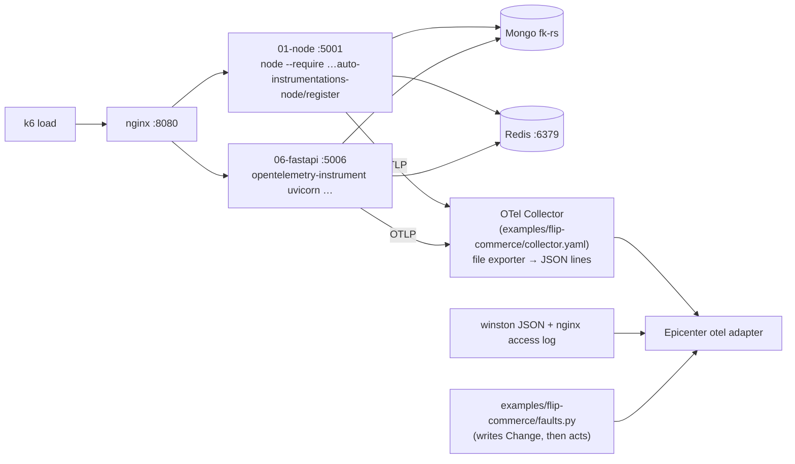

# Example Runs

Three environments Epicenter is demoed and tested on. Run **one at a time**: the OTel Demo and flip-commerce both use
host port 8080. Why these three: [ADR 0010](adr/0010-example-environments.md).

| | OTel Demo | flip-commerce | RCAEval replay |
|---|---|---|---|
| Source | `open-telemetry/opentelemetry-demo` (public) | your `D:\vertical_scaling\system-design-journey` (self-owned) | RCAEval RE2 (public) |
| What it shows | Multi-hop search across ~20 services | A real Mongo / Redis failure in your own system; config change as the cause | Same engine on a benchmark, with a number |
| Graph depth | 3–5 hops | ~2 hops | 3–6 hops |
| Faults | flagd feature flags | `docker stop`, CPU limit + k6, config change | recorded fault cases |
| RAM | ~6 GB | ~2 GB | none extra |
| `ENV_NAME` | `astronomy-shop` | `flip-commerce` | `rcaeval-tt` / `rcaeval-ob` |

---

## 1. OpenTelemetry Demo (primary, multi-hop)

```bash
git clone https://github.com/open-telemetry/opentelemetry-demo
cd opentelemetry-demo && docker compose up -d        # shop :8080, Jaeger :16686, Prometheus :9090 (check its .env)
```

Epicenter's `otel` adapter reads Jaeger (`/api/traces`), Prometheus (`query_range`), OpenSearch logs and flagd changes.

| Scenario | How to trigger | Expected verdict |
|---|---|---|
| `paymentFailure` | flagd UI or `POST /api/v1/runs {"env":"astronomy-shop","scenario":"paymentFailure"}` | `payment/Charge`, change = flag on |
| `adHighCpu` | same | `ad/*`, kind `cpu` |
| `emailMemoryLeak` | same | `email/*`, kind `mem` |

Check the flag names in the demo's flagd config file before the demo; they change between releases.

**Fault Simulator demo moment (`paymentFailure`):** fire the alert on `frontend` (the loudest symptom), so `frontend`
itself is hypothesis 0. Its predicted footprint covers only frontend and its own callers, and `checkout` and `payment`
show red as *unexplained*. Then click
`payment/Charge`: the whole chain lights up green, "explains 6 of 7 symptoms". This is symptom anchoring being avoided,
on screen.

---

## 2. flip-commerce (your system-design-journey)

**Source:** `D:\vertical_scaling\system-design-journey\season-1\2.vertical-vs-horizontal-scaling\`.
**Rule: that repo is never modified.** Everything Epicenter needs lives in `graph-hacks/examples/flip-commerce/`
(collector config, run scripts, fault scripts).

### 2.1 What's there

| Part | Detail |
|---|---|
| API | The same flip-commerce REST API (users, products, cart, wishlist) in 6 stacks: `servers/01-node`, `02-express`, `03-fastify`, `04-nestjs`, `05-go`, `06-fastapi` (ports 5001–5006) |
| Front | nginx (`servers/nginx/nginx.conf`, :8080), path prefix picks the backend, 10 s proxy cache |
| Data | MongoDB 8 replica set `fk-rs` (27017–27019, `servers/<x>/infra/mongo/compose.yaml`), Redis (:6379) for sessions |
| Resilience | Mongo circuit breaker (`shared/mongo-gate.ts`, `MONGO_CIRCUIT_MS`, `MONGO_CIRCUIT_FAILS`, `MONGO_SELECT_TIMEOUT_MS`) → `503` + `Retry-After`; 30 s request timeout |
| Load | k6 scenarios in `bench/v2/` (normal 100 VUs, stress 600, breakpoint 1k+) and an interactive CLI `bench/src/cli.js` |
| Logs | winston (`logs/combined.log`, `logs/error.log`; JSON with `NODE_ENV=production`), nginx access log with `$upstream_addr $upstream_response_time` |
| Telemetry | **No traces and no app `/metrics`.** Only k8s mode has kube-prometheus-stack (pod CPU / mem) |

### 2.2 How Epicenter gets telemetry without code changes



- **Traces:** start the servers with OpenTelemetry auto-instrumentation **from the command line** (env vars + `--require` /
  `opentelemetry-instrument`). The http, mongodb/mongoose and ioredis instrumentations give `flip-node → mongodb` and
  `flip-node → redis` call edges. The Go server (`05-go`) needs code changes, so it's left out.
- **Logs:** set `NODE_ENV=production` so winston writes JSON; point `FLIP_LOG_DIR` at each server's `logs/` and
  `FLIP_NGINX_LOG` at the nginx access log.
- **Changes:** `faults.py` writes the `Change` node **before** it acts, so the change is on record with an exact time.

### 2.3 Scenarios

| Scenario id | What `faults.py` does | What happens in flip-commerce | Expected verdict |
|---|---|---|---|
| `mongo-primary-down` | `docker stop` the current primary | Election; burst of `503` with `Retry-After` | `mongodb`, change `infra: docker stop mongo1` |
| `mongo-majority-lost` | stop 2 of 3 Mongo nodes | Circuit opens; `ECONNREFUSED` crash loop (the same pattern is already in `01-node/logs/combined.log`) | `mongodb`, kind `down` |
| `redis-down` | `docker stop` Redis | Auth / session failures on `/users`, `/cart` | `redis`, kind `down` |
| `cpu-saturation` | lower the container CPU limit, run k6 breakpoint | Latency climbs on every route | `flip-node/*`, kind `saturation` (self time, not Mongo) |
| `circuit-misconfig` | restart a server with `MONGO_CIRCUIT_FAILS=1` | Breaker trips on the first slow query → `503`s while Mongo is healthy | `flip-node/*`, change `config: MONGO_CIRCUIT_FAILS=1` |

`circuit-misconfig` is the best one for judges: Mongo looks guilty at first glance, and the skeptic plus Q3 show that
the cause is a config change on the API, with Mongo refuted.

### 2.3b Expected Fault Simulator footprints

| Scenario | Hypothesis | Predicted footprint | Observed | Result |
|---|---|---|---|---|
| `mongo-primary-down` | `mongodb` (down) | every `flip-node/*` route that reads Mongo → `errors` (p ≈ 0.95), nginx `/products` → `errors` (p ≈ 0.8) | same, plus a short election gap | coverage ≈ 1.0, **confirmed** |
| `circuit-misconfig` | `mongodb` (latency, if a slow query shows up) | Mongo operations slow, then API routes slow | Mongo only mildly slow; API routes return `503` **errors** almost at once | wrong symptom kind and timing → low coverage → **refuted**. If Mongo shows no anomaly at all, it isn't a hypothesis, and "why not mongodb?" answers `no_anomaly` |
| `circuit-misconfig` | `flip-node/*` + config change | API routes `errors`, nginx `errors`; no Mongo symptoms | matches | **confirmed** |

### 2.3c Healthy-baseline run (expects `no_root_cause`)

Run k6 at normal load (100 VUs) with no fault, and fire a test alert on `flip-node/GET /products` by hand
(`POST /api/v1/alerts`). Expected: weak, scattered anomalies at most, no hypothesis covers ≥ 50% → incident ends
`no_root_cause` with "Nothing in the graph explains this alert". This shows Epicenter doesn't invent causes.

### 2.4 Ports

flip-commerce uses 6379 (Redis), 8080 (nginx), 5001–5006, 27017–27019. Epicenter uses 6380 for FalkorDB on the host, so
both run together. Stop the OTel Demo first (it also wants 8080).

### 2.5 Limits (be honest in the demo)

- Shallow graph: nginx → API → Mongo / Redis. Good for "real failure, right answer, clear why"; not for multi-hop.
- No service-to-service calls, so blast radius is small. Use the OTel Demo for that part of the story.

---

## 3. RCAEval replay (offline, measured)

```bash
docker compose exec api python -m api.ingest.rcaeval --case re2tt_ts-auth-service_cpu_2 --env rcaeval-tt --download
docker compose exec api python -m api.eval --suite re2 --system tt
```

- Cases come from Hugging Face `phamquiluan/RCAEval` (Parquet layout, ~25 MB each); `--download` fetches one into
  `RCAEVAL_DIR` (`./data/rcaeval`, git-ignored). Names are `re2tt_<service>_<fault>_<n>`; faults are cpu, mem, disk,
  delay, loss, socket.
- RCAEval has no alert, so the symptom is the root operation (a span with no `parentSpanID`; orphans whose parent is
  missing from the data don't count) with the strongest
  latency/errors/down anomaly, else the busiest root operation. The incident id is `rc-<case>`.
- Replaying a case again replaces that incident's anomalies, so a replay is idempotent. One case takes ~15 s.
- Uses the same writers and the same causal search; only the adapter differs.
- `inject_time.txt` is used as the alert time only, never as a `Change`, so the answer can't leak into the graph.
- Report AC@1 / AC@3 and the ablations whatever they are, including losses.
