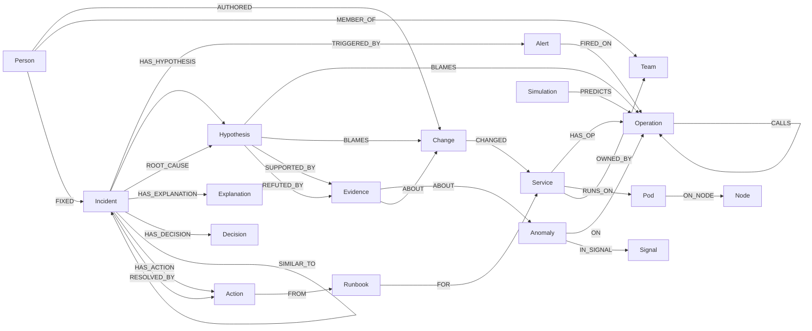

# Epicenter Graph Schema

FalkorDB property graph. Queries that use it: [LLD §2](LLD.md#2-graphpy). Why it's shaped this way:
[ADR 0001](adr/0001-falkordb-primary-store.md), [0006](adr/0006-operation-level-aggregation.md), [0007](adr/0007-graph-as-shared-agent-state.md).

---

## 1. Graphs

| Graph key | Holds | Lifetime |
|---|---|---|
| `env:<name>` (e.g. `env:astronomy-shop`, `env:flip-commerce`, `env:rcaeval-tt`) | Topology, changes, owners, runbooks, incidents and their investigations | Permanent |
| `scratch:<incident_id>` | Projection for PageRank (`Operation`, `BLAME`) | Deleted right after scoring |
| `kb:propagation` | Fault Simulator rules (`Rule`), environment-agnostic, shared by every `env:*` graph ([ADR 0011](adr/0011-fault-simulator.md)) | Permanent, versioned |
| `env:test` | Test fixture | Recreated per test run |

Nothing queries across `env:*` graphs. That's the tenant boundary. `kb:propagation` holds no customer data, so every
environment may read it.

---

## 2. Overview



In `kb:propagation` (separate graph): standalone `Rule` nodes, no edges.

---

## 3. Node labels

Types: `str`, `int`, `float`, `bool`, `ts` (epoch seconds, `int`), `list<…>`, `vecf32`. **Key** = the property used in `MERGE`.

### Topology

**`Service`**: key `name`
| Property | Type | Req | Notes | Writer |
|---|---|---|---|---|
| `name` | str | ✓ | `payment`, `flip-node`, `mongodb` | ingest |
| `kind` | str | ✓ | `app` · `datastore` · `proxy` · `external` | ingest |
| `last_seen` | ts | ✓ | | ingest |

**`Operation`**: key `id` = `<service>/<operation>`
| Property | Type | Req | Notes |
|---|---|---|---|
| `id` | str | ✓ | `checkout/PlaceOrder`, `flip-node/GET /products`, `mongodb/find products` |
| `name` | str | ✓ | operation part only |
| `last_seen` | ts | ✓ | |

**`Pod`** (key `id`), **`Node`** (key `name`): k8s placement when available (OTel Demo on k8s); omitted on Docker-only runs.

### Signals

**`Anomaly`**: key `id` (`an-<incident>-<n>`; a retired ingest's copy is `an-<incident>-<n>@i<k>`)
| Property | Type | Req | Notes |
|---|---|---|---|
| `incident` | str | ✓ | incident id (indexed). A re-replay **retires** the previous ingest's anomalies by re-keying them `<incident>@i<k>` instead of deleting them, so readers (which match `incident: $inc`) see only the current ingest while older diagnosis runs keep their `ABOUT` edges |
| `kind` | str | ✓ | `latency` · `errors` · `cpu` · `mem` · `saturation` · `log_burst` · `new_template` · `down` |
| `onset` | ts | ✓ | first change point |
| `score` | float | ✓ | normalized 0..1 |
| `self_ratio`, `child_ratio` | float | | latency anomalies only |
| `detector` | str | ✓ | `short` (10-min baseline) · `slow_burn` (6-h trend, [LLD §3.2](LLD.md#32-detectors-detectpy)) |
| `ref` | str | | source pointer (PromQL, trace id, log file:lines) |

**`Signal`**: key `id`
| Property | Type | Req | Notes |
|---|---|---|---|
| `type` | str | ✓ | `metric` · `log_template` |
| `text` | str | ✓ | metric name or Drain3 template (full-text indexed) |

### Changes

**`Change`**: key `id`
| Property | Type | Req | Notes |
|---|---|---|---|
| `type` | str | ✓ | `deploy` · `flag` · `config` · `infra` (e.g. `docker stop`, scale) · `manual` |
| `ts` | ts | ✓ | when it happened (indexed) |
| `summary` | str | ✓ | `flag paymentFailure → on`, `docker stop mongo1` |
| `ref` | str | | flagd event id, commit sha, journal line |

### Investigation

**`Alert`**: key `id` (source alert id) · `starts_at` ts · `labels` str (JSON) · `count` int
**`Incident`**: key `id`
| Property | Type | Req | Notes |
|---|---|---|---|
| `status` | str | ✓ | `open` · `diagnosing` · `diagnosed` · `no_root_cause` · `delivered` · `resolved` |
| `symptom` | str | ✓ | operation id |
| `opened_at` | ts | ✓ | |
| `run` | int | after diagnosis | current diagnosis run (1, 2, …); every run is kept |
| `ingest` | int | after ingest | current anomaly ingest (1, 2, …); bumped by every replay, older ingests are retired as `<id>@i<k>` |
| `signature` | vecf32[64] | after diagnosis | [ADR 0008](adr/0008-deterministic-incident-signature.md) (vector-indexed) |
| `confidence` | float | after diagnosis | |
| `weights_version` | str | ✓ | from `weights.json` |
| `gaps` | list<str> | | sources that were unavailable |
| `summary` | str | | set for `no_root_cause`: what was checked and why nothing explains the alert |
| `resolved_at` | ts | when resolved | `POST /resolve` |
| `delivery` | str (JSON) | after `POST /deliver` | per target: `{ok, url, error, message, ts, run}` |

**`Hypothesis`**: key `id` (`<incident>:r<run>:h-<n>`, e.g. `inc-1:r2:h-3`; the API shows `h-3`)
| Property | Type | Req | Notes |
|---|---|---|---|
| `status` | str | ✓ | `open` · `supported` · `refuted` · `inconclusive` · `confirmed` · `pruned` |
| `run` | int | ✓ | diagnosis run that wrote it; the current one is `Incident.run`, older runs are history |
| `ingest` | int | ✓ | the anomaly ingest this run read (`Incident.ingest` at the time) |
| `hops` | int | ✓ | distance from the symptom (0 = symptom itself) |
| `onset` | ts | | earliest anomaly onset on the target |
| `score` | float | after scoring | |
| `score_parts` | str (JSON) | after scoring | feature values, `pagerank_impl` |
| `round` | int | ✓ | 1 = ranked against the symptom; 2 = second-cause round seeded from the winner's unexplained symptoms |
| `kinds`, `strength` | list<str>, float | ✓ | the target's anomaly kinds and max score (from Q1) |
| `seed` | str | ✓ | operation the round searched from (the symptom, or the round-2 seed) |
| `scope` | list<str> | round 2 | the unexplained ops a round-2 hypothesis is matched against |
| `facts` | str (JSON) | after investigation | victim, self_caused, change, footprint, coverage, unexplained; read by the scorer |

**`Evidence`**: key `id` (`<incident>:r<run>:E<n>.<k>`, the k-th evidence of hypothesis n, e.g. `inc-1:r2:E3.1`;
the API shows `E3.1`; the skeptic's is `E<n>.s`). Incidents share the env graph, so per-incident ids are scoped (`models.scoped_id` / `local_id`)
| Property | Type | Req | Notes |
|---|---|---|---|
| `kind` | str | ✓ | `propagation` · `mechanism` · `change` · `victim` · `pagerank` · `footprint` · `log` · `history` |
| `summary` | str | ✓ | one sentence, generated from a template (not LLM) |
| `path` | list<str> | | node ids of the supporting path |
| `value` | str (JSON) | | numbers behind it (onsets, ratios; for `footprint`: coverage, precision, order, matched, missed, unexplained) |
| `ref` | str | | source pointer |

**`Explanation`**: key `id` (`<incident>:r<run>:X`, one per run) · `run` int · `claims` str (JSON: `[{section, text, cites,
support_p, status}]`, status `verified` · `unverified` · `template`) · `dropped` int · `verified` bool · `source`
(`llm` · `template`) · `ai_calls` str (JSON: agent, model, tokens, cost, ms)
**`Decision`**: key `id` (`<incident>:d-<n>`; the API shows `d-<n>`) · `by` str · `text` str · `ts` ts. Human notes
during an incident (`POST /notes`); a note's optional change is a `Change {id: 'chg-manual-<incident>-<n>'}`.
**`Simulation`**: key `id` · `target` str (operation or service) · `kind` str · `ts` ts · `rules_version` str. A saved
what-if run ([LLD §7.7](LLD.md#77-what-if-mode-no-incident)).

**`Action`**: key `id` (`<incident>:r<run>:a-<n>`; the API shows `a-<n>`) · `run` int · `name` str · `status`
(`proposed` · `done`) · `rank` int · `chosen_by` (`history` · `runbook` · `demoted`) · `p` float (Jev relevance to the
cause)

### Knowledge base (`kb:propagation` graph only)

**`Rule`**: key `id`
| Property | Type | Req | Notes |
|---|---|---|---|
| `cause_kinds` | list<str> | ✓ | anomaly kinds on the candidate, e.g. `["errors","down"]` |
| `symptom_kind` | str | ✓ | kind predicted on the dependent (or on itself) |
| `direction` | str | ✓ | `upstream` (callers) · `self` |
| `p` | float | ✓ | per-hop probability before traffic share |
| `delay_s_max` | int | ✓ | max delay per hop |
| `service_kind` | str | | restricts the rule, e.g. `datastore` |
| `version` | str | ✓ | rules version, recorded on every footprint |

### People and knowledge

**`Team`** (key `name`), **`Person`** (key `handle`, `name`): from `seed/owners.yaml` and git authors.
**`Runbook`**: key `id` · `kind` (anomaly kind it applies to) · `steps` list<str> · `success` str (JSON: step → count)

Seed files are keyed by environment name, so seeding one env never creates another env's services:
[`seed/owners.yaml`](../seed/owners.yaml) `<env>: {teams: [{name, services: [...], members: [{handle, name}]}]}` and
[`seed/runbooks.yaml`](../seed/runbooks.yaml) `<env>: {runbooks: [{id, kind, services: [...], steps: [...]}]}`.
Rule ids in `kb:propagation` come from the rule's content (`errors+down->errors:upstream`, `down->errors:upstream@datastore`).

---

## 4. Relationships

| Type | From → To | Properties | Notes |
|---|---|---|---|
| `HAS_OP` | Service → Operation | | |
| `CALLS` | Operation → Operation | `rps` float, `p95_ms` float, `err_rate` float, `last_seen` ts | rolling 30 s aggregate ([ADR 0006](adr/0006-operation-level-aggregation.md)) |
| `RUNS_ON` | Service → Pod | | |
| `ON_NODE` | Pod → Node | | |
| `CHANGED` | Change → Service | `ts` | |
| `AUTHORED` | Person → Change | | |
| `ON` | Anomaly → Operation | | |
| `IN_SIGNAL` | Anomaly → Signal | | |
| `TRIGGERED_BY` | Incident → Alert | | |
| `FIRED_ON` | Alert → Operation | | |
| `HAS_HYPOTHESIS` | Incident → Hypothesis | | |
| `BLAMES` | Hypothesis → Operation \| Change | | |
| `SUPPORTED_BY` / `REFUTED_BY` | Hypothesis → Evidence | `by` (agent name) | |
| `ABOUT` | Evidence → Anomaly \| Change | | |
| `ROOT_CAUSE` | Incident → Hypothesis | `rank` int, `run` int, `ingest` int, `confidence` float, `weights_version` str, `ts` | `rank: 1` after diagnosis; `rank: 2` if the Fault Simulator finds a second, independent fault; none when `no_root_cause` |
| `PREDICTS` | Simulation → Operation | `p` float, `hops` int, `kind` str | what-if prediction |
| `HAS_EXPLANATION` | Incident → Explanation | | |
| `HAS_DECISION` | Incident → Decision | | |
| `SIMILAR_TO` | Incident → Incident | `score` float, `run` int | written by the historian, per diagnosis run |
| `HAS_ACTION` | Incident → Action | | proposed by the responder |
| `RESOLVED_BY` | Incident → Action | | |
| `FROM` | Action → Runbook | `step` int | |
| `FOR` | Runbook → Service | | |
| `OWNED_BY` | Service → Team | | |
| `MEMBER_OF` | Person → Team | | |
| `FIXED` | Person → Incident | | |
| `BLAME` | Operation → Operation | `w` float | **only in `scratch:*`** |

---

## 5. Indexes

```cypher
CREATE INDEX FOR (s:Service) ON (s.name)
CREATE INDEX FOR (o:Operation) ON (o.id)
CREATE INDEX FOR (a:Anomaly) ON (a.incident)
CREATE INDEX FOR (c:Change) ON (c.ts)
CREATE INDEX FOR (c:Change) ON (c.id)
CREATE INDEX FOR (e:Evidence) ON (e.id)
CREATE INDEX FOR (i:Incident) ON (i.id)
CREATE INDEX FOR (i:Incident) ON (i.symptom)   // alert join window
CREATE INDEX FOR (a:Alert) ON (a.id)
CREATE INDEX FOR (h:Hypothesis) ON (h.id)
CREATE INDEX FOR (p:Person) ON (p.handle)
CREATE INDEX FOR (s:Simulation) ON (s.id)
// on kb:propagation
CREATE INDEX FOR (r:Rule) ON (r.id)
CREATE INDEX FOR (s:Signal) ON (s.id)
CALL db.idx.fulltext.createNodeIndex('Signal', 'text')
CREATE VECTOR INDEX FOR (i:Incident) ON (i.signature) OPTIONS {dimension: 64, similarityFunction: 'cosine'}
```

Seeded on API startup; "index already exists" errors are ignored. Check the exact syntax on the pinned FalkorDB version
with the smoke test ([README §5](../README.md#5-smoke-test)).

---

## 6. Example queries

```cypher
// Everything that calls into payment, within 3 hops, with owners
MATCH (:Service {name:'payment'})-[:HAS_OP]->(o)
MATCH p = (c:Operation)-[:CALLS*1..3]->(o)
MATCH (cs:Service)-[:HAS_OP]->(c)
OPTIONAL MATCH (cs)-[:OWNED_BY]->(t:Team)
RETURN DISTINCT cs.name, t.name, min(length(p)) AS hops ORDER BY hops

// The investigation of one incident, as the canvas draws it
MATCH (i:Incident {id:$inc})-[:HAS_HYPOTHESIS]->(h)-[r:SUPPORTED_BY|REFUTED_BY]->(e)
OPTIONAL MATCH (h)-[:BLAMES]->(t)
RETURN h.id, h.status, t, type(r), e.kind, e.summary

// Who fixed incidents on this service before
MATCH (p:Person)-[:FIXED]->(i:Incident)-[:ROOT_CAUSE]->(:Hypothesis)-[:BLAMES]->(o:Operation)<-[:HAS_OP]-(:Service {name:$svc})
RETURN p.name, count(i) AS fixes ORDER BY fixes DESC

// Log templates mentioning a word (full-text)
CALL db.idx.fulltext.queryNodes('Signal', 'ECONNREFUSED') YIELD node RETURN node.text
```

---

## 7. Retention

| Data | Rule |
|---|---|
| Topology | never deleted; `last_seen` shows staleness; UI hides operations unseen for 24 h |
| Anomalies, signals, investigation nodes | kept with the incident (they are the memory). Replays never delete anomalies: the previous ingest is retired as `<incident>@i<k>` and stays linked from the diagnosis runs that cited it |
| Scratch graphs | deleted after scoring (`finally` block) |
| `Simulation` nodes | kept, so predictions can be compared with later incidents |
| `kb:propagation` | replaced as a whole when the rules version changes (old version kept in git as YAML) |
| Manual purge | `DELETE /incidents/{id}` is **not** exposed; use `GRAPH.DELETE env:<name>` to reset an environment |
