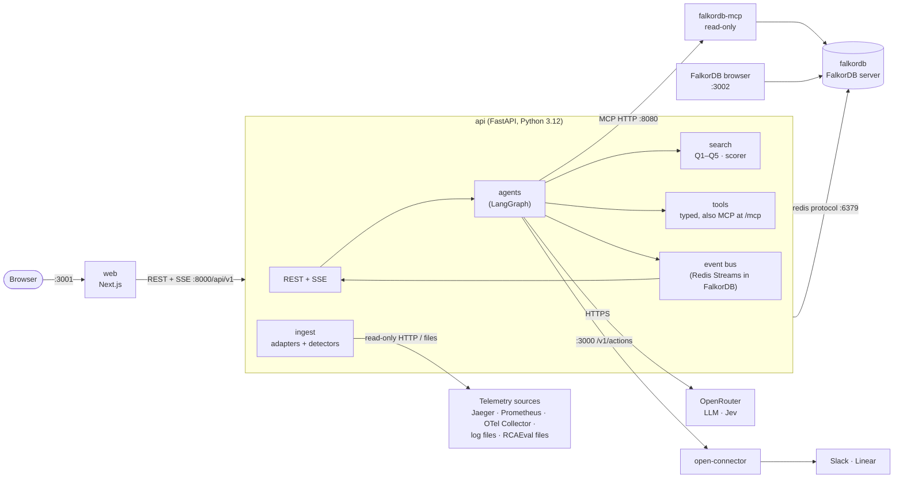
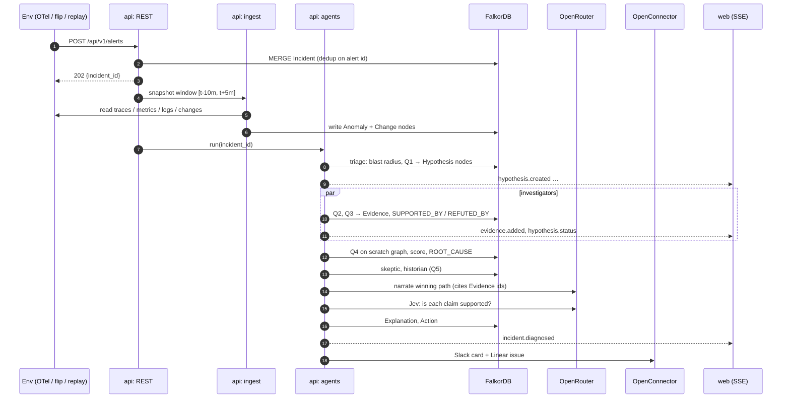
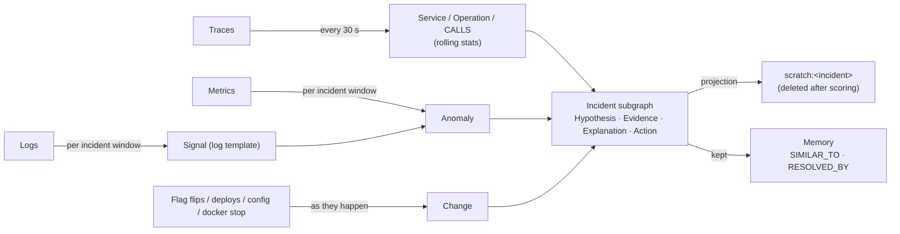
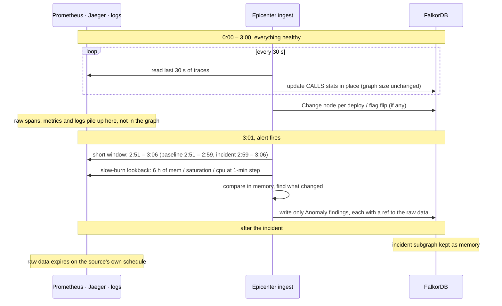

# Epicenter: High-Level Design

Scope: the containers, how they talk, how data moves and ages, how the system fails, scales and stays safe.
Module-level detail is in [LLD.md](LLD.md). Requirements (F1–F10, N1–N7) are in [ARCHITECTURE.md §1](ARCHITECTURE.md#1-requirements).

---

## 1. Architecture style

**Modular monolith** ([ADR 0005](adr/0005-modular-monolith.md)). A team of 1–3 people building for a hackathon gets
nothing from microservices. The API process holds four modules with clear boundaries: `ingest`, `search`, `agents`,
`tools`. They talk through function calls, and **through the graph**. FalkorDB is the only stateful component.

Exceptions, each with a reason:
- `falkordb-mcp` is the official image, so it runs as its own container.
- `web` is a separate Next.js app.
- `open-connector` is a third-party service.

---

## 2. Containers



| Container | Image | Responsibility | State |
|---|---|---|---|
| `falkordb` | `falkordb/falkordb:<pinned>` | Graph storage and queries; browser UI | **All persistent state** (named volume) |
| `falkordb-mcp` | `falkordb/mcpserver:<pinned>` | Read-only Cypher + schema tools for the ask box | none |
| `api` | built from `./api` | Ingest, causal search, agents, typed tools (REST + MCP), SSE | none (events live in FalkorDB's Redis Streams; LangGraph checkpoints in `./data`) |
| `web` | built from `./web` | UI | none |
| `open-connector` | OpenConnector self-host image | Slack / Linear delivery with OAuth | its own config |

---

## 3. Runtime views

### 3.1 Alert → diagnosis (the main flow)



Inside the investigator step, each hypothesis also runs the **Fault Simulator** (Q6 + rules from `kb:propagation`,
[LLD §7](LLD.md#7-fault-simulator)). Its `footprint` events drive the predicted-vs-observed overlay on the canvas. After
the skeptic, unexplained symptoms can trigger one search for a second root cause, or the incident ends `no_root_cause`.

### 3.1b What-if (no incident)

`POST /api/v1/simulate {service | operation, kind}` → `search/simulate.py` reads the current topology and the rules,
returns the predicted footprint with probabilities, order and owners, and optionally saves a `Simulation` node. It's
read-only towards everything except that node. Typical use: before restarting Redis or shipping a risky change
([USER_FLOW Flow 8](USER_FLOW.md#flow-8-what-if-before-a-change)).

### 3.2 Ask box

`POST /api/v1/ask` → ask agent (OpenRouter LLM) with two tool sets: the typed tools (preferred) and
`falkordb-mcp` (`get_graph_schema`, `query_graph_readonly`) as a fallback. The answer comes back with the node/edge ids it
used, so the UI highlights the path.

### 3.3 Memory recall

The historian computes the incident's 64-dim signature ([ADR 0008](adr/0008-deterministic-incident-signature.md)) and runs Q5
(vector index + graph overlap). It writes `SIMILAR_TO` edges. When an incident is resolved, `RESOLVED_BY` edges and the
runbook step's success count update **procedural memory**.

---

## 4. Data flow and lifecycle



| Data | Created | Updated | Deleted |
|---|---|---|---|
| Topology (`Service`, `Operation`, `CALLS`, `Pod`) | first seen in traces | rolling stats every 30 s | never (marked `last_seen`) |
| `Change` | when the change happens | never | never |
| `Anomaly`, `Signal` | when an incident window opens | never | with the incident (manual purge only) |
| `Incident` subgraph | on alert | during diagnosis and resolution | kept as memory |
| `scratch:<incident>` graph | scoring step | — | right after scoring |
| `kb:propagation` graph (`Rule`) | API startup seed from `seed/propagation_rules.yaml` | replaced on a new rules version | never |
| `Simulation` (what-if) | `POST /simulate` with `save: true` | never | never (compared with later incidents) |

Raw telemetry (spans, metric points, log lines) is **never** stored in FalkorDB ([ADR 0006](adr/0006-operation-level-aggregation.md)).
Evidence nodes keep a `ref` back to the source (trace id, PromQL, log file + line range).

### 4.1 What's stored where

The monitored system's own tools keep the raw data. FalkorDB keeps the **map**, the **changes** and the **findings**.

| Data | Lives in | Stored in FalkorDB? | How it grows |
|---|---|---|---|
| Request traces (spans) | Jaeger / OTel Collector | No: aggregated into `CALLS` stats only | With traffic; expires by the source's retention |
| Metrics (CPU, latency, errors …) | Prometheus | No: read only for an incident window | With time; Prometheus keeps 15 days by default |
| Log lines | OpenSearch / log files | No: only templates of unusual logs, as `Signal` | With traffic; source retention |
| Service / operation map (`Service`, `Operation`, `CALLS`) | **FalkorDB** | Yes, **updated in place** every 30 s | Fixed size: a few hundred nodes whether it's run 3 minutes or 3 months |
| Changes (deploys, flags, config, `docker stop`) | **FalkorDB** | Yes, one small node each | Slowly, one per change |
| Incident findings (`Anomaly`, `Hypothesis`, `Evidence`, …) | **FalkorDB** | Yes, kept as memory | ~100–300 nodes per incident |

**Example: 3 healthy hours, then a break**



Nothing is lost by not copying raw data: every `Evidence` / `Anomaly` keeps a `ref` (trace id, PromQL query, log file +
lines), so the UI can open the original. The slow-burn lookback catches problems that built up over hours, such as a
memory leak that started at hour 1 ([LLD §3.2](LLD.md#32-detectors-detectpy)).

---

## 5. Deployment

### 5.1 Ports

| Host port | Container | Note |
|---|---|---|
| **6380** | `falkordb:6379` | 6379 is left free for flip-commerce's own Redis ([ADR 0009](adr/0009-falkordb-via-docker.md)) |
| **3002** | `falkordb:3000` (browser) | 3000 belongs to OpenConnector |
| **8081** | `falkordb-mcp:8080` | 8080 belongs to the example environments |
| 8000 | `api` | REST at `/api/v1`, MCP at `/mcp` |
| 3001 | `web` | |
| 3000 | `open-connector` | |
| 8080, 16686, 9090 | OTel Demo (separate compose) | run one example environment at a time |
| 8080, 6379, 27017–27019 | flip-commerce (its own compose) | run one example environment at a time |

### 5.2 `docker-compose.yml`

```yaml
services:
  falkordb:
    image: falkordb/falkordb:${FALKORDB_TAG}
    ports: ["6380:6379", "3002:3000"]
    environment:
      REDIS_ARGS: "--requirepass ${FALKORDB_PASSWORD} --appendonly yes"
      FALKORDB_ARGS: "THREAD_COUNT 4 TIMEOUT_MAX 30000"
    volumes:
      - falkordb_data:/var/lib/falkordb/data   # verified on v4.22.1: /data/data is a symlink to this path
    healthcheck:
      test: ["CMD", "redis-cli", "-a", "${FALKORDB_PASSWORD}", "PING"]
      interval: 5s
      retries: 10
    restart: unless-stopped

  falkordb-mcp:
    image: falkordb/mcpserver:${FALKORDB_MCP_TAG}
    ports: ["8081:8080"]
    environment:
      FALKORDB_HOST: falkordb
      FALKORDB_PORT: 6379
      FALKORDB_PASSWORD: ${FALKORDB_PASSWORD}
      FALKORDB_DEFAULT_READONLY: "true"
      MCP_TRANSPORT: http
      MCP_PORT: 8080
      MCP_API_KEY: ${MCP_API_KEY}
    depends_on: { falkordb: { condition: service_healthy } }

  api:
    build: { context: ., dockerfile: api/Dockerfile }   # repo root, so api/ is a package under /app
    ports: ["8000:8000"]
    env_file: .env
    environment:
      FALKORDB_URL: redis://:${FALKORDB_PASSWORD}@falkordb:6379
      FALKORDB_MCP_URL: http://falkordb-mcp:8080/mcp
      OPENCONNECTOR_URL: http://open-connector:3000
    extra_hosts: ["host.docker.internal:host-gateway"]   # reach example environments on the host
    depends_on: { falkordb: { condition: service_healthy } }

  web:
    build: ./web
    ports: ["3001:3000"]
    environment:
      NEXT_PUBLIC_API_URL: http://localhost:8000/api/v1
    depends_on: [api]

  open-connector:
    image: ${OPENCONNECTOR_IMAGE}            # ghcr.io/oomol-lab/open-connector:<release>
    ports: ["3000:3000"]
    env_file: .env.openconnector             # OOMOL_CONNECT_ORIGIN / _ENCRYPTION_KEY / _ADMIN_TOKEN
    volumes:
      - open_connector_data:/app/data

volumes:
  falkordb_data:
  open_connector_data:
```

The real [docker-compose.yml](../docker-compose.yml) adds health checks for `api` and `open-connector` and `restart: unless-stopped`.

**Startup order:** `falkordb` (healthy) → `falkordb-mcp`, `api` → `web`. `api` runs the seed step (indexes, runbooks,
owners) on startup; every statement in it is idempotent (`MERGE`, `CREATE INDEX` guarded).

---

## 6. Non-functional requirements: how each is met

| NFR | Design response |
|---|---|
| N1 < 60 s diagnosis | Window snapshot instead of continuous anomaly detection; investigators in parallel; LLM calls only after the verdict |
| N2 < 200 ms queries | Hop limit 6; operation-level graph ([ADR 0006](adr/0006-operation-level-aggregation.md)); indexes on every lookup key; `Anomaly` filtered by `incident` index first |
| N3 determinism | Deterministic detectors, fixed weights, tie-break on id, sorted iteration; LLM output never read by the scorer |
| N4 production safety | Adapters use read-only APIs; responder actions are posted as proposals |
| N5 laptop footprint | FalkorDB < 1 GB; one API process; OTel Demo is the only heavy part and is optional |
| N6 explainability | `Explanation.cites` must reference `Evidence` ids; Jev gate drops claims under 0.7 |
| N7 LLM-free verdict | Verdict = scorer output; narrator has a template fallback |
| N1 (Fault Simulator cost) | One Q6 per hypothesis (≤ 50 × ~10 ms) + in-process matching; well inside the 60 s budget |

---

## 7. Failure modes

| Failure | Detected by | Behaviour | User sees |
|---|---|---|---|
| FalkorDB down | health check, connection error | API returns `503 GRAPH_UNAVAILABLE`; ingest skips the tick and retries | Red banner "graph offline" |
| Telemetry source down | adapter timeout (5 s) | Incident continues with the signals it has; `Incident.gaps` lists missing sources | "Traces unavailable for this window" |
| OpenRouter down / timeout | HTTP error, 20 s timeout | Template explanation from `score_parts`; verdict unchanged | "AI explanation unavailable" badge |
| Jev down | HTTP error | Keep cited claims, mark them `unverified` | "Claims not verified" badge |
| OpenConnector down | HTTP error | `Action.delivery = failed`; retry button | Retry button on the card |
| Agent crash mid-incident | LangGraph exception | Incident stays `diagnosing`; `POST /incidents/{id}/diagnose` resumes. The graph already holds what finished | Resume button |
| Duplicate alerts (storm) | `MERGE` on alert id + 10-min window per symptom | Joins the open incident | One incident, alert count goes up |
| Query too slow | FalkorDB `TIMEOUT_MAX` 30 s; app-side 5 s per query | Hypothesis marked `inconclusive` | Grey branch on the canvas |

---

## 8. Bottlenecks and how they're handled

| Bottleneck | Why | Handling |
|---|---|---|
| Variable-length paths `[:CALLS*1..6]` | Path count grows fast with fan-out | Hop limit, start from the indexed symptom, filter by `Anomaly.incident` early, aggregate to operations |
| Writes to one graph | FalkorDB serializes writes per graph | Writes are small (one hypothesis' evidence at a time); reads run in parallel on `THREAD_COUNT` threads |
| PageRank on the whole env graph | Unnecessary work, and blame should only flow among anomalous ops | Copy only anomalous ops + the calls among them into `scratch:<incident>` (tens of nodes) |
| SSE fan-out | Many browser tabs | In-process broadcaster; one event per graph write; 1 demo audience, so no broker needed |
| LLM latency | 2–10 s per call | Only after the verdict; claims verified in parallel |

---

## 9. Security

| Concern | Control |
|---|---|
| DB access | `requirepass`; FalkorDB not exposed beyond localhost in the demo; password from `.env` |
| Cypher injection | All queries parameterized (`$param`); agents can't send Cypher to the write path |
| Agent overreach | LLM agents call typed tools only; free-form Cypher goes through `falkordb-mcp` with `FALKORDB_DEFAULT_READONLY=true` + `MCP_API_KEY` |
| Prompt injection via telemetry (log lines are untrusted text) | Log text reaches the LLM only inside evidence fields marked as data; tools are read-only; the verdict doesn't depend on the LLM |
| Secrets | Never written to the graph; `.env` git-ignored; OpenConnector holds OAuth tokens |
| Web | CORS restricted to the web origin; no auth for the local demo, API key header if deployed ([docs/API.md](API.md)) |
| Tenancy | One graph per environment; tool calls are bound to the incident's environment |

---

## 10. Observability of Epicenter itself

- Structured JSON logs per agent step: `incident_id`, `agent`, `tool`, `query_id`, `duration_ms`, `rows`.
- Query timings for Q1–Q5 are exported on `GET /api/v1/health` (last p50 / p95) so N2 is visible during the demo.
- Every LLM call records model id, token counts and latency on the `Explanation` node (`ai_calls` property).

---

## 11. Technology choices

| Concern | Choice | Why |
|---|---|---|
| Graph DB | FalkorDB | Native graph + vector + full-text, multi-graph, built-in algorithms, MCP server ([ADR 0001](adr/0001-falkordb-primary-store.md)) |
| API | FastAPI | Async, SSE, typed models; matches the team's stack |
| Agents | LangGraph | Fixed graph of steps with parallel fan-out; checkpoints for resume |
| LLM access | OpenRouter (LLM + Jev) | One key, pinned model ids |
| Delivery | OpenConnector | Slack / Linear OAuth handled for us |
| Anomaly detection | numpy + `ruptures` (PELT) + Drain3 | Deterministic, light |
| Fault Simulator | Rule propagation over `CALLS` (rules in `kb:propagation`) | Deterministic, graph-native, simpler first step towards a Causely-style causal codebook ([ADR 0011](adr/0011-fault-simulator.md)) |
| UI | Next.js + Tailwind + shadcn + React Flow | Team's stack; React Flow handles a few hundred nodes |
