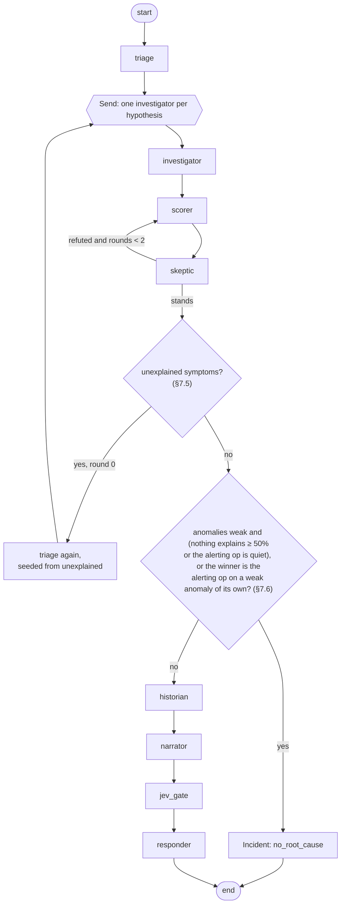
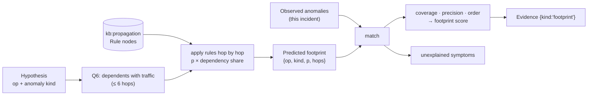
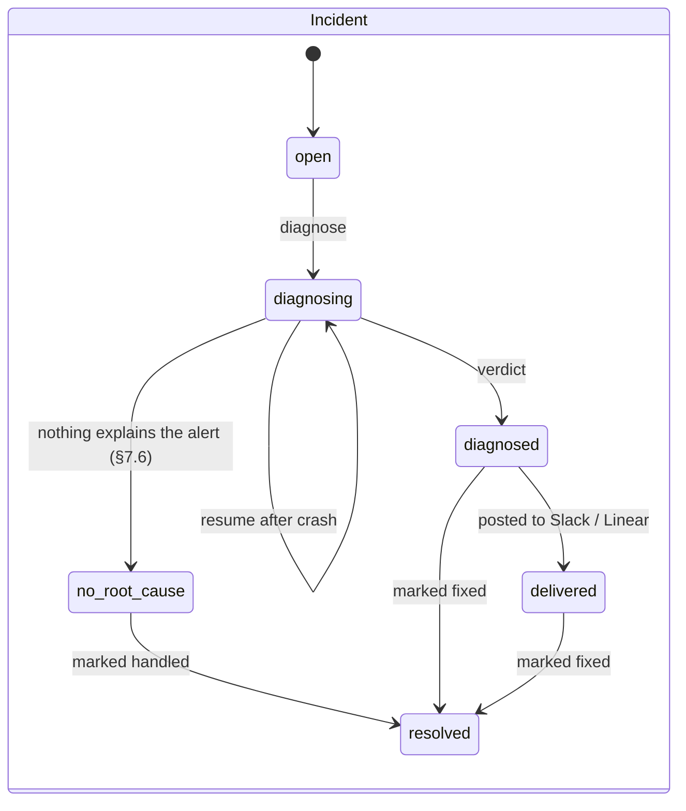
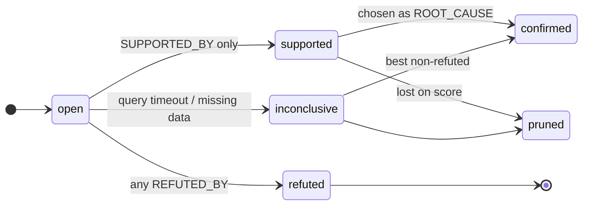

# Epicenter: Low-Level Design

How each part is built. Containers and runtime views are in [HLD.md](HLD.md); the full label/edge reference is in
[docs/GRAPH_SCHEMA.md](GRAPH_SCHEMA.md); endpoints are in [docs/API.md](API.md).

---

## 1. Package layout

```
graph-hacks/
  docker-compose.yml  .env.example  weights.json
  api/
    main.py               # FastAPI app: REST router, SSE, MCP mount at /mcp, startup seed
    config.py             # Settings (pydantic-settings) from env
    graph.py              # FalkorDB client wrapper + query catalogue (Q1–Q5, upserts)
    models.py             # Pydantic models shared by REST, tools and agents
    events.py             # incident event bus for SSE (Redis Streams in FalkorDB's Redis, §9)
    routes/               # REST endpoints by resource: alerts, incidents (+ SSE), graph_views, health, runs; deps
    runs.py               # example-run scenario registry + host fault runner client (phase 9, ADR 0012)
    ingest/
      base.py             # Adapter protocol
      window.py           # one ingest window for any adapter: baseline + window → detectors → graph (§3.1)
      spans.py            # OTLP / Jaeger spans → operation-level CALLS + series (pure)
      otel.py             # `otel` adapter: flip mode (collector file, winston, nginx) and demo mode (Jaeger,
                          # Prometheus, OpenSearch)
      live.py             # live envs: adapter per env (LIVE_ENVS), alert-time ingest, topology tick
      logs.py             # Drain3 over log lines (OpenSearch, winston JSON, nginx access)
      changes.py          # the fault journal (examples/*/faults.py) → ChangeEvent
      rcaeval.py          # RCAEval file adapter
      detect.py           # robust z, PELT onset, self/child time, slow burn → AnomalyRow (pure)
      write.py            # the only ingest → graph writer (U1–U5, batched)
      seed.py             # indexes, owners.yaml, runbooks.yaml
    search/
      causal.py           # hypotheses from Q1, checks Q2/Q3, projection + Q4
      score.py            # deterministic scoring + confidence
      signature.py        # 64-dim incident signature
      simulate.py         # Fault Simulator: Q6 + rules → predicted footprint, match vs observed (§7)
    agents/
      flow.py             # LangGraph wiring
      triage.py  investigator.py  skeptic.py  historian.py  narrator.py  responder.py  ask.py
      prompts/            # narrator.md, ask.md: fixed system prompts (data framing, citation rules)
    tools/
      graph_tools.py      # typed tools (Python functions)
      mcp_server.py       # same tools exposed over MCP
      falkordb_mcp.py     # client for falkordb-mcp: allowlisted read tools only, graph pinned to the env
    ai/
      openrouter.py       # chat completions client (GPT-4o snapshot, temperature 0)
      jev.py              # Jev Noul client (OpenRouter decisions API)
      calibrate.py        # (agents/) Jev cutoff calibration from labelled claims, CLI
    deliver/
      openconnector.py    # POST /v1/actions/{id} with an Idempotency-Key
    eval.py               # RCAEval replay + metrics
    smoke_falkordb.py     # FalkorDB feature check on the pinned tag (README §5)
                          # graph.py also records per-run query receipts (`recording()`, phase 12)
    selftest.py           # phase 11: fixtures → scratch graphs → diagnose → verdict table (§13)
  web/                    # Next.js 15 app (React 19, Tailwind 4, shadcn, React Flow 12)
    app/                  # / incidents · incident/[id] canvas · blast-radius · simulate · ask · runs · eval
    components/           # graph/incident-canvas.tsx · incident/{verdict,act,side}.tsx · shell/top-bar.tsx · ui/
    lib/
      api-types.ts        # generated from /openapi.json (npm run gen:api), committed
      api.ts              # openapi-fetch client; error envelope → ApiError(code, request_id)
      incident-state.ts   # pure reducer: /graph snapshot + SSE events, applied by id (idempotent)
      layout.ts           # elk layered layout, incremental: placed nodes keep their position
      useIncidentStream.ts  # EventSource, reconnects with ?after=<last seq> + backoff
      *.test.ts           # node:test (npm test)
  seed/  owners.yaml  runbooks.yaml  propagation_rules.yaml
  examples/
    flip-commerce/        # collector config + run scripts for the user's system-design-journey
    otel-demo/            # notes + fault script
    fault_runner.py       # host-side, token-gated: the API's only path to an environment (ADR 0012)
    synthetic/gen.py      # phase 11: self-made samples in the RCAEval layout (EXAMPLE_RUNS §4)
    hotrod/  train-ticket/  # phase 11: small and huge live samples (EXAMPLE_RUNS §5, §6)
  deploy/                 # phase 11: compose.prod.yaml, Caddyfile, cloud-init.sh, aws.sh, demo.sh (ADR 0013)
  syscheck.py             # phase 11: host system evaluator, stdlib only (§13)
  tests/
    report.py             # pytest plugin: data/reports/<n>-<utc>/findings.md + agent-context.md per run (phase 12)
```

Dependency rule: `agents → tools → search → graph`, `ingest → graph`. Nothing imports `agents` except `main.py`.
`graph.py` is the only module that talks to FalkorDB.

---

## 2. `graph.py`

> **Smoke results on the pinned tag** (`falkordb/falkordb:v4.22.1`, graph module 42201, Redis 8.10.2; run 2026-10-16,
> 6/6 PASS): Q1 and Q2 run verbatim. `algo.pageRank('Operation', 'BLAME') YIELD node, score` works; **no weighted form**
> (`algo.pageRank(label, rel, 'w')` and `{weightAttribute}` both fail), so Q4b is unweighted and `BLAME.w` is unused unless
> the networkx fallback is chosen. `db.idx.vector.queryNodes` returns cosine **distance** as `score` (lower = nearer),
> so Q5 sorts ascending. Full-text index and two parallel writers work.

```python
class Graph:
    def __init__(self, url: str): ...
    def env(self, name: str) -> "EnvGraph"              # select_graph(f"env:{name}")
    def scratch(self, incident_id: str) -> "EnvGraph"   # select_graph(f"scratch:{incident_id}")

    def kb(self) -> "EnvGraph"                          # select_graph("kb:propagation")

class EnvGraph:
    def ro(self, qid: str, **params) -> list[dict]      # GRAPH.RO_QUERY, timed, logged; [] if the graph doesn't exist yet
    def rw(self, qid: str, **params) -> list[dict]      # GRAPH.QUERY
    def delete(self) -> None                            # no-op if already gone
    def load_cypher(self, path) -> None                 # trusted `;`-separated files (test fixtures) only
```

`Graph` connects lazily, so the API starts (degraded) while FalkorDB is down. Connection or timeout errors are retried
once, then raised as `GraphUnavailable` → `503 GRAPH_UNAVAILABLE`. Besides the queries below, the catalogue holds the
index statements (GRAPH_SCHEMA §5), the seed upserts (`seed_rule`, `seed_team`, `seed_member`, `seed_runbook`) and
`Q4_blame`, which writes the Q4 projection into the scratch graph:
`UNWIND $edges AS e MERGE (x:Operation {id: e.caller}) MERGE (y:Operation {id: e.callee}) MERGE (x)-[b:BLAME]->(y) SET b.w = e.w`.

Every query lives in one dict, `QUERIES: dict[str, str]`, keyed by id. Callers pass the id plus parameters, never Cypher
text. Each call logs `{qid, duration_ms, rows}` and feeds the p50/p95 shown on `/health`. Per-query client timeout: 5 s.

### 2.1 Upserts (ingest)

```cypher
-- U1 upsert_call: one aggregated caller→callee pair per 30 s tick
MERGE (cs:Service {name: $caller_svc})
MERGE (co:Operation {id: $caller_op}) ON CREATE SET co.name = $caller_name
MERGE (cs)-[:HAS_OP]->(co)
MERGE (ts:Service {name: $callee_svc}) ON CREATE SET ts.kind = $callee_kind
MERGE (to:Operation {id: $callee_op}) ON CREATE SET to.name = $callee_name
MERGE (ts)-[:HAS_OP]->(to)
MERGE (co)-[c:CALLS]->(to)
SET c.rps = $rps, c.p95_ms = $p95_ms, c.err_rate = $err_rate, c.last_seen = $ts,
    co.last_seen = $ts, to.last_seen = $ts

-- U2 write_anomaly
MATCH (o:Operation {id: $op})
CREATE (a:Anomaly {id: $id, incident: $incident, kind: $kind, onset: $onset, score: $score,
                   self_ratio: $self_ratio, child_ratio: $child_ratio, ref: $ref,
                   detector: $detector})-[:ON]->(o)

-- U3 write_change
MATCH (s:Service {name: $service})
MERGE (c:Change {id: $id}) ON CREATE SET c.type = $type, c.ts = $ts, c.summary = $summary, c.ref = $ref
MERGE (c)-[:CHANGED {ts: $ts}]->(s)
```

Operation ids are `<service>/<operation>`, e.g. `checkout/PlaceOrder`, `flip-node/GET /products`, `mongodb/find products`.
Datastores become `Service {kind: 'datastore'}` from the span's `db.system` attribute.

### 2.2 Causal-search queries

**Q1 `upstream_candidates`**
```cypher
MATCH p = (sym:Operation {id: $symptom})-[:CALLS*1..6]->(cand:Operation)
MATCH (a:Anomaly {incident: $inc})-[:ON]->(cand)
WITH cand, min(length(p)) AS hops, min(a.onset) AS onset, max(a.score) AS strength,
     collect(DISTINCT a.kind) AS kinds
RETURN cand.id AS op, hops, onset, strength, kinds
ORDER BY onset, op
```
The symptom operation itself is added in Python as a hypothesis with `hops = 0` (it can be its own cause), but only
when it has an anomaly in the incident: an operation with no anomaly can't be the cause (e.g. RCAEval's `client/load`).

**Q2 `propagation_path`**
```cypher
MATCH p = (sym:Operation {id: $symptom})-[:CALLS*1..6]->(cand:Operation {id: $cand})
WITH p, nodes(p) AS ops
UNWIND range(0, size(ops) - 1) AS i
WITH p, i, ops[i] AS n
OPTIONAL MATCH (a:Anomaly {incident: $inc})-[:ON]->(n)
WITH p, i, n, min(a.onset) AS onset
ORDER BY i
WITH p, collect(n.id) AS path, collect(onset) AS onsets
RETURN path, onsets
```
Python check, per returned path (`search/causal.py: propagation_passes`): no `null` in `onsets` except on the symptom
itself (an alert can fire on an operation with no anomaly of its own), and `onsets[i+1] <= onsets[i] + skew` (default
skew 15 s; it allows each hop to be up to 15 s *later*, so it adds up along long paths), i.e.
the problem started at the candidate end and moved towards the symptom. Best path = passes, then fewest hops, then
lexicographic. Pass → `Evidence {kind:'propagation'}` `SUPPORTED_BY`; no passing path → `REFUTED_BY`.

**Q3 `mechanism`**
```cypher
MATCH (a:Anomaly {incident: $inc})-[:ON]->(cand:Operation {id: $cand})<-[:HAS_OP]-(s:Service)
OPTIONAL MATCH (ch:Change)-[:CHANGED]->(s)
  WHERE ch.ts <= a.onset AND ch.ts >= a.onset - $lookback_s
RETURN a.id AS anomaly, a.kind AS kind, a.self_ratio AS self_ratio, a.child_ratio AS child_ratio,
       collect(ch {.id, .type, .ts, .summary}) AS changes
```
Rules: `child_ratio >= 2 * self_ratio` and `child_ratio > 1.5` → **victim** (refuted: its callee explains it).
Any change in the lookback (default 600 s) → `Evidence {kind:'change'}` `SUPPORTED_BY`.

**Q3b `saturated caller`** (phase 9): a datastore's latency is measured by its callers' client spans, so it carries their
scheduling lag.
```cypher
MATCH (:Service {kind: 'datastore'})-[:HAS_OP]->(cand:Operation {id: $cand})<-[:CALLS]-(caller:Operation)
MATCH (a:Anomaly {incident: $inc, kind: 'latency'})-[:ON]->(caller)
WHERE a.self_ratio IS NOT NULL AND a.child_ratio IS NOT NULL
RETURN caller.id AS caller, a.id AS anomaly, a.self_ratio AS self_ratio, a.child_ratio AS child_ratio
```
For a latency-only candidate: if **every** such caller has `self_ratio >= 2 * child_ratio` and `self_ratio > 1.5` (its own
time grew far more than its waiting), the candidate is a **victim** of its saturated caller. That's the mirror of the
rule above. A genuinely slow datastore shows the opposite: its callers wait (child up) while their own time stays flat
(`tests/fixtures/saturated_caller.cypher` checks both).

**Q4 `pagerank`** (two steps)
```cypher
-- Q4a, on env graph: anomalous ops in this incident and the CALLS edges among them
MATCH (a:Anomaly {incident: $inc})-[:ON]->(o:Operation)
WITH collect(DISTINCT o) AS ops
UNWIND ops AS x
MATCH (x)-[c:CALLS]->(y) WHERE y IN ops
RETURN x.id AS caller, y.id AS callee, c.err_rate AS err, c.p95_ms AS p95

-- Q4b, on scratch:<inc>: after Python writes (:Operation {id}) nodes and (caller)-[:BLAME {w}]->(callee) edges
CALL algo.pageRank('Operation', 'BLAME') YIELD node, score
RETURN node.id AS op, score
```
`BLAME` points the same way as `CALLS` (caller → callee): an anomalous caller "blames" the anomalous operations it
depends on, so rank flows from symptoms down the dependency chain and collects at the deepest anomalous callee of a chain. With fan-out it doesn't: an operation that calls two anomalous callees keeps the caller's full share and each callee gets half, so the fan-out point can outrank them (seen on `mini_graph`). That's one reason `pagerank` is a low-weight feature (§6.3).
`w = max(err, p95 ratio)` of the call, if the pinned version supports weighted PageRank. The scratch graph is deleted in a `finally`. If the pinned FalkorDB
lacks this signature, the fallback is `networkx.pagerank` on the same edge list, recorded in `score_parts.pagerank_impl`.

**Q5 `similar_incidents`**
```cypher
CALL db.idx.vector.queryNodes('Incident', 'signature', 5, vecf32($sig)) YIELD node AS past, score
WITH past, score WHERE past.id <> $inc AND past.status = 'resolved'
MATCH (past)-[:ROOT_CAUSE]->(:Hypothesis)-[:BLAMES]->(cause)
OPTIONAL MATCH (past)-[:RESOLVED_BY]->(act:Action)
RETURN past.id AS incident, score, labels(cause)[0] AS cause_type,
       coalesce(cause.id, cause.name) AS cause, collect(act.name) AS fixes
ORDER BY score, incident
```
`score` is cosine distance (0 = identical); show similarity as `1 - score`.

**Q6 `simulate`** (Fault Simulator, §7): every operation that depends on the candidate through calls that carried traffic.
```cypher
MATCH p = (caller:Operation)-[:CALLS*1..6]->(c:Operation {id: $cand})
WHERE all(r IN relationships(p) WHERE r.rps > 0)
RETURN caller.id AS op, length(p) AS hops,
       [n IN nodes(p) | n.id] AS path, [r IN relationships(p) | r.rps] AS rps
ORDER BY hops, op
```

### 2.3 Tool queries

The typed tools live in `api/tools/graph_tools.py` (pydantic in/out, env-bound, no Cypher): `blast_radius`,
`upstream_candidates` (Q1), `propagation_path` (Q2), `mechanism` (Q3), `why_not`, `recent_changes`,
`similar_incidents` (Q5), `incident_summary` (an incident's root causes, fixes and who fixed it; added in phase 7 so
the ask agent answers "how was inc-X fixed?" from a typed tool), `who_knows`, `simulate` (what-if). `api/tools/mcp_server.py` registers the same `TOOLS`
list on an MCP server mounted at `/mcp` (streamable HTTP, stateless, JSON responses). `why_not` answers from the
current run: `is_root_cause` (rank 1 or 2), `victim` / `later_onset` / `small_footprint` (the refuting evidence
kind), `small_footprint` or `lost_on_score` for a pruned hypothesis (coverage below / at the winner's),
`not_upstream` (anomalous, but no hypothesis) or `no_anomaly`.

| Tool | Query |
|---|---|
| `blast_radius(service)` | `MATCH (s:Service {name:$svc})-[:HAS_OP]->(o) MATCH p=(caller:Operation)-[:CALLS*1..6]->(o) MATCH (cs:Service)-[:HAS_OP]->(caller) OPTIONAL MATCH (cs)-[:OWNED_BY]->(t:Team) RETURN cs.name, caller.id, min(length(p)) AS hops, t.name ORDER BY hops, caller.id` |
| `why_not(incident, service)` | the service's `Hypothesis` with its `REFUTED_BY` evidence and stored paths; if none, run Q1 membership → "not upstream of the symptom" |
| `recent_changes(service, minutes)` | `Change -[:CHANGED]-> Service` with `ts >= $since` (the caller turns minutes into `$since`), with `AUTHORED` people; newest first |
| `who_knows(service)` | `OWNED_BY` team members + `FIXED` incidents whose root cause is on that service + `AUTHORED` changes on it, one point per reason, ranked by count then handle |

---

## 3. Ingest

### 3.1 Adapter protocol

```python
class Adapter(Protocol):           # times are epoch seconds (int), like the graph
    env: str
    def calls(self, since: int, until: int) -> Iterable[CallAgg]        # aggregated per (caller_op, callee_op)
    def series(self, start: int, end: int) -> Iterable[Series]          # (op, metric, kind, ts[], values[]); kind 'aux'
                                                                        # = helper series: count, self_ms, child_ms
    def logs(self, start: int, end: int) -> Iterable[LogLine]           # (service, ts, level, text)
    def changes(self, since: int) -> Iterable[ChangeEvent]
```
Adapters return plain dataclasses (`api/ingest/base.py`) and never import `graph.py`; `api/ingest/write.py` is the
only ingest code that writes (U1–U6, batched with `UNWIND` in chunks of 500). `U6_ops` upserts every operation an
anomaly points at before U2 runs, so an anomaly on an operation with no call pair yet is never silently dropped.
A replay starts a new **ingest** (`write.new_ingest`): `Incident.ingest` is bumped and the previous ingest's anomalies
are re-keyed `<incident>@i<k>` (`retire_anomalies`), never deleted. Every reader already matches `incident: $inc`, so
it sees only the current ingest with no extra filter, and older diagnosis runs keep their `ABOUT` edges. Live ingest
writes an incident's anomalies once, so it never retires anything.

**One window, any adapter (`ingest/window.py`).** RCAEval replay and live envs run the same steps:
1. calls over the baseline;
2. series over baseline + window;
3. `detect_window`, slow burn and logs;
4. changes;
5. write.

The adapter also brings `entry_ops()` (where log anomalies attach), `gaps` and `source` (the `ref` prefix).

**Live envs (phase 9, `ingest/live.py`).**
- An env listed in `LIVE_ENVS` has an `otel` adapter. Before its incident's first diagnosis, `Diagnosis.start` ingests
  the window around the alert.
- Live data ends *now*, mid-bucket, so the window is cut at the last **complete** bucket (`until`). Otherwise the
  half-filled bucket reads as a traffic drop, a false `down`, on every operation.
- `LIVE_TICK_S` > 0 writes the topology of the last 60 s every N s, so blast radius and what-if work before any
  incident.

**Spans → operations (`ingest/spans.py`).**
- An operation span is a server / consumer span, a root span, or a client span with `db.system` (a datastore
  operation `mongodb/find products`, `redis/GET`). Other client and internal spans are plumbing: a span's caller is its
  nearest *operation* ancestor.
- Series bucket each span where it **ends** (start + duration): its error and latency are known only then, and a parent
  always ends after the child that failed it. By start time, a slow parent's errors landed before its child's and the
  propagation check refuted the real cause (OTel Demo `paymentFailure`).
- A live incident is ingested once, at alert time; "ingested" is `Incident.ingest > 0`, not "has anomalies" (a healthy
  window has none, and a rerun must not re-read the window with what happened since). `again` / the CLI re-ingest.
- Bare HTTP-method span names (raw `node:http`) get the route, and `METHOD /path` names have their path normalized:
  id segments (hex, uuid, numbers, upper-case SKUs with a digit) become `{id}`, static files (`.js`, `.css`, images,
  fonts) `{file}`.
- nginx access-log lines can't join the trace (nginx sends no `traceparent`). Each one names its upstream operation
  (prefix stripped) and upstream time, which stand in for the `CALLS` edge and the child time.

| Adapter | calls | series | logs | changes |
|---|---|---|---|---|
| `otel` (OTel Demo) | Jaeger `/jaeger/ui/api/traces` | span-derived, plus Prometheus `query_range` of cores (`rate(container_cpu_usage_nanoseconds_total[1m])`) and `container_memory_usage_total_bytes` by `container_name` | OpenSearch `otel-logs-*` | `examples/run/changes.jsonl` (flag flips, journaled by `faults.py`) |
| `otel` (flip-commerce) | OTel Collector file exporter (OTLP JSON lines) + nginx access log | span-derived per-op latency p95 / error rate / count / self / child in 5 s buckets | winston JSON (`NODE_ENV=production`) | `examples/run/changes.jsonl` (written by `faults.py` before it acts) |
| `rcaeval` | `traces.parquet` (span parent joins → pairs over the baseline) | span-derived per-op latency p95 / error rate / self / child in 5 s buckets, plus `metrics.parquet` (per **service**, averaged to 5 s, attached to the service's busiest inbound op; `ts-*-mongo` have no traced ops and are skipped) | `logs.parquet` (`timestamp, container_name, message`; missing in a few cases → `Incident.gaps`) | none: `inject_time.txt` is the alert time only (not a `Change`, so it can't leak the answer) |

### 3.2 Detectors (`detect.py`)

- **Baseline:** `[t_alert - 10 min, t_alert - 2 min]`. **Window:** `[t_alert - 2 min, t_alert + 5 min]`.
- **Robust z:** `z = (x - median_base) / (1.4826 · MAD_base + ε)`, `ε = eps_abs + eps_rel · |median_base|`. Anomaly
  if `z ≥ 4` **upwards** (a drop in latency or CPU isn't a fault) and held for `sustain` (3) consecutive points, so one
  noisy bucket doesn't count. On RE2-TT this cut anomalies per case from ~90 to ~20 with the injected service on top.
- **Score:** `1 − exp(−z / 8)` (z 4 → 0.39, 8 → 0.63, 16 → 0.86); log and slow-burn detectors map a ratio onto the same curve.
- **Onset:** the last `ruptures.Pelt(model="rbf")` change point between the window start and the first sustained
  crossing (PELT fitted on that stretch only, it's O(n²)); fallback = the crossing itself.
- **Parameters** (`z`, `sustain`, `eps_*`, `pelt_pen`, `bucket_s`, log and slow-burn thresholds) live in
  `weights.json → "detect"`, so phase 10 tunes and freezes them with the weights.
- **Self vs child time** (latency anomalies): from spans, `self = duration − Σ child durations`.
  `self_ratio = p95_self_window / p95_self_base`, `child_ratio = p95_child_window / p95_child_base`.
- **Logs:** Drain3 templates per service; anomaly if a template is **new** in the window or its rate ratio ≥ 5 with ≥ 10
  occurrences. Kind `new_template` (onset = first line) or `log_burst` (onset = first bucket whose count reaches 5× the
  baseline rate, not the template's first line in the window).
- **Kinds:** `latency`, `errors`, `cpu`, `mem`, `saturation`, `log_burst`, `new_template`, `down` (an operation that had
  traffic in the baseline goes silent after the alert for long enough that its baseline rate would have produced
  ≥ `down_min_base` calls in the gap; sparse operations don't count).

All detectors sort inputs by key before processing so the output order is stable (N3).

#### Slow-burn pass (problems that build over hours)

The short baseline only looks back 10 minutes. A memory leak that started 3 hours ago already looks "normal" by then and
would be missed. So for kinds in `SLOW_BURN_KINDS` (default `mem`, `saturation`, `cpu`; plus disk and queue-length
metrics when present), a second pass runs:

1. **Fetch:** the same series at a 1-minute step over `[t_alert − SLOW_BURN_LOOKBACK_S, t_alert]` (default 6 h) via
   Prometheus `query_range`. This is read from the source, not stored.
2. **Trend test:** Mann-Kendall for a monotonic increase (p < 0.01) plus the Theil-Sen slope.
3. **Anomaly if** the trend is significant **and** either the value at `t_alert` is ≥ 1.5× the value at the start of
   the lookback, or it crosses 80% of a known limit (e.g. `container_spec_memory_limit_bytes`).
4. **Onset** = hinge fit (the split that best fits "flat, then linear"), i.e. when the climb started, not the alert
   time. PELT's rbf cost places the start of a gentle ramp tens of minutes late, so it isn't used here.
5. Written as `Anomaly {…, detector: 'slow_burn'}`; the existing pass writes `detector: 'short'`. If both fire on the
   same operation and kind, keep one node with the earlier onset and the higher score.

How it fits the rest:
- **Q2 (onset order):** slow-burn onsets are earlier, so the true cause naturally sits at the start of the chain.
- **Fault Simulator:** `mem` rules already predict self `latency`, then `down` (§7.1).
- **Cost:** one extra `query_range` per (operation, slow-burn kind), about 360 points each, only when an incident opens.

---

## 4. Data models (`models.py`, excerpt)

```python
class HypothesisOut(BaseModel):
    id: str; target: str; target_type: Literal["Operation", "Change"]
    status: Literal["open", "supported", "refuted", "inconclusive", "confirmed", "pruned"]
    score: float | None; score_parts: dict[str, float]; hops: int; onset: datetime | None

class EvidenceOut(BaseModel):
    id: str; kind: Literal["propagation", "mechanism", "change", "victim", "pagerank", "footprint", "log", "history"]
    verdict: Literal["supports", "refutes"]; summary: str; path: list[str]; ref: str | None

class Verdict(BaseModel):
    incident_id: str; root_cause: HypothesisOut; confidence: float
    runner_up: HypothesisOut | None; path: list[str]; evidence: list[EvidenceOut]
```

---

## 5. Agents (`agents/flow.py`)

### 5.1 State

```python
class IncidentState(TypedDict):
    incident_id: str
    env: str
    symptom: str                         # operation id
    alert_ts: datetime
    hypothesis_ids: list[str]            # set by triage
    verdict_id: str | None               # set by scorer
    second_cause_id: str | None          # set if the Fault Simulator finds unexplained symptoms (§7.5)
    no_root_cause: bool                  # typed negative answer (§7.6)
    skeptic_rounds: int                  # max 2
    explanation_id: str | None
    action_ids: list[str]
    errors: Annotated[list[str], operator.add]
```

State holds **ids only**. Content lives in the graph (P4 / [ADR 0007](adr/0007-graph-as-shared-agent-state.md)).
The implementation (`agents/flow.py`) adds `run` (the diagnosis run), `round2_ids` (second-cause round) and
`skeptic_refuted` (loop flag); every node rebuilds what it needs from the graph (`causal.open_run`).

### 5.2 Graph of steps



LangGraph `Send` handles the fan-out; a checkpointer (SQLite, `./data/checkpoints.db`, thread id
`<env>:<incident>:r<run>`) lets `POST /incidents/{id}/diagnose` resume after a crash: finished steps are not redone, and a
step that was cut off re-runs and `MERGE`s onto what it already wrote (hypothesis, evidence, `ABOUT` and
`ROOT_CAUSE` writes all merge on ids).

**Steps are search-layer functions** (`search/causal.py`: `start_run`, `triage`, `investigate`, `score_round`,
`skeptic`, `decide`, `pick_second`, `finalize`, `read_verdict`), and the graph is their only shared state: the
investigator stores each hypothesis's `facts` (victim, self_caused, change, footprint, coverage, unexplained) and the
scorer reads them back. `diagnose()` runs the same steps in order in one process (CLI, tests, eval), so the agent
flow and the sequential path return the same verdict (tested on every fixture and on RE2-TT cases). Evidence ids are
per hypothesis, `<incident>:r<run>:E<n>.<k>` (k-th evidence of hypothesis n), so parallel investigators never share a
counter.

**Skeptic (phase 5, deterministic):** if the alerting operation has an anomaly and the provisional winner's footprint
does not explain it, the skeptic writes `REFUTED_BY {kind:'footprint', by:'skeptic'}` and the scorer ranks again (at
most 2 challenges). The LLM that picks *which* alternative / tool to test arrives with the OpenRouter client in
phase 7; everything it can pick is deterministic, so the verdict is identical with or without a model (N7).

**Events:** nodes publish the §9 events through `api/events.py` (`EventBus` interface; phase 5 had an in-process implementation with
a per-incident `seq` and a bounded history for replay).

### 5.3 Agent contracts

| Agent | LLM | Input | Output (graph writes) |
|---|---|---|---|
| triage | no | alert | `Incident {status:'diagnosing'}`, `TRIGGERED_BY`, `Hypothesis` per Q1 row + symptom |
| investigator | **optional**: may call extra tools (`recent_changes`, `who_knows`) for context; never sets status | hypothesis id | Q2, Q3 and the **Fault Simulator** (Q6 + match, §7) → `Evidence` (incl. `footprint`) + `SUPPORTED_BY`/`REFUTED_BY`; status from rules in §2.2 and §7 only |
| scorer | no | hypothesis ids | Q4, `score`, `score_parts`, `Incident -[:ROOT_CAUSE]->` top hypothesis |
| skeptic | yes: picks which alternative to test and which tool to use | top-2 + the winner's `unexplained` symptoms | `Evidence` (refutes) **only via deterministic tools**; the LLM chooses, the tools decide. Leads with "what doesn't the winner explain?" |
| historian | no | incident | signature, `SIMILAR_TO` edges |
| narrator | yes | verdict + evidence (as JSON data) | `Explanation {claims:[{text, cites[]}]}` |
| jev_gate | Jev Noul | each claim + its cited evidence | `support_p` per claim; drop < `min_support` (calibrated, 0.65) or uncited |
| responder | Jev Noul (relevance per action) | root cause + its supporting evidence + `Runbook` steps + past `RESOLVED_BY` counts | `Action {name, status:'proposed'}`; delivery |

Narrator prompt contract (system message, fixed): output JSON `{"what":[claim], "where":[claim], "why":[claim]}` with
`claim = {"text": str, "cites": ["E…"]}`; only ids that appear in the input may be cited; temperature 0; pinned model id.

**Implementation (phase 7).** Models: **GPT-4o** (`openai/gpt-4o-2024-11-20` via OpenRouter chat completions) for the
narrator and the ask agent; **Jev** (`typesafe/jev-1.13`, OpenRouter `POST /api/alpha/decisions`) for typed decisions.
historian, narrator, jev_gate and responder run after `finalize` has published the verdict, so they never delay it
(N1), and a failure in one of them publishes an `error` event instead of failing the run (N7).

- **historian:** signature (ADR 0008) → `Incident.signature` → Q5 (5 nearest resolved incidents) → re-rank by
  `(1 − distance) + overlap_op·[same root op] + overlap_change·[shared change type]` (`weights.json` `memory`) → top 3 →
  `SIMILAR_TO {score, run}` → event `memory.similar {similar: [{incident, score, cause, fixes, worked}]}`.
- **narrator:** input = verdict + the evidence of the top 4 hypotheses and the committed causes, as one JSON document
  inside `<verdict_json>…</verdict_json>` (the system prompt says it is data). `confidence` goes in at 2 decimals (the
  model quotes it verbatim); hypothesis scores stay unrounded so they can't be mistaken for it. Output is a strict JSON schema; a claim
  citing an unknown id, or nothing, is dropped and counted. No key / error / invalid output → **template** (claims
  built from the evidence summaries), `source: 'template'`.
- **jev_gate:** one Jev request, one **Noul per claim**; each question carries its own claim and the text, kind,
  path **and subject operation** of its cited evidence, and the state carries the engine's verdict (a single shared
  question text makes Jev score every claim the same; evidence like "explains 1 of 15 symptoms" without its operation
  can't refute a claim about the wrong operation). `support_p < explanation.min_support` → dropped.
  `min_support` is **calibrated**, not guessed: `python -m api.agents.calibrate` builds TRUE claims from the engine's
  own evidence and FALSE ones by perturbing them (another operation, another number, "after" for "before", a refuted
  hypothesis as root cause, an invented deploy), scores each twice through this same gate, and recommends the lowest
  cutoff with no false accept plus 0.05. Run of 2026-10-16 (3 RE2-TT cases + mini_graph, 48 true / 96 false claims,
  $0.003): zero false accepts from 0.60 → **0.65**, keeping 38% of true claims (26% at the old 0.7). Report:
  [docs/calibration/jev-2026-10-16.json](calibration/jev-2026-10-16.json); phase 10 reruns it on the full RE2 suite. Jev down → claims kept as
  `unverified`. Afterwards the headline (root cause, or "nothing explains it") and the root cause's change are always
  present: if no kept claim states them, the template's claim is added with `status: 'template'`; if every claim
  failed, the explanation is the template.
- **responder:** candidates = steps of `Runbook`s `FOR` the root-cause service whose `kind` is among its anomaly kinds,
  plus fixes of similar incidents. Order: past `RESOLVED_BY` count for that action name (procedural memory), then the
  rest in runbook order, except the ones Jev judges irrelevant: one **Noul per action**, "does this action address
  the cause shown in the evidence?", with the root cause's supporting evidence in the state; `p < actions.min_relevance`
  (0.15) → last (`demoted`). The cutoff is deliberately low: live on mini_graph, Jev scored "Turn the flag off" only
  0.31–0.35 for a flag fault (and "Restart payment" 0.73), so relevance only demotes clearly unrelated actions and
  never reorders the rest; history and runbook order decide. Jev rules actions out instead of picking a winner: a Choice over near-equal options
  ("Check recent flag changes" 0.47 vs "Turn the flag off" 0.48) flipped between runs, and without the evidence it put
  "Restart payment" first for a flag fault. `Action {id: <inc>:r<run>:a-<n>, rank, chosen_by: history|runbook|demoted,
  p}` + `HAS_ACTION` + `FROM {step}`. `no_root_cause` → "Check the alert
  threshold against the baseline".
- **ask:** GPT-4o tool loop (≤ 4 steps) over the typed tools plus `graph_schema` / `cypher_readonly`, which call
  falkordb-mcp's `get_graph_schema` / `query_graph_readonly` only, with `graphName` pinned to `env:<name>` (the server
  also has write tools; they are never offered). `path` keeps only ids that appeared in tool results.
- **skeptic:** stays deterministic (phase 5). An LLM choosing which check to run first can't change the verdict,
  because every check runs; not built.

---

## 6. Scoring (`search/score.py`)

### 6.1 Features (all in [0, 1], rank-normalized within the incident)

| Feature | From |
|---|---|
| `onset_earliness` | 1 − rank of onset among hypotheses |
| `strength` | max anomaly score of the candidate |
| `mechanism_fit` | 1 if self-caused (`self_ratio ≥ child_ratio`) or kind ∈ {cpu, mem, down, errors}; 0.5 if mixed; 0 if victim |
| `pagerank` | Q4 score |
| `change_match` | 1 if a `Change` in the lookback, else 0 |
| `footprint` | Fault Simulator match score (§7.4) |
| `refuted` | 1 if any `REFUTED_BY` evidence |

### 6.2 Formula

```
score = w·features − 1.0 · refuted
confidence = 1 / (1 + exp(−k · (score₁ − score₂)))
```

### 6.3 `weights.json`

```json
{ "version": "2026-10-16.v3",
  "w": { "onset_earliness": 0.25, "strength": 0.20, "mechanism_fit": 0.15, "pagerank": 0.10,
         "change_match": 0.10, "footprint": 0.20 },
  "k": 8.0, "skew_s": 15, "lookback_s": 600, "max_hops": 6,
  "simulator": { "rules_version": "2026-10-15", "min_p": 0.3, "refute_below_coverage": 0.0,
                 "no_root_cause": { "max_coverage": 0.5, "max_anomaly": 0.6 },
                 "second_cause": { "min_unexplained_ops": 2, "strong_anomaly": 0.8, "min_coverage": 0.5 } } }
```
v1 (before the Fault Simulator) had no `footprint` term. Both versions are kept so the ablation table can compare them.
v3 (phase 9) changes only `detect.down_z` 16 → 80: an operation that went fully silent now scores 1.0, like a 100% error
rate, instead of 0.86. Before, `strength` (rank-normalized across hypotheses) turned that small gap into 0.25 vs 0.88
and let a caller's errors outrank the dead datastore behind them (flip-commerce `mongo-majority-lost`). The RE2-TT
verdicts are unchanged.

Tie-break: higher score, then earlier onset, then operation id. The weights version is stored on the `Incident`.

Implementation notes (`search/score.py`): `onset_earliness`, `strength` and `pagerank` are rank-normalized within
the incident (ties share the average rank, a missing value ranks last; `strength` is rounded to 2 decimals first, so
0.9999 and 1.0 are a tie rather than 0.5 vs 1.0); `mechanism_fit` 1 / 0.5 / 0 as above;
`change_match` 0/1. Confidence uses `s2 = 0` when there is a single non-refuted hypothesis. `score_parts` is stored
as JSON with sorted keys and floats rounded to 6 places, so reruns are byte-identical. `weights.v1.json` (no
`footprint`, the rest renormalized to sum 1) is kept for the ablation; `load_weights` rejects files whose weights
don't sum to 1. PageRank is unweighted (pinned FalkorDB has no weighted form; §2 smoke results).

---

## 7. Fault Simulator

"If this were the cause, what would we see?" For each hypothesis, predict the **symptom footprint** from the graph and
compare it with what was observed. Why: [ADR 0011](adr/0011-fault-simulator.md); research:
[docs/TECH_RESEARCH.md](TECH_RESEARCH.md).



### 7.1 Propagation rules (`kb:propagation`)

Environment-agnostic knowledge, kept in its own FalkorDB graph and seeded from `seed/propagation_rules.yaml`:

```yaml
version: 2026-10-16
rules:   # cause_kind on the candidate → symptom_kind on a dependent (upstream) or on itself (self)
  - { cause: [errors, down],               symptom: errors,  direction: upstream, p: 0.80, delay_s_max: 30 }
  - { cause: [errors, down],               symptom: latency, direction: upstream, p: 0.30, delay_s_max: 30 }
  - { cause: [latency, cpu, saturation],   symptom: latency, direction: upstream, p: 0.90, delay_s_max: 20 }
  - { cause: [latency, cpu, saturation],   symptom: errors,  direction: upstream, p: 0.25, delay_s_max: 60 }   # timeouts
  - { cause: [mem],                        symptom: latency, direction: self,     p: 0.60, delay_s_max: 120 }
  - { cause: [mem],                        symptom: down,    direction: self,     p: 0.40, delay_s_max: 300 }
  - { cause: [down], kind_of_service: datastore, symptom: errors, direction: upstream, p: 0.95, delay_s_max: 15 }
  - { cause: [latency, cpu, saturation], kind_of_caller: proxy, symptom: errors, direction: upstream, p: 0.70, delay_s_max: 30 }
```
- `kind_of_service` restricts a rule to a cause in that kind of service.
- `kind_of_caller` restricts it to a dependent of that kind. A proxy in front of a slow or overloaded app fails fast
  (passive health checks eject the upstream; timeouts become 502 / 504) instead of waiting (phase 9).

```cypher
// seed (MERGE per rule)
MERGE (r:Rule {id: $id})
SET r.cause_kinds = $cause, r.symptom_kind = $symptom, r.direction = $direction,
    r.p = $p, r.delay_s_max = $delay_s_max, r.service_kind = $kind_of_service, r.caller_kind = $kind_of_caller,
    r.version = $version
```

Probabilities start from the values above and are tuned on RCAEval (grid search, then frozen with `rules_version`).
Hop 1 applies the rules for the *candidate's* cause kind. Each further hop treats the previous hop's symptom as the new
cause and applies the same table (so `errors` keeps propagating as `errors` at p 0.8 per hop, `latency` as `latency` at
0.9), which keeps the rule table small.

### 7.2 Simulation (`search/simulate.py`)

```python
def simulate(env: EnvGraph, cand_op: str, cause_kind: str, rules: list[Rule], min_p=0.3) -> list[Prediction]:
    """Predicted footprint of a fault on cand_op. Deterministic; sorted by (hops, op)."""
```
1. Self predictions: `direction: self` rules on `cand_op` (plus the cause itself, `p = 1`).
2. Q6 rows → for each dependent, walk its path from the candidate outwards. At each hop
   `p_hop = rule.p × share`, with `share = min(1, call.rps / caller_total_in_rps)`: the fraction of the caller's work that
   depends on this call. The caller's incoming rps is the sum of `CALLS.rps` into it. `Operation` stores no rps of its
   own, so an **entry point** (no incoming calls) gets `share = 1`: its whole load is taken to depend on the call.
   A rule with `service_kind` applies only when the op the cause sits on at that hop belongs to such a service.
3. `p = Π p_hop` along the best path (max over paths and over intermediate kinds); prune below `min_p` hop by hop.
4. Expected onset window per prediction: `[t_cause − skew_s, t_cause + Σ delay_s_max along the path]` (the same
   clock-skew tolerance as Q2). Q6 rows and per-op traffic (`op_info`) are fetched once per diagnosis and reused by
   the second-cause round (`search/simulate.py: Simulator`).

`Prediction = {op, kind, p, hops, path, onset_window}`.

### 7.3 Observed set

`O` = operations with an `Anomaly` in this incident, each with all its kinds, its highest score and earliest onset.
Datastore and proxy operations are included; the symptom is included when it has an anomaly (RCAEval's virtual
`client/load` has none). An observed op is matched when **any** of its kinds is predicted on it in time.

### 7.4 Match and footprint score

```
matched     = {o ∈ O : ∃ prediction with same op and kind, onset inside its window}
missed      = predictions not observed                    (predicted, didn't happen)
unexplained = O \ matched                                 (happened, not predicted)

coverage  = |matched| / |O|
precision = Σ p(matched predictions) / Σ p(all predictions)
order     = Spearman(hops, onset) over matched, mapped from [-1, 1] to [0, 1]   (0.5 if < 3 matched)
footprint = 0.5 · coverage + 0.3 · precision + 0.2 · order
```

Written as `Evidence {kind:'footprint', summary:'explains 6 of 7 symptoms', value:{coverage, precision, order, matched,
missed, unexplained, predictions, rules_version}}`, `ABOUT` the matched anomalies: `SUPPORTED_BY` if
`coverage ≥ refute_below_coverage`, else `REFUTED_BY`.

**`refute_below_coverage` is 0 (footprint is a scoring feature, not a refuter).** The design started at 0.2. On real
RE2-TT incidents the observed set holds 14–16 anomalies, most of them unrelated noise on other services, so even the
true cause explains only ~7% and every hypothesis was refuted → false `no_root_cause` on 2 of 3 cases. As a feature
it took AC@1 from 1/3 (weights v1) to 2/3, and all fixtures still pass. Phase 10 tunes the threshold on a dev split.

**Why it beats symptom anchoring:** a downstream victim (e.g. `frontend`) predicts a footprint of its own callers only, and
the deeper anomalies (`cart`, `valkey`) land in `unexplained`, so coverage stays low. The true cause predicts the whole
chain.

### 7.5 Second root cause (multi-fault)

After the skeptic, take the winner's `unexplained` set `U`. If `|U| ≥ 2`, or any op in `U` has anomaly score ≥ 0.8,
run triage once more seeded from the earliest-onset op in `U` (Q1 from that op), investigate, score (footprint against
`U` only), and write a second `(Incident)-[:ROOT_CAUSE {rank: 2}]->(Hypothesis)`. One extra round at most; its
hypotheses carry `round: 2` in the same run. The second cause must be an **independent** fault: on a different service
than the winner, and explaining at least `second_cause.min_coverage` (0.5) of `U`. Without that gate, scattered noise
(almost always ≥ 2 unexplained anomalies on real data) produced a "second cause" on the winner's own service.

### 7.6 Typed negative answer: `no_root_cause`

If the strongest anomaly score in the incident is `< 0.6` **and** either no hypothesis has `coverage ≥ 0.5` or the alerting
operation itself shows no anomaly, **or** the best hypothesis is the alerting operation itself and its own anomaly is
`< 0.6` (whatever its callers show: they sit downstream), the incident ends in status `no_root_cause` with summary "Nothing in the graph explains this alert", listing what was checked. No root cause
is invented, and the responder proposes "check the alert threshold" from the runbook instead. The same status is used
when every hypothesis is refuted (nothing left to name). Weights without a `footprint` weight (v1) skip the simulator,
the second round and the coverage test, which keeps the ablation clean.

The quiet-symptom case was added in phase 9: an absorbed fault (flip-commerce's Mongo failover) or a hand-fired alert
leaves one weak anomaly, which trivially "covers" itself 100% while explaining nothing the alert saw
(`tests/fixtures/quiet_symptom.cypher`). The weak self-blame case too: the OTel Demo's `emailMemoryLeak` run blamed
`frontend/POST /api/checkout` at 0.81 on two latency blips that began before the flag flipped, while a 0.71 blip on its
caller kept the incident from counting as "weak" (`tests/fixtures/weak_self.cypher`).

### 7.7 What-if mode (no incident)

`POST /api/v1/simulate {operation | service, kind}` runs §7.2 on the current topology with no matching:
- returns predicted operations with `p`, hops, expected delay and owners (`OWNED_BY`);
- if `service` is given, simulates every operation of that service and merges, keeping max `p`;
- writes `(:Simulation {id, target, kind, ts, rules_version})-[:PREDICTS {p, hops, kind}]->(:Operation)` so a later
  incident can be compared against the prediction made before the change ("we predicted 9, 8 happened").

### 7.8 Canvas overlay

Observed = filled node, predicted = dashed outline. Matched → green, missed (predicted, didn't happen) → amber,
unexplained (happened, not predicted) → red. The legend shows `explains 6 / 7 · precision 0.82 · order 0.9`.

---

## 8. State machines





Every diagnosis is a kept, numbered **run**: `Incident.run` is the current one, each run writes its own hypotheses
and evidence (ids `<incident>:r<n>:h-<k>` / `:E<k>`, properties `run` and `ingest`, the anomaly ingest it read), and
`ROOT_CAUSE` carries `{rank, run, ingest, confidence, weights_version, ts}`. Evidence links (`ABOUT`) to every anomaly
it is about (propagation and victim evidence → the candidate's anomalies, change evidence → the `Change`). Readers (why_not, Q5, who_knows, the canvas) use `run = Incident.run`; older runs
stay as history ("superseded" = `h.run < i.run`), e.g. to compare verdicts before and after a weights change. If every
hypothesis is refuted there is no `ROOT_CAUSE` and the incident stays `diagnosing` until §7.6 decides `no_root_cause`.

---

## 9. Events (SSE)

`GET /api/v1/incidents/{id}/stream`, `text/event-stream`. One event per graph write.

| Event | Data |
|---|---|
| `incident.status` | `{status}` |
| `hypothesis.created` | `{id, target, hops, onset}` |
| `evidence.added` | `{id, hypothesis_id, kind, verdict, path, summary}` (summary: the "Ruled out" line) |
| `footprint` | `{hypothesis_id, coverage, precision, order, matched[], missed[], unexplained[]}` (drives the canvas overlay) |
| `hypothesis.status` | `{id, status, score?}` |
| `verdict` | `Verdict` (incl. `second_root_cause` when found) |
| `no_root_cause` | `{summary, checked: [hypothesis ids], max_coverage}` |
| `memory.similar` | `[{incident, score, cause, fixes}]` |
| `explanation` | `{claims, dropped}` |
| `action` | `{id, name, delivery}` |
| `error` | `{code, message}` |
| `receipts` | once per run, at its end (also when it fails): `{run, queries: [{n, qid, ms, rows}], dropped, total_query_ms, verdict_ms, run_ms}`. Recorded by `graph.recording()` (a `contextvars` recorder that LangGraph's worker threads share) and also kept on `Incident.receipts`, so `GET /incidents/{id}/graph` serves them after a reload. Capped at 500 listed queries |

**Storage (phase 6):** each incident's events go to a Redis Stream in FalkorDB's own Redis,
`events:env:<name>:<incident>` (streams are per environment, like the graphs). One Lua script does `INCR
seq:env:<name>:<incident>` and `XADD … MAXLEN ~ 10000 0-<seq>`, so `seq` is gap-free, monotonic across API restarts, and
is both the stream entry id and the SSE `id`. `GET /stream` replays `XRANGE (0-<Last-Event-ID> +` and then tails with
`XREAD BLOCK 2000` (a `: keepalive` comment when nothing arrives). Any API replica can serve any subscriber.
Only `api/graph.py` touches Redis (`Graph.publish_event` / `Graph.read_events`).

Why not replay from the incident subgraph: rebuilding events from hypotheses and evidence can't reproduce the exact
seq of live events (statuses are overwritten, rounds interleave), and a stream is one write per event with no Cypher.
The graph stays the source of truth for the incident itself (`GET /incidents/{id}`); the stream is its change log.

ponytail: the SSE tail is one blocking read per subscriber in the threadpool; move to `redis.asyncio` if subscriber
count grows past the pool.

---

## 10. External calls: timeouts and retries

| Call | Timeout | Retries | On final failure |
|---|---|---|---|
| FalkorDB query | 5 s | 1 (connection errors only) | `503 GRAPH_UNAVAILABLE` / hypothesis `inconclusive` |
| Jaeger / Prometheus / OpenSearch | 5 s | 2, backoff 0.5 s | record gap on `Incident.gaps` |
| OpenRouter chat | 20 s | 1 | template explanation |
| Jev | 10 s | 1 | claims marked `unverified` |
| OpenConnector | 10 s | 0 (user retries; `Idempotency-Key` = env, incident run, target + payload hash) | per-target `ok:false` in `Incident.delivery` |
| falkordb-mcp (ask fallback) | 10 s | 0 | the tool error goes back to the model |

---

## 11. Configuration

| Env var | Default | Used by |
|---|---|---|
| `FALKORDB_URL` | `redis://:pw@falkordb:6379` | `graph.py` |
| `FALKORDB_MCP_URL`, `MCP_API_KEY` | — | ask agent, `/health` |
| `API_KEY` | unset | deployed mode: `X-API-Key` required on `/api/v1` (not `/health`) |
| `WEB_ORIGIN` | `http://localhost:3001` | CORS |
| `OPENROUTER_API_KEY`, `LLM_MODEL`, `JEV_MODEL` | `openai/gpt-4o-2024-11-20`, `typesafe/jev-1.13` (empty = default) | `ai/` |
| `OPENROUTER_URL` | `https://openrouter.ai/api` | `ai/` |
| `OPENCONNECTOR_URL`, `OPENCONNECTOR_API_KEY` | — | `deliver/` |
| `SLACK_CHANNEL`, `LINEAR_TEAM_ID` | — | `POST /deliver` defaults (Slack channel id, Linear team id) |
| `ENV_NAME` | `astronomy-shop` | ingest |
| `JAEGER_URL`, `PROMETHEUS_URL`, `OPENSEARCH_URL` | host.docker.internal ports | `ingest/otel.py` |
| `FLIP_OTEL_FILE`, `FLIP_LOG_DIR`, `FLIP_NGINX_LOG` | — | flip-commerce adapter (paths inside the api container) |
| `LIVE_ENVS` | empty | envs that ingest live telemetry at alert time (`flip-commerce,astronomy-shop`) |
| `LIVE_TICK_S` | `0` (off) | topology roll-up period for the live envs |
| `CHANGE_JOURNAL` | — | `examples/run/changes.jsonl` as mounted in the api container |
| `FAULT_RUNNER_URL`, `FAULT_RUNNER_TOKEN` | `http://host.docker.internal:8090`, — | `POST /runs` → host fault runner (ADR 0012) |
| `FAULT_RUNNER_BIND`, `FAULT_RUNNER_PORT` | `127.0.0.1`, `8090` | `examples/fault_runner.py` (host); `0.0.0.0` on Linux / the demo box |
| `FLIP_REPO`, `DEMO_DIR` | the authors' Windows paths | `examples/*/run.py` (host): the flip-commerce checkout and the OTel Demo clone |
| `PUBLIC_API_URL` | `http://localhost:8000/api/v1` | web **build** arg `NEXT_PUBLIC_API_URL` (phase 11; `https://<host>/api/v1` on the demo box) |
| `EPICENTER_HOST`, `DEMO_USER`, `DEMO_PASSWORD_HASH` | — | `deploy/Caddyfile` (phase 11, demo box only) |
| `RCAEVAL_DIR` | `./data/rcaeval` | `ingest/rcaeval.py` |
| `BASELINE_S` | `480` (t − 10 min … t − 2 min) | `ingest/detect.py` short pass |
| `WINDOW_AFTER_S` | `300` | incident window end (t + 5 min) |
| `SLOW_BURN_LOOKBACK_S` | `21600` (6 h) | `ingest/detect.py` slow-burn pass |
| `SLOW_BURN_KINDS` | `mem,saturation,cpu` | slow-burn pass |

---

## 12. Test plan

| Test | How |
|---|---|
| Query unit tests | `tests/fixtures/mini_graph.cypher` (8 ops, a known root cause) loaded into `env:test`; assert Q1–Q5 rows |
| Rule tests | victim rule, onset-order rule, change lookback: table-driven with hand-made rows |
| Slow burn | synthetic memory series climbing linearly for 3 h before the alert: short pass alone → **missed**; with the slow-burn pass → detected, onset within 5 min of the climb's start |
| Fault Simulator | `mini_graph` with a known cause: the true cause explains 3 of 4 symptoms (the 4th, `cart/GetCart`, is deliberately unrelated) and beats the loudest victim (2 of 4); hand-computed `p` for a 2-hop path with a partial traffic share matches |
| Multi-fault | fixture with two independent faults → second `ROOT_CAUSE {rank: 2}` |
| Healthy baseline | fixture with weak, unrelated anomalies → status `no_root_cause`, no `ROOT_CAUSE` edge |
| What-if | `POST /simulate` on `redis` returns the same ops as reverse `CALLS*` with traffic, sorted, with owners |
| Determinism | diagnose one RCAEval case twice → identical `score_parts` JSON |
| Agent contract | narrator output validated against the JSON schema; uncited claim is dropped |
| Smoke (pinned FalkorDB) | `api/smoke_falkordb.py`: variable-length filter, Q2 shape, `algo.pageRank`, vector index, full-text, two parallel writers |
| Eval | `python -m api.eval --suite re2 --system tt` → AC@1, AC@3, ablations (no PageRank / no temporal / no mechanism / **no footprint**, i.e. weights v1 vs v2) |
| End-to-end | flip-commerce: stop the Mongo primary → incident → verdict names `mongodb` with a `docker stop` change |
| System evaluator (phase 11) | `tests/test_syscheck.py`: `pick_tier` on fake probes (2 CPU / 4 GB → 1; 16 GB host with an 8 GB Docker VM → 2; 8 / 32 / 60 + tools → 4; no Docker → 0) |
| Investigation UI (phase 12) | `test_api`: verdict owner / change / found-in, canvas `alert_ts` / `changes` / `receipts`, action precedent, `GET /graph/topology`, blast-radius and what-if edges; `test_flow`: one numbered `receipts` event per run, investigators' threads included; web `graph-data.test.ts` / `investigation.test.ts`: tables, CSV, sort / filter, ruled out, lanes, slicer, T-minus, explainers |
| Test reports (phase 12) | `test_report.py`: numbered, never overwritten; findings list failures and skips; agent context points each failure at its spec, code and rerun command |
| Synthetic samples (phase 11) | `tests/test_synth.py`: same seed → byte-identical files; `small/cpu` → the labelled op; `small/healthy` → `no_root_cause` |

---

## 13. System evaluator (`syscheck`)

Phase 11, not built yet. One command for anyone with a fresh clone: it finds out what the machine can run, runs it, and
reports. Two parts:

| Part | Where | Needs | Does |
|---|---|---|---|
| `syscheck.py` | host, repo root | Python ≥ 3.10, stdlib only | probe, tier, recommend; with `--run`, drives Docker, `docker compose exec`, the REST API and `examples/*/run.py` |
| `api/selftest.py` | api container | the app | the small simulation: each `tests/fixtures/*.cypher` → `scratch:selftest-<name>` → diagnose → compare with the expected verdict → `GRAPH.DELETE` in `finally` |

### 13.1 Probe (read-only, < 15 s)

| Probe | How | Used for |
|---|---|---|
| OS, arch, cores, RAM | `platform`, `os.cpu_count()`; RAM from `/proc/meminfo`, `sysctl hw.memsize`, or `GlobalMemoryStatusEx` via `ctypes` | report |
| Disk free | `shutil.disk_usage` on the repo drive and on Docker's root (`docker info -f {{.DockerRootDir}}`; on Docker Desktop the VM disk) | tier |
| Docker | `docker version`, `docker compose version` (≥ 2.24), `docker info -f '{{.NCPU}} {{.MemTotal}}'` | tier: **the Docker VM's CPUs and memory, not the host's** |
| Ports | `socket.bind` on 6380 3002 8081 8000 3001 3000 (core) and 8080 16686 9090 9200 8090 (envs); a bound port that answers `/api/v1/health` counts as "Epicenter already up" | warnings |
| Tools | `shutil.which` git, node (≥ 20), k6, uv | tier 3+ |
| Internet | HEAD `huggingface.co` and `openrouter.ai`, 3 s timeout | RCAEval download, explanations |
| `.env` | exists; no `change-me`; which optional keys are set (names only, values never read into the report) | warnings |
| Stack | `GET /api/v1/health`, `GET /api/v1/runs/scenarios` (`ready`) | skip what's already up |
| Bench | 3 s single-thread loop → ops/s relative to a reference machine; 256 MB write + fsync → MB/s | scales the time estimates; < 0.4× reference drops one tier |

### 13.2 Tiers

`pick_tier(probe) -> int` is a pure function. Thresholds use `min(host, Docker VM)`; all of a tier's conditions must
hold. The thresholds live in one table in `syscheck.py` that mirrors this one.

| Tier | CPUs | Memory | Disk | Also needs | `--run` executes | ~Time |
|---|---|---|---|---|---|---|
| 0 | below tier 1 | | | | nothing; prints the hosted URL / video and why | — |
| 1 Lite | 2 | 4 GB | 10 GB | Docker | `up -d falkordb api web`, smoke, `api.selftest`, synthetic small (`cpu`, `healthy`), `pytest` offline subset (`test_simulate`, `test_causal`, `test_score`, `test_spans`, `test_detect`) | 3–5 min |
| 2 Standard | 4 | 8 GB | 20 GB | internet | + full stack, full `pytest`, synthetic medium (`two`, `loud-victim`, `healthy`), 3 RCAEval replays + `api.eval`, N1 / N2 timings; with `--live`: HotROD | 10–15 min |
| 3 Live | 6 | 12 GB | 30 GB | node, k6, uv, `FLIP_REPO` | with `--live`: flip-commerce `redis-down`, `circuit-misconfig`, `healthy-baseline`; OTel Demo minimal `paymentFailure` | +25 min |
| 4 Full | 8 | 16 GB | 40 GB | `DEMO_DIR` | + synthetic huge (`mem` slow burn); with `--live`: OTel Demo full `paymentFailure`, `adHighCpu` | +30 min |
| 5 Huge | 16 | 32 GB | 80 GB | `--tier 5` (never chosen automatically) | with `--live`: Train-Ticket `auth-cpu`, `order-delay` | +45 min |

Each run's expected verdict comes from the scenario registry (`api/runs.py` `Scenario.expect`, machine-readable) or
the synthetic `labels.json`. **Matching:** `target_prefix` on the top `ROOT_CAUSE` op, or `status == no_root_cause`.

### 13.3 Modes and flow

```
python syscheck.py [--run] [--live] [--tier N] [--minutes M] [--json] [--yes-envs]
```

- **Default:** probe → tier → print the recommended runs that fit `--minutes` (default 30), each with its command
  and expected verdict. Changes nothing.
- **`--run`:**
  1. `docker compose up -d` (only the core services on tier 1);
  2. wait for health;
  3. run the tier's non-live checks in order, stopping a group at its first infrastructure error (a wrong verdict is
     recorded and the run carries on).
- **`--live`:** per environment, `run.py up` (asks `y/N` first; `--yes-envs` skips the question for unattended
  rehearsal). Then per scenario:
  1. `POST /api/v1/runs`;
  2. poll the incident until it is final (timeout `settle_s + 120 s`);
  3. compare the verdict;
  4. `DELETE /api/v1/runs/{id}` (undo);
  5. wait for `run.py status` to be healthy.

  `run.py down` at the end. Only one environment runs at a time.
- **Never:** `docker compose down -v`, `GRAPH.DELETE` outside its own `scratch:selftest-*` graphs, or an environment
  change without `--live` and a yes. Ctrl-C undoes the scenario in flight before exiting.

### 13.4 Report

- **Screen:** probe summary, tier and why (which threshold capped it), one line per run (expected → got, ✓ / ✗,
  duration), then suggested next runs (the next tier's items, if the machine is close).
- **Files:** `data/syscheck/<n>-<utc>.json` (full), plus the same pair a test run writes (phase 12,
  `tests/report.py`): `findings.md` (what ran, expected → got, timings) and `agent-context.md` (a guide a coding agent
  can be pointed at: per failed check, the spec section, the code to look at and the exact rerun command). `n` is the
  next number, so reports are never overwritten. `data/` is git-ignored. No secret values are written; `.env` keys are
  reported by name only.
- **Exit codes:** 0 all passed, 1 a check failed or a verdict differed, 2 below tier 1 or Docker missing.
