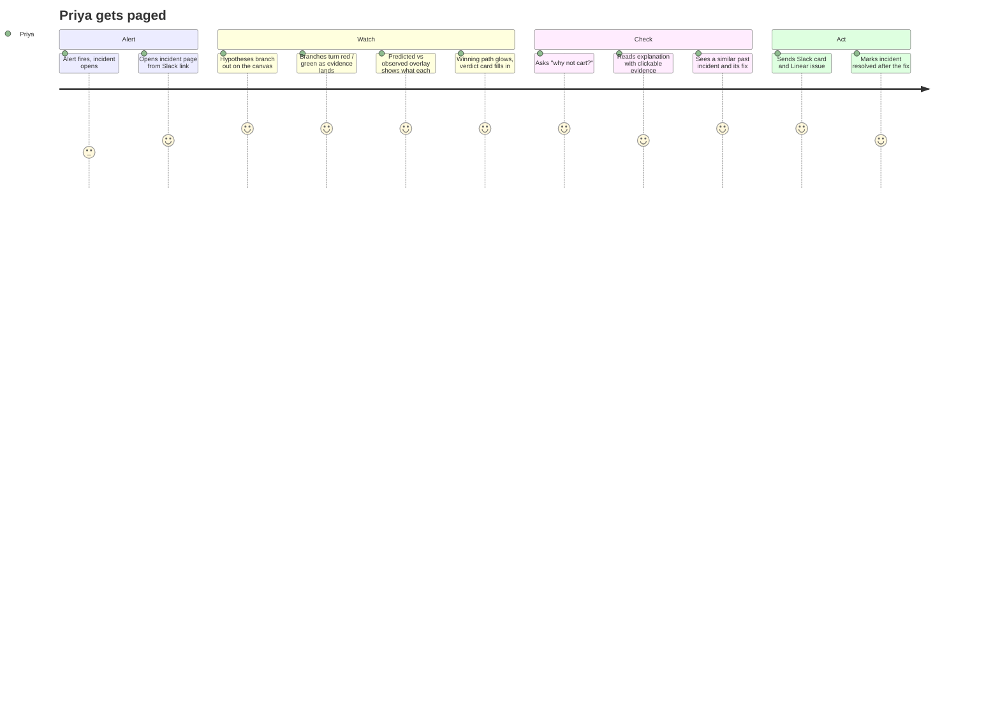
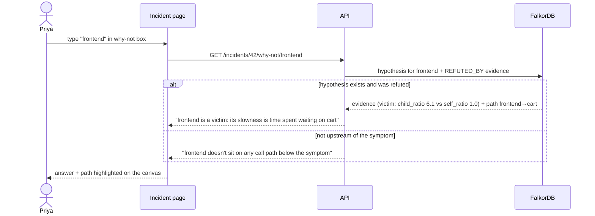
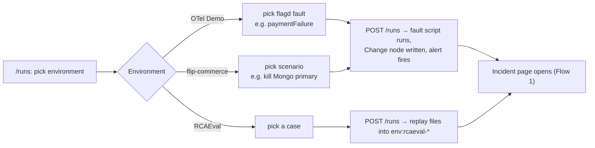
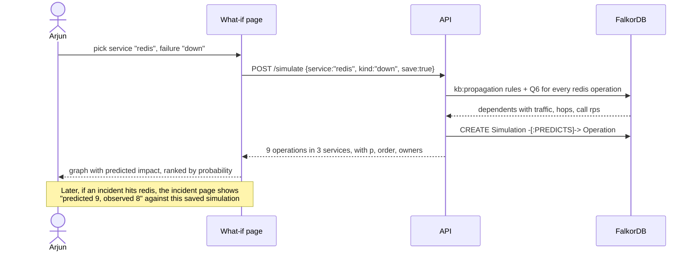

# Epicenter: User Flows

Who uses Epicenter, and what they do, step by step. Every step names the **screen**, the **API call** and the **graph work**
behind it, so flows trace straight into [docs/API.md](API.md) and [LLD.md](LLD.md).

---

## Personas

| Persona | Wants | Main screens |
|---|---|---|
| **Priya, on-call SRE** | Know what broke and what to do, fast, and trust it | Incident page, why-not box, Slack card |
| **Arjun, team lead** | Check the impact of a change before shipping; know who to pull in | Blast radius, ask box, memory panel |
| **Judge / demo viewer** | See that the graph does the reasoning | Live canvas, FalkorDB browser, example runs |

## Screens

| Screen | Route | Purpose |
|---|---|---|
| Landing | `/` | Scroll text reveal; optional illustration slots (`web/public/landing/<name>.webp`, hidden until the file exists) |
| Incidents list | `/incidents` | Open and past incidents, environment switcher |
| Incident | `/incident/[id]` | Live graph canvas, verdict card, evidence, explanation, why-not box, memory panel. Header: Rerun, Resolve, a **Deliver** menu (Slack / Linear) and two downloads, `incident_info.md` (people) and `AGENTS.md` (agent context, `GET /incidents/{id}/export.md`). Right panel collapsed by default, tabs **Suspects / Timeline / Notes / Chat** |
| Blast radius | `/blast-radius` | Bento dossier for one service: risk line, impact by hop, graph, people to page, incidents rooted here, changes (7 d), runbooks, who calls it, try-it links. With none picked: the riskiest services (`GET /services/risk`) |
| What-if lab | `/simulate` | Pick a service → all six failure kinds side by side, spread timeline, "did it happen before?" (`POST /simulate/compare`), the rules behind it (`GET /rules`), saved experiments (`GET /simulations`) |
| Map | `/map` | **Layers \| Network \| Data**. Network = force-directed graph of every label (`GET /graph/explore`, FalkorDB-browser style), legend toggles per label, highlight search |
| Ask | `/ask` | Chat with saved history, file attachments, scope (env or one incident) and a wiki rail; answers show their path |
| Example runs | `/runs` | Start a scripted fault on an example environment, or replay an RCAEval case |
| Eval | `/eval` | KPIs, run history, ablation deltas, by fault, confidence calibration, synthetic scale, score parts (hits vs misses), where misses go, time to verdict, per-case drill-down |

---

## Flow 1: Alert → live diagnosis → deliver (the main flow)

| # | User does | Screen | API | Graph work |
|---|---|---|---|---|
| 1 | Nothing (alert arrives) | — | `POST /api/v1/alerts` | `MERGE Incident` on alert id; `TRIGGERED_BY` |
| 2 | Opens the link | Incident | `GET /incidents/{id}`, `GET /incidents/{id}/graph`, then `GET /incidents/{id}/stream?after=<last_seq>` | read incident subgraph |
| 3 | Watches hypotheses appear | Incident: canvas | SSE `hypothesis.created` | triage: blast radius, **Q1** |
| 4 | Watches branches turn red / green | Incident: canvas | SSE `evidence.added`, `hypothesis.status` | investigators: **Q2**, **Q3** |
| 4b | Clicks a hypothesis; sees dashed "predicted" nodes over filled "observed" ones, coloured matched / missed / unexplained, and "explains 6 of 7 symptoms" | Incident: canvas overlay | SSE `footprint`, `GET /incidents/{id}/hypotheses/{hid}/footprint` | **Fault Simulator**: **Q6** + rules from `kb:propagation`, match |
| 5 | Reads the verdict (and a second root cause, if the simulator found symptoms the winner can't explain) | Incident: verdict card | SSE `verdict` | **Q4** + scorer, `ROOT_CAUSE {rank}` |
| 6 | Types "cart" into why-not | Incident: why-not box | `GET /incidents/{id}/why-not/cart` | refuting `Evidence` + path, or "not upstream" |
| 7 | Clicks `[E3]` in the explanation | Incident: explanation | — | highlights that evidence's path on the canvas |
| 8 | Reads "seen before" | Incident: memory panel | SSE `memory.similar` | **Q5**, `SIMILAR_TO` |
| 9 | Opens **Deliver** in the header, picks Slack / Linear | Incident | `POST /incidents/{id}/deliver` | `Incident.delivery` updated |
| 9b | Downloads `incident_info.md` or `AGENTS.md` (for a coding agent on the failing repo) | Incident: header | `GET /incidents/{id}/export.md?flavor=human\|agent` | none (built from the incident, no LLM) |
| 10 | Clicks **Resolved**, picks what fixed it | Incident | `POST /incidents/{id}/resolve` | `RESOLVED_BY`, runbook success count +1, `Person -[:FIXED]->` |

**Edge cases**
- Second alert for the same symptom within 10 min → joins the open incident (alert count goes up), no new incident.
- LLM down → verdict still shows; explanation shows "AI explanation unavailable" and a template summary.
- A source is down → banner "Traces unavailable for this window"; hypotheses that needed it end `inconclusive` (grey).
- Nothing explains the alert (no suspect covers ≥ 50% of symptoms, anomalies weak) → status `no_root_cause`: "Nothing in
  the graph explains this alert", with the list of what was checked and a "check the alert threshold" suggestion.
  No cause is invented.
- Connection drops (API restart, network) → the top bar shows "API unreachable" and the stream retries with backoff
  from the last seq it saw (`?after=`). Events are applied by id, so nothing is drawn twice when it reconnects.
- Diagnosis still `diagnosing` with no events for 30 s → a **Resume diagnosis** button (resumes from the checkpoint).

---

## Flow 2: "Why not X?"

---

## Flow 3: Blast radius before a change

Arjun wants to restart Redis during business hours.

| # | User does | Screen | API | Graph work |
|---|---|---|---|---|
| 0 | Opens Blast radius with nothing picked; sees the riskiest services | Blast radius | `GET /services/risk` | incidents rooted per service, calling services |
| 1 | Picks `redis` | Blast radius | `GET /blast-radius/redis` | reverse `CALLS*1..6` into redis operations |
| 2 | Reads the risk line and impact by hop (3 services / 9 operations), with the graph | Blast radius | — | — |
| 3 | Sees owners and the people to page | Blast radius | `GET /services/redis/people` | `OWNED_BY`, `MEMBER_OF`, `FIXED`, `AUTHORED` |
| 4 | Sees incidents rooted at redis, its changes in the last 7 d, its runbooks and who calls it | Blast radius | `GET /incidents?cause=redis`, `GET /services/redis/changes?hours=168`, `GET /services/redis/runbooks` | `ROOT_CAUSE → BLAMES → redis ops`, `CHANGED`, `FOR` |
| 5 | Clicks "simulate a failure" to see *how likely* each breaks, not just *whether* it's reachable | → What-if (Flow 8) | — | — |

---

## Flow 4: Ask box

| # | User does | Screen | API | Graph work |
|---|---|---|---|---|
| 1 | Asks "who should I page for checkout?" | Ask | `POST /ask` | ask agent picks `who_knows('checkout')` |
| 2 | Gets "team-payments (owner); Ravi fixed the last two checkout incidents" | Ask | — | `OWNED_BY`, `FIXED`, `AUTHORED` |
| 3 | Clicks the answer | Ask | — | path shown: Ravi → FIXED → INC-17 → ROOT_CAUSE → checkout/PlaceOrder |
| 4 | Asks something no tool covers ("which operation has the most callers?") | Ask | `POST /ask` | ask agent uses `falkordb-mcp` `query_graph_readonly`; the Cypher it ran is shown under the answer |
| 5 | Attaches a log file and asks a follow-up in the same chat | Ask | `POST /ask {conversation_id, attachments}` | last 6 turns go to the model; question and answer saved as `Message`s (file names only) |
| 6 | Reopens the chat later, or from another device; searches past chats in the rail | Ask | `GET /conversations?q=`, `GET /conversations/{id}` | `Conversation -[:HAS_MESSAGE]-> Message` |

A chat is scoped to the env or to one incident (`POST /conversations {incident_id}`; the incident page's Chat tab uses
that scope). If the LLM is down the question still lands in the thread and the answer shows the `502`.

---

## Flow 5: Repeat incident (memory)

1. Last week: `paymentFailure` on the OTel Demo was diagnosed, fixed by "turn off flag", marked resolved (Flow 1, step 10).
2. Today: the same fault fires. Q5 finds last week's incident with high similarity.
3. Memory panel: "Seen 7 days ago. Root cause `payment/Charge`. Fixed by: turn off flag `paymentFailure` (worked 1/1)."
4. Responder ranks "turn off flag" first because of its `RESOLVED_BY` success count.

---

## Flow 6: Human takeover mid-incident

1. Priya sees the investigators chasing `cart`, but she knows a deploy just went out to `currency`.
2. She adds a note in the incident page: "currency deployed at 14:02".
3. API: `POST /incidents/{id}/notes` → `Decision {by:'priya', text}` + a `Change` node if she picks "this was a change".
4. The next agent step reads the subgraph, sees the new `Change`, and Q3 picks it up for `currency`.
5. The canvas shows her note as a node linked to the incident, so the handoff is visible.

---

## Flow 7: Example run (demo / judge)

| Environment | Scenario examples | What the judge sees |
|---|---|---|
| OTel Demo | `paymentFailure`, `adHighCpu`, `emailMemoryLeak` (check names in flagd config) | Multi-hop search across ~20 services |
| flip-commerce | kill Mongo primary, kill 2 Mongo nodes, stop Redis, CPU limit + k6 breakpoint, change `MONGO_CIRCUIT_*` | A real failover in your own system; config change found as the cause |
| RCAEval | any RE2 case | Same engine on a public benchmark, with an accuracy number |

Details: [docs/EXAMPLE_RUNS.md](EXAMPLE_RUNS.md).

---

## Flow 8: What-if before a change

Arjun plans to restart Redis at 3 pm and wants to know what will actually break.

| # | User does | Screen | API | Graph work |
|---|---|---|---|---|
| 1 | Picks `redis` and failure kind `down` | What-if | `POST /simulate` | Q6 per redis operation + propagation rules |
| 2 | Sees "cart/GetCart errors p 0.95 within 15 s; checkout/PlaceOrder errors p 0.61 within 45 s; …" | What-if | — | — |
| 3 | Sees owners per affected service and pings them | What-if | — | `OWNED_BY` |
| 4 | Saves the simulation and links it in the change ticket | What-if | `save: true` | `Simulation -[:PREDICTS]->` |
| 5 | After the restart, opens the incident (if any): prediction vs. reality side by side | Incident | `GET /incidents/{id}` | compares footprint with the saved `Simulation` |

The What-if lab runs all six kinds for the picked service side by side, with a spread timeline (when each operation
is expected to break). "Did it happen before?" matches the prediction against each past incident rooted at that
service (`POST /simulate/compare`: coverage, precision, footprint, "explains N of M"). It also lists the propagation
rules behind the prediction (`GET /rules`) and the saved experiments (`GET /simulations`).
