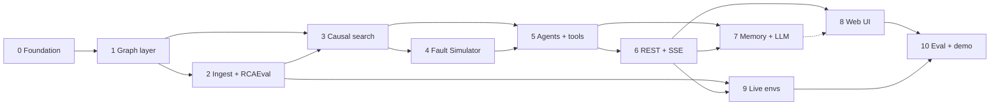

# Implementation phases

The design in [ARCHITECTURE](../ARCHITECTURE.md), [HLD](../HLD.md), [LLD](../LLD.md), [API](../API.md) and
[GRAPH_SCHEMA](../GRAPH_SCHEMA.md), cut into build order. Each phase says what to build, which doc sections are the
spec, how to know it works, and what to keep in mind so it scales. The phase files **point to** the design docs and
don't copy them. If a phase file and a design doc disagree, the design doc wins; fix the phase file.

> Status: design only. No product code before hackathon kickoff.

## Phase order

| # | Phase | Delivers | Depends on |
|---|---|---|---|
| 0 | [Foundation](phase-00-foundation.md) | Compose stack, config, FalkorDB smoke test, CI | — |
| 1 | [Graph layer](phase-01-graph-layer.md) | `graph.py`, query catalogue, upserts, indexes, seeds, test fixture | 0 |
| 2 | [Ingest + RCAEval](phase-02-ingest-rcaeval.md) | Adapter protocol, RCAEval adapter, detectors, slow-burn pass | 1 |
| 3 | [Causal search + scorer](phase-03-causal-search.md) | Q1–Q4, hypothesis rules, PageRank, deterministic score | 1, 2 |
| 4 | [Fault Simulator](phase-04-fault-simulator.md) | Q6, footprint match, second cause, `no_root_cause`, what-if | 3 |
| 5 | [Agents + typed tools + MCP](phase-05-agents-tools.md) | LangGraph flow, typed tools, `/mcp`, resume | 3, 4 |
| 6 | [REST API + SSE](phase-06-api-sse.md) | Every endpoint in API.md, SSE with replay, health | 5 |
| 7 | [Memory, LLM, delivery](phase-07-memory-llm-delivery.md) | Signature + Q5, narrator, Jev gate, responder, OpenConnector | 5, 6 |
| 8 | [Web UI](phase-08-web-ui.md) | Next.js screens, live canvas, overlay | 6 (7 for memory / explanation panels) |
| 9 | [Live environments](phase-09-live-environments.md) | OTel adapter, flip-commerce scripts, `/runs` | 2, 6 |
| 10 | [Eval, hardening, demo](phase-10-eval-demo.md) | AC@1/AC@3 + ablations, frozen weights, demo assets | all |

**Critical path to a demo:** 0 → 1 → 2 → 3 → 4 → 5 → 6 → 8. That is the RCAEval replay diagnosed end to end on the
canvas. Phases 7 and 9 can run in parallel with 8 if there is more than one person.

**Parallel work for a team of 3:**
- Person A: 1 → 3 → 4 (graph + reasoning)
- Person B: 2 → 9 (ingest + environments)
- Person C: 6 → 8 (API surface + UI; start the UI against API.md example payloads before the backend is live)
- Phases 5, 7 and 10 are shared.

## Phase file template

Every phase file has the same sections: **Goal · Depends on · Spec (source docs) · Files · Tasks · Acceptance ·
Scalability · Risks / open questions · Done when.** Tick task checkboxes as you go.

## Definition of done (every phase)

- Acceptance checks in the phase file pass (`pytest` green).
- The hard rules in [AGENTS.md](../../AGENTS.md#hard-rules) hold (dependency direction, parameterized Cypher, determinism).
- Any design change made while building is written back into the design doc it changes (and a new ADR if it reverses a decision).

## Coverage check

Every requirement, endpoint and planned test lands in exactly one phase.

| Item | Phase |
|---|---|
| F1 topology graph | 1, 2, 9 |
| F2 alert → incident → root cause | 3, 5, 6 |
| F3 why winner / why not X | 3, 5, 6 |
| F4 blast radius | 5, 6 |
| F5 agents in parallel via the graph | 5 |
| F6 memory + recall | 7 |
| F7 one graph per environment | 1 |
| F8 who to page | 5, 7 |
| F9 NL questions with path | 7 (ask agent) |
| F10 Slack / Linear | 7 |
| F11 Fault Simulator | 4 |
| F12 what-if | 4, 6 |
| N1 < 60 s, N2 < 200 ms | 10 (measured), budgets in 3–5 |
| N3 determinism | 3 (test), 10 (RCAEval rerun) |
| N4 read-only / proposals | 2, 7 |
| N6 cited claims, N7 LLM-free verdict | 7 |
| `POST /alerts`, `GET /incidents`, `GET /incidents/{id}`, `POST …/diagnose`, `GET …/stream`, `GET …/footprint`, `GET …/why-not`, `POST …/notes`, `POST …/resolve` | 6 |
| `POST …/deliver` | 7 |
| `GET /graph/subgraph`, `GET /blast-radius`, `POST /simulate`, `GET /health` | 6 |
| `POST /ask` | 7 |
| `GET /runs/scenarios`, `POST /runs` | 9 |
| `GET /eval` | 10 |
| LLD §12 tests: query unit, rule tests | 1, 3 |
| slow burn | 2 |
| Fault Simulator, multi-fault, healthy baseline, what-if | 4 |
| determinism | 3 |
| agent contract (narrator schema, uncited dropped) | 7 |
| smoke (pinned FalkorDB) | 0 |
| eval | 10 |
| end-to-end flip-commerce | 9 |

## Doc conflicts already resolved

The planning notes in [docs/planning/](../planning/) predate the final design. Where they differ, the design docs win:

| Topic | planning/ says | Use |
|---|---|---|
| FalkorDB host port | 6379 | **6380** ([ADR 0009](../adr/0009-falkordb-via-docker.md), [HLD §5.1](../HLD.md#51-ports)) |
| Typed tools server | separate `graph-mcp` container on 8090 | **mounted at `/mcp` on the API** ([ADR 0005](../adr/0005-modular-monolith.md)) |
| Change nodes | `Deploy` / `ConfigChange` / `FeatureFlag` labels | **one `Change` label with `type`** ([GRAPH_SCHEMA](../GRAPH_SCHEMA.md#3-node-labels)) |
| Operation → service edge | `(Operation)-[:OF]->(Service)` | **`(Service)-[:HAS_OP]->(Operation)`** |
| Q1 shape | single query with path-onset filter | **Q1 + Q2 split** ([LLD §2.2](../LLD.md#22-causal-search-queries)) |

## Open questions found while phasing

Gaps in the design docs, listed in the phase where they bite. Decide them there and write the answer back into the design doc.

| # | Question | Phase |
|---|---|---|
| Q-a | `Evidence.id` is `E<n>` "unique per incident", but the graph is per environment, so `E3` collides across incidents. Store `<incident>:E<n>`, show `E<n>`? Same for `Hypothesis` (`h-7`) and `Action` (`a-1`) | 1 |
| Q-b | `EvidenceOut.kind` in [LLD §4](../LLD.md#4-data-models-modelspy-excerpt) lacks `footprint`, which GRAPH_SCHEMA has | 3 |
| Q-c | API `?force=true` marks old hypotheses "superseded", a status not in the state machine ([LLD §8](../LLD.md#8-state-machines)) or schema | 5 |
| Q-d | `eval.py`'s RCAEval loader and the `/runs` scenario runner aren't in the [LLD §1](../LLD.md#1-package-layout) layout (`smoke_falkordb.py` added in phase 0) | 9 |
| Q-e | GRAPH_SCHEMA lists `Action` under the `kb:propagation` section; it belongs in `env:*` | 1 |
| ~~Q-f~~ | **Closed (phase 0):** build context is the repo root; `api/Dockerfile` copies `api/` to `/app/api` | 0 |
